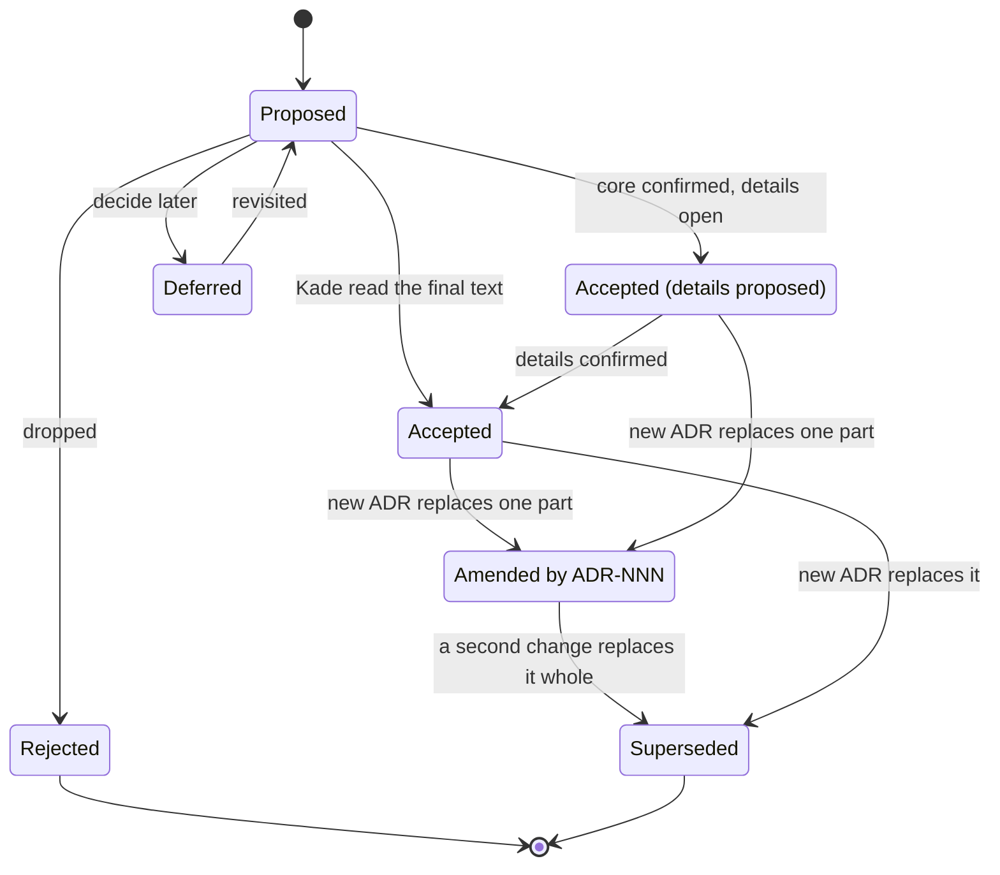

# ADR-000: ADR process and template

- **Status:** Amended by ADR-052
- **Date:** 2026-10-10

## Context

The repository this one replaces kept its decisions in dated sentences of its `CLAUDE.md`, in
session notes and in commit bodies. None of them answered "is this still in force?", so none
of it could be trusted as a source of truth (ADR-001). This repository starts with its
decisions, written down before anything is built from them.

The rules below are the ones Kade's Stella Rain project arrived at after four kinds of drift:
bundled decisions restated whole to change one part, notes in Accepted ADRs that became new
rules, ADRs accepted while still being discussed, and living documents citing superseded ADRs.

## Decision

1. **One file per decision** in `docs/adr/`, named `NNN-kebab-case-title.md`, numbered
   sequentially from 000, never reused. Choices that could change independently go in
   separate ADRs.
2. **Header:** `# ADR-NNN: Title`, then the **Status**, **Date** and (optional) **Related**
   lines. Sections: Context, Decision, Diagram, Alternatives considered, Consequences.
3. **Statuses:** Proposed, Accepted, Accepted (details proposed), Deferred, Rejected,
   Superseded by ADR-NNN, Amended by ADR-NNN.
4. **Acceptance follows the discussion.** A new ADR is Proposed. It becomes Accepted in a
   commit of its own, after Kade has read the final text.
5. **Proposed ADRs may be edited freely. Accepted ADRs are immutable**, except for a typo, a
   broken link, or wording that changes nothing a gate, rule, check or build relies on.
6. **Changing an Accepted ADR:** the whole decision: a new ADR; the old one becomes
   `Superseded by ADR-NNN`. One part: a new ADR that says exactly what it replaces and lists the
   old one as Related; the old one becomes `Amended by ADR-NNN`. An ADR already amended is
   superseded whole instead.
7. **At least one Mermaid diagram** when the decision has structure or flow.
8. **The index** (`docs/adr/README.md`) changes in the same commit as any ADR; an ADR changes
   in the same commit as the configuration or code it affects.
9. **Living documents cite the ADR in force:** `README.md`, `CLAUDE.md`, `.claude/`,
   `docs/plans/` and the index never cite a superseded ADR.
10. **Evidence from the archive** (ADR-001) is cited by path and commit in the Context; a claim
    the archive makes but never proved is marked as such and stays open until a gate proves it.
11. **Not ADRs:** measurements and their numbers, tuning values, tasks, runbooks.

### Template

```markdown
# ADR-NNN: Title

- **Status:** Proposed
- **Date:** YYYY-MM-DD
- **Related:** ADR-xxx

## Context
## Decision
## Diagram
## Alternatives considered
## Consequences
```

## Diagram



## Alternatives considered

- **A single decision log** (`docs/decisions.md`): lighter, but no status per decision and
  harder to check by script.
- **Decisions in `CLAUDE.md`:** what the previous repository did; the rule and its history
  shared a line and the file grew to 330 lines.

## Consequences

- Every rule in `CLAUDE.md` and `.claude/` cites the ADR it comes from.
- Writing an ADR takes two commits (Proposed, then Accepted), with Kade's reading between.
- The checker used in Stella Rain (`adr_check.py`) is ported with the first CI, so names,
  numbers, headers, index rows and citations are checked by a script.
