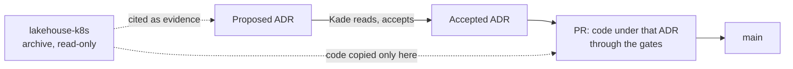

# ADR-001: The repository starts from its decision records; code enters only under an Accepted ADR

- **Status:** Proposed
- **Date:** 2026-10-10
- **Related:** ADR-000, ADR-002

## Context

`enjay27/lakehouse-k8s` built the same platform from 2026-06 to 2026-10, as two repositories
merged into one on 2026-09-21. It works on one local cluster, but its decisions were never
recorded as decisions:

- `CLAUDE.md` was 330 lines of rules mixed with dated history; `MEMORY.md` was 75 lines
  against its own limit of 40; `.memory/` held 1.2 MB of session notes.
- Values files state intent, and the repository records at least one case where an entire
  block sat at the wrong nesting level for months while the cluster ran on chart defaults.
- No Claude session could run its platform gate, so chart changes were never checked by CI.
- It held work-specific names and a committed credential, in a public repository.

Kade's conclusion (2026-10-10): with no ADRs, nothing in it can be trusted as the source of
truth, so the new repository starts from the decisions alone.

## Decision

- **The first content of this repository is its ADRs**, all Proposed, plus `.gitattributes`,
  `.gitignore`, `.env.template` and a short README.
- **Nothing else enters until an ADR that covers it is Accepted.** A chart, script, test or
  document arrives in a PR that cites its ADR, and passes the gates in force (ADR-017 to
  ADR-019) on arrival.
- **`enjay27/lakehouse-k8s` becomes a read-only archive** (private and archived on GitHub, a
  setting Kade changes). It is evidence: an ADR may cite a file or commit there, and code may
  be copied from it, but nothing is carried over because it exists there.
- **No work-specific names** come over: hostnames, namespaces named after an employer,
  people's roles. Configuration that differs per environment goes to `.env` (ADR-002).

## Diagram

## Alternatives considered

- **Refactor the old repository in place:** keeps history and every unrecorded assumption;
  months of moves before anything is trusted.
- **Copy the whole tree into a new repository, then write ADRs:** fast, but everything arrives
  unproven and the ADRs would describe the code instead of deciding it.
- **Rewrite everything from nothing:** throws away working charts, tests and scripts; the
  archive is evidence worth copying from once a decision covers it.

## Consequences

- The platform is rebuilt in steps; until a step's ADRs are Accepted, the old cluster keeps
  running from the archive's charts.
- Every file here can be traced to a decision.
- The archive's history (`git log -S`, blame across the 2026-09-21 merge) is searched in the
  archive, not here.
