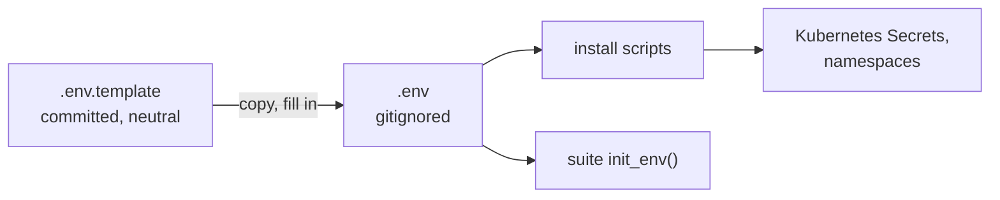

# ADR-002: The repository is public; environment-specific configuration lives in `.env`

- **Status:** Accepted
- **Date:** 2026-10-10
- **Related:** ADR-001, ADR-006, ADR-007, ADR-017

## Context

Kade wants the repository public (2026-10-10), mainly for CI: GitHub's standard runners for
public repositories are larger and their minutes are not counted, which matters for a gate
that runs a three-node cluster (ADR-017). Kade's global rules say that in a public repository
everything is public, issues and Actions logs included: no internal URLs, personal data or
private planning. The archive broke that rule (ADR-001).

## Decision

- **Public.** Everything committed, every issue, PR and Actions log is written for anyone to
  read.
- **Anything that differs per environment is a variable in `.env`**, never a literal in a
  committed file: namespaces (ADR-007), the Kubernetes context, credentials (ADR-006),
  endpoints of the shared environments the suite reaches (ADR-005).
- **Only `.env.template` is committed:** every variable, with a neutral example or empty.
  `.gitignore` excludes `.env` and `.env.*` except the template.
- **Never committed, anywhere:** hostnames, URLs or IP addresses of non-local systems,
  employer names, people's names or roles, credentials. A finding about a real environment is
  written in neutral terms ("the shared dev environment").
- GitHub secret scanning and push protection are switched on (a setting Kade changes).

## Diagram

## Alternatives considered

- **Private:** no public-content discipline needed, but smaller runners and a monthly minutes
  quota for a gate that needs a three-node cluster.
- **Public with a private overlay repository** for environment values: two repositories again,
  the drift the archive's 2026-09-21 merge ended.

## Consequences

- The gate can use the larger public runners (ADR-017).
- Every PR needs the same scrutiny for names and endpoints; a check for known patterns
  (`.env` committed, credential-like literals) comes with the first CI.
- Facts about the target clusters (ADR-004) are committed only as versions and counts.
