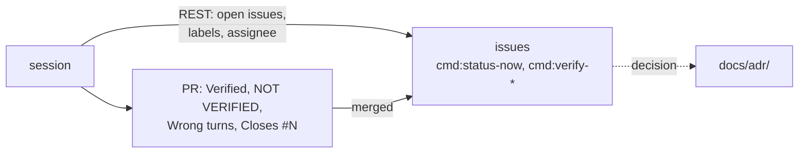

# ADR-003: State lives in labelled issues of this repository; the PR is the session record

- **Status:** Amended by ADR-073
- **Date:** 2026-10-10
- **Related:** ADR-000, ADR-002

## Context

Kade's repositories keep their state in one of two ways: an organization Project fed by
labelled issues (Stella Rain, Resonance), or a `MEMORY.md` with a *Now* section. The archive
used `MEMORY.md`; it grew past its own limit (75 lines against 40), and its 41 session files
were rarely read. This repository belongs to a personal account; an organization with a
Project needs a bridge App and snapshots. Kade's choice (2026-10-10): labelled issues in this
repository, no organization, at the start of its life; an organization can come later.

## Decision

- **Work, open questions and unverified items are issues** in `enjay27/lakehouse`, read by
  sessions over GitHub's REST API.
- **Labels**, the same names as Stella Rain so the account skills read both:

  | Label | Means |
  |---|---|
  | `cmd:status-now` | In progress now |
  | `cmd:verify-not-verified` | Done, but a check could not run; the issue names it |
  | `cmd:verify-needs-linux` | Needs a Linux test cluster with cluster access (ADR-004) |

  A decision that is Kade's: the issue is **assigned to him**, no label. Work a session can
  take stays unassigned.
- **The PR is the session record:** *What changed and why*, *Verified*, *NOT VERIFIED*,
  *Wrong turns*, and `Closes #N` for the issue it finishes. No session or handoff files, no
  `MEMORY.md`.
- **Decisions go to ADRs**, never to issues alone; an issue that leads to a decision links the
  ADR.
- **Measurements and their numbers** are committed with their evidence under
  `docs/measurements/`, in the PR that took them, each labelled with the versions measured.
- Everything in issues is public (ADR-002): no hostnames, credentials, employer names or
  private planning.
- **Moving to an organization later** (a Project, a bridge, `STATUS.md` snapshots) keeps these
  labels and issues; it is a new ADR that amends this one.

## Diagram

## Alternatives considered

- **`MEMORY.md` with a *Now* section** (the archive): one file to read, but it grew past its
  limit without anything stopping it, and it duplicated what PRs and commits already hold.
- **An organization with a Project** (Stella Rain): a board and snapshots, at the cost of an
  organization, a bridge App and its secrets, for one repository.

## Consequences

- The `session-resume` and `session-handoff` skills read and write labelled issues here, as in
  Stella Rain, without the `STATUS.md` snapshot.
- The labels are created once, with the first implementation PR.
- Planning is public; anything that must stay private is not written here at all.
