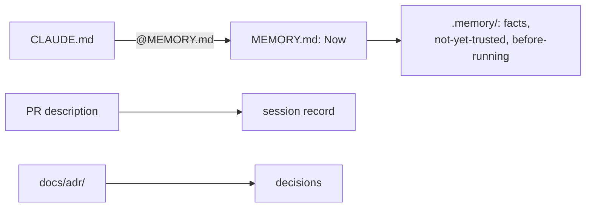

# ADR-003: State lives in `MEMORY.md`; the PR is the session record

- **Status:** Proposed
- **Date:** 2026-10-10
- **Related:** ADR-000, ADR-002

## Context

Kade's repositories keep state either in an organization Project with labelled issues or in a
`MEMORY.md` with a *Now* section. This repository belongs to a personal account (a user
Project needs a classic token) and is public (ADR-002), so planning in issues would be
public. The archive's `MEMORY.md` had no enforced limit and grew past it; its 41 session files
were rarely read.

## Decision

- **`MEMORY.md`** holds *Now* only: one line per item, at most 40 lines and 200 characters a
  line, decisions named by ADR number. `CLAUDE.md` imports it (`@MEMORY.md`). CI checks the
  limits.
- **Detail** goes to `.memory/` by kind: facts with numbers, items not yet trusted, what to
  read before running anything. Each file starts when the first fact for it does.
- **The PR is the session record:** *What changed and why*, *Verified*, *NOT VERIFIED*,
  *Wrong turns*. A local commit carries the same in its body. No session or handoff files.
- **Decisions go to ADRs**, never to *Now*.
- Everything in `MEMORY.md` and `.memory/` is public (ADR-002).

## Diagram

## Alternatives considered

- **Labelled issues:** readable from cloud sessions, but public and one more place to keep
  in sync.
- **Session files:** they kept the wrong turns, but nobody read them; the PR keeps the same
  next to the change.

## Consequences

- The `session-resume` and `session-handoff` skills work here through their `MEMORY.md` path.
- The limits are enforced from the first commit that adds `MEMORY.md`.
