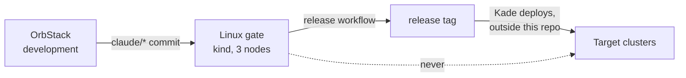

# ADR-004: Releases are proven on Linux; OrbStack is for development; target clusters are never reached

- **Status:** Proposed
- **Date:** 2026-10-10
- **Related:** ADR-002, ADR-017, ADR-020

## Context

The archive treated one OrbStack node on Kade's Mac as the only cluster and the place every
platform change was verified. OrbStack is there because it runs Kubernetes well on macOS; the
platform is deployed to multi-node Linux clusters (the **target clusters**). OrbStack hides
faults those clusters would show:

- **One node.** The archive's Polaris log volume is `ReadWriteOnce`, commented "single node;
  the CronJob pod lands on the same node" (`logging/k8s/polaris-logs-pvc.yaml`). With Polaris
  autoscaled, a pod or the batch CronJob on another node cannot attach it.
- **CPU architecture.** An Apple Silicon Mac builds `arm64` images; target nodes may not run
  them.
- **Its own VM, storage and networking**, with failure modes of their own.

## Decision

| Environment | Role | Reached by |
|---|---|---|
| **OrbStack** on Kade's Mac | Development, and Kade's checks against a running object | Kade; Claude only in a local session, with context `KUBE_CONTEXT` |
| **Linux gate** on GitHub Actions (ADR-017) | **What a release is proven on** | CI |
| **Target clusters** | Where a release tag is deployed | **Never from this repository or its CI.** Kade deploys through their own process |

- A release (ADR-020) means "proven on the Linux gate".
- The gate copies the target clusters, not OrbStack: Linux `x86_64`, three nodes, their
  Kubernetes minor version. Kade gives those facts in a session; only versions and counts are
  committed (ADR-002).
- **Commands Claude runs against a cluster:** the context must equal `KUBE_CONTEXT` from
  `.env`, every command names its namespace explicitly, and destructive commands
  (`helm uninstall`, deleting a namespace or a volume, resetting the cluster) need Kade's
  approval at the moment they run, not as part of an approved plan.

## Diagram

## Alternatives considered

- **OrbStack as the release criterion:** a single `arm64` node; the `ReadWriteOnce` fault
  would ship.
- **Gate against a target cluster from CI:** the closest copy, but CI would hold its
  credentials and could change a shared cluster.

## Consequences

- Images that ship are built for `x86_64` in CI; an `arm64` build for OrbStack is local.
- The gate is only as close to the target clusters as the facts Kade gives it; each gap is
  listed in `.memory/` until it is closed.
