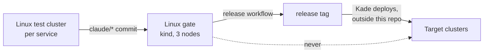

# ADR-004: The platform targets Linux only; releases are proven on the Linux gate; target clusters are never reached

- **Status:** Accepted
- **Date:** 2026-10-10
- **Related:** ADR-002, ADR-017, ADR-020

## Context

The archive's only cluster was a single-node development cluster on macOS, and every platform
change was verified there. The platform is deployed to multi-node Linux clusters (the
**target clusters**), and a single macOS node hid faults those clusters would show:

- **One node.** The archive's Polaris log volume is `ReadWriteOnce`, commented "single node;
  the CronJob pod lands on the same node" (`logging/k8s/polaris-logs-pvc.yaml`). With Polaris
  autoscaled, a pod or the batch CronJob on another node cannot attach it.
- **CPU architecture.** Images built on an `arm64` Mac may not run on the target nodes.
- **A VM, storage and networking of its own**, with failure modes the target clusters do not
  have.

Kade's direction (2026-10-10): the source targets Linux only; every service is tested on a
Linux Kubernetes cluster.

## Decision

| Environment | Role | Reached by |
|---|---|---|
| **Linux test clusters** | Developing and testing each service, and Kade's checks against a running object | Kade; Claude only in a session with cluster access, through `KUBE_CONTEXT` |
| **Linux gate** on GitHub Actions (ADR-017) | **What a release is proven on** | CI |
| **Target clusters** | Where a release tag is deployed | **Never from this repository or its CI.** Kade deploys through their own process |

- **Linux only.** Nothing in the repository supports or works around macOS, OrbStack or other
  desktop Kubernetes; images are built for the target clusters' architecture.
- A release (ADR-020) means "proven on the Linux gate".
- The gate copies the target clusters: Linux, three nodes, their Kubernetes minor version and
  CPU architecture. Kade gives those facts in a session; only versions and counts are committed
  (ADR-002).
- **Commands Claude runs against a cluster:** the context must equal `KUBE_CONTEXT` from
  `.env` (no default: an empty value stops the scripts), every command names its namespace
  explicitly, and destructive commands (`helm uninstall`, deleting a namespace or a volume,
  resetting a cluster) need Kade's approval at the moment they run, not as part of an
  approved plan.

## Diagram

## Alternatives considered

- **Keep a macOS development cluster:** convenient on a laptop, but it is one node on another
  architecture; the archive's `ReadWriteOnce` fault went unseen there.
- **Gate against a target cluster from CI:** the closest copy, but CI would hold its
  credentials and could change a shared cluster.

## Consequences

- One architecture to build and test for; no desktop-specific values or scripts.
- The gate is only as close to the target clusters as the facts Kade gives it; each gap is
  recorded until it is closed.
