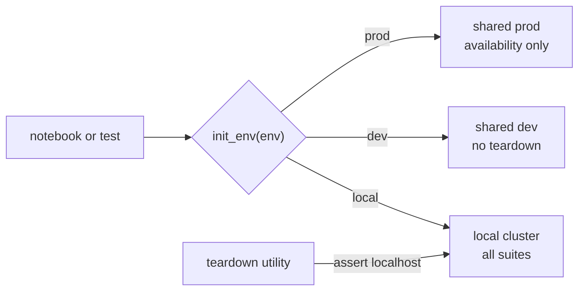

# ADR-005: The suite runs in three environments, each with its own guards

- **Status:** Accepted
- **Date:** 2026-10-10
- **Related:** ADR-002, ADR-006

## Context

The suite measures the platform: notebooks and pytest modules that call Polaris, PostgreSQL
and object storage. In the archive it selected one of three environments with
`init_env(<env>)`, each with its own settings and secrets (archive `CLAUDE.md`, section
"Environments"): a local cluster, and two shared environments other people use, a development
one and a production one. Running a destructive notebook against a shared environment would
delete other people's data.

## Decision

| Environment | Selected by | Allowed |
|---|---|---|
| `local` (default) | `init_env("local")` | Everything, including destructive teardown utilities |
| `dev` (shared) | `init_env("dev")` | Functional and integration suites; **never** destructive teardown |
| `prod` (shared) | `init_env("prod")` | **Availability checks only** |

- Settings and credentials of each environment come from `.env` and environment variables
  (ADR-002, ADR-006); one environment's values are never assumed to apply to another.
- Every mutating notebook or test calls `require_not_prod(...)` right after setup.
- Teardown utilities are `local`-only: hardcoded to localhost with an assert-based host guard,
  and never wired to `init_env()`.
- Connectivity and query code lives in importable modules; notebooks only display, map and
  summarise, and close their connections in a final cell.

## Diagram

## Alternatives considered

- **One environment, local only:** safest, but the suite exists partly to check the shared
  environments.
- **Guards by convention only:** the archive's notebooks show that a hardcoded secret and a
  missing guard both slipped in; the guards are code, and CI checks for them when the suite
  arrives.

## Consequences

- The suite arrives with a check that every mutating notebook calls `require_not_prod`.
- Endpoints of the shared environments are never committed (ADR-002).
