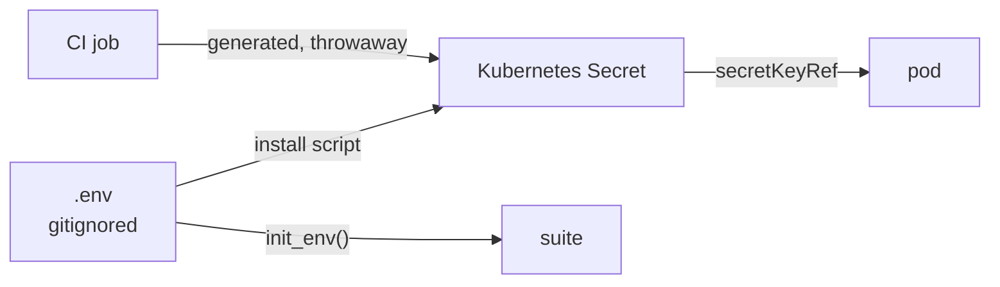

# ADR-006: Credentials are never committed; they become Kubernetes Secrets at install time

- **Status:** Proposed
- **Date:** 2026-10-10
- **Related:** ADR-002, ADR-005, ADR-017

## Context

The archive committed at least one plaintext credential to a public repository (a log
shipper's output password), and notebooks carried literal client secrets at times. Moving a
credential out of a file does not remove it from history; only rotating it does.

## Decision

- **No credential in any committed file**: values files, notebooks, scripts, docs, test
  fixtures. Not even an example value; `.env.template` leaves them empty (ADR-002).
- **Charts read credentials from Kubernetes Secrets** (`existingSecret`, `secretKeyRef`).
  The install scripts create those Secrets from `.env` before the release that needs them.
- **The suite reads credentials from environment variables** through `init_env()` (ADR-005).
- **CI generates its own credentials** inside each job; the gate has no repository secrets
  (ADR-017).
- **A credential that reaches a commit is rotated**, whatever else is done; pushed history is
  never rewritten.

## Diagram

## Alternatives considered

- **Encrypted secrets in git** (SOPS, sealed-secrets): one more tool and key to manage for a
  single developer; `.env` plus Secrets is enough until there is a second operator.
- **`--set-string` on the command line:** the archive's earlier rule; it leaves credentials
  in shell history and in `helm get values` output.

## Consequences

- A chart that cannot take a credential from a Secret is wrapped or replaced before it enters.
- The archive's committed credential is rotated before anything is deployed from this
  repository.
