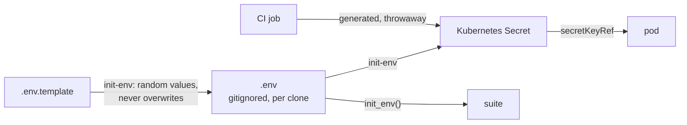

# ADR-006: Credentials are never committed; an init-env script generates them per clone and creates the Secrets

- **Status:** Accepted
- **Date:** 2026-10-10
- **Related:** ADR-002, ADR-005, ADR-017

## Context

The archive committed at least one plaintext credential to a public repository (a log
shipper's output password), and notebooks carried literal client secrets at times. Moving a
credential out of a file does not remove it from history; only rotating it does.

## Decision

- **No credential in any committed file**: values files, notebooks, scripts, docs, test
  fixtures. Not even an example value; `.env.template` leaves them empty (ADR-002).
- **An `init-env` script generates the credentials, per clone.** Run once after cloning, it
  writes `.env` from `.env.template` and fills every empty credential variable with a new
  random value, so no two clones share a password. It never overwrites a value already in
  `.env`; rerunning it is safe.
- **The same script creates or updates the Kubernetes Secrets** from `.env`, in the namespace
  of the service that uses each one (ADR-007), before the release that needs them.
- **Charts read credentials only from those Secrets** (`existingSecret`, `secretKeyRef`).
- **Credentials of shared environments the suite reaches** (ADR-005) are not generated: they
  are typed into `.env` by hand and never leave it.
- The script is not the suite's `init_env()` function, which only selects an environment for a
  notebook or test (ADR-005).
- **The suite reads credentials from environment variables** through `init_env()` (ADR-005).
- **CI generates its own credentials** inside each job; the gate has no repository secrets
  (ADR-017).
- **A credential that reaches a commit is rotated**, whatever else is done; pushed history is
  never rewritten.

## Diagram

## Alternatives considered

- **Encrypted secrets in git** (SOPS, sealed-secrets): one more tool and key to manage for a
  single developer; `.env` plus Secrets is enough until there is a second operator.
- **`--set-string` on the command line:** the archive's earlier rule; it leaves credentials
  in shell history and in `helm get values` output.
- **Fixed example passwords in the template:** convenient, but every clone would share them,
  and a public repository would publish them.

## Consequences

- A chart that cannot take a credential from a Secret is wrapped or replaced before it enters.
- Losing `.env` loses the local credentials; rerunning `init-env` makes new ones, and the
  Secrets and databases of that test cluster are reset with them (a destructive step, ADR-004).
- The archive's committed credential is rotated before anything is deployed from this
  repository.
