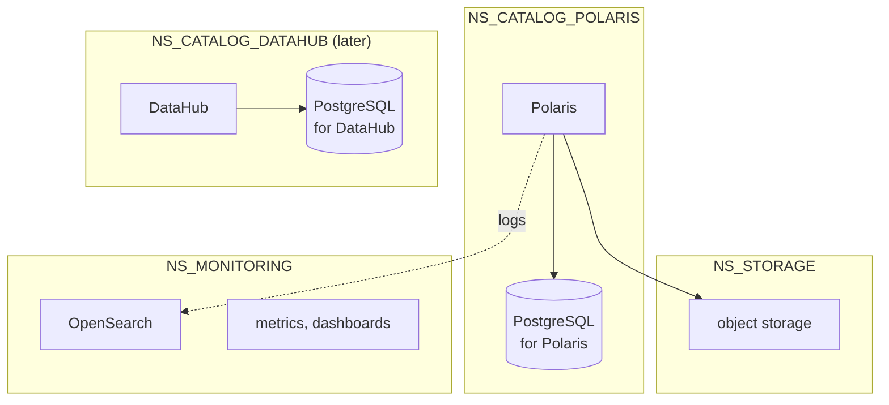

# ADR-007: Namespaces are split by service type, and their names come from `.env`

- **Status:** Amended by ADR-023
- **Date:** 2026-10-10
- **Related:** ADR-002, ADR-008, ADR-010, ADR-012

## Context

The archive put every component into one namespace named after an employer, "strictly
enforced, no exception". One namespace made the rule easy to check, but it mixed services
whose lifecycles, owners and credentials differ, and its name cannot appear in a public
repository (ADR-002). Kade's direction (2026-10-10): namespaces by service type, names from
`.env`.

## Decision

| Variable (`.env`) | Default | Holds |
|---|---|---|
| `NS_CNPG_SYSTEM` | `cnpg-system` | The CloudNativePG operator (ADR-010) |
| `NS_STORAGE` | `storage` | Object storage (ADR-011) |
| `NS_CATALOG_POLARIS` | `catalog-polaris` | Apache Polaris and its own PostgreSQL (ADR-008, ADR-009) |
| `NS_CATALOG_DATAHUB` | `catalog-datahub` | DataHub and its own PostgreSQL, when DataHub enters under its own ADR |
| `NS_MONITORING` | `monitoring` | OpenSearch, log shippers' targets, metrics and dashboards (ADR-013) |

- A new service type gets a new namespace and a new variable, in the ADR that brings it in.
- **Every command and chart names its namespace explicitly** from these variables; nothing
  relies on the context's default namespace.
- Cross-namespace traffic uses full service DNS names; which namespaces may talk to which is
  written into the service's ADR, so network policies can follow later.
- A cluster that needs other names changes only `.env`.

## Diagram

## Alternatives considered

- **One namespace for everything** (the archive): simple guard, but one blast radius, one set
  of quotas, and a name that cannot be public.
- **A namespace per component** (each PostgreSQL apart from its service): more boundaries
  than owners; a service and its database are installed, upgraded and removed together.

## Consequences

- The archive's single-namespace guard becomes "the namespace comes from `.env`", checked by
  the install scripts.
- Credentials live as Secrets in the namespace of the service that uses them (ADR-006).
