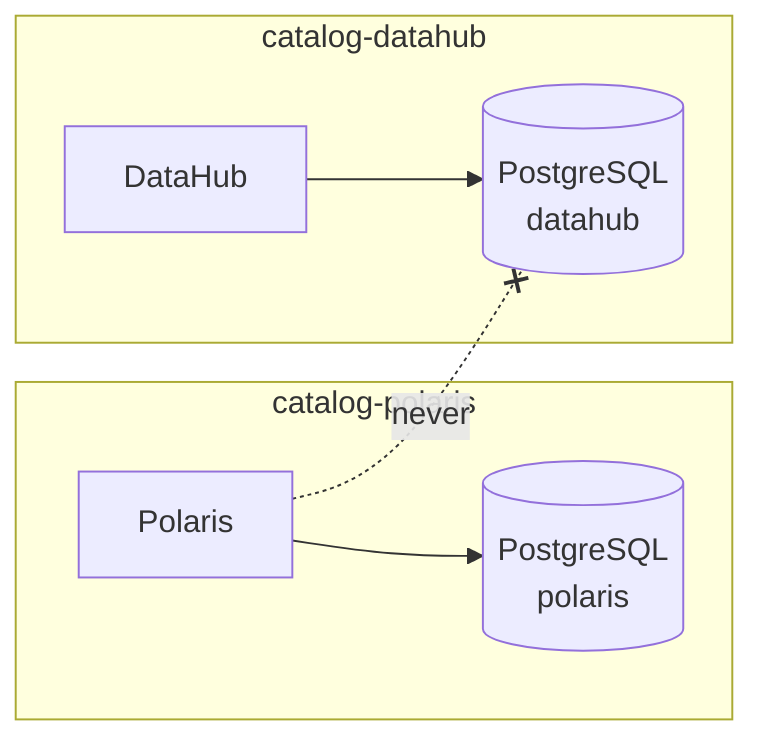

# ADR-008: Each service has its own PostgreSQL, in the service's namespace

- **Status:** Accepted
- **Date:** 2026-10-10
- **Related:** ADR-004, ADR-007, ADR-010, ADR-015

## Context

Several services need PostgreSQL: Polaris now, DataHub and other catalog or platform services
later. Kade asked (2026-10-10) whether to run one PostgreSQL per service, as the target
clusters do, or one PostgreSQL with a database per service.

What weighs here:

- **The gate copies the target clusters** (ADR-004). They run one PostgreSQL per service.
- **The suite measures Polaris's SQL.** Latency and query plans taken on a PostgreSQL shared
  with DataHub would measure DataHub's load as well (ADR-015).
- **Versions and upgrades.** Services pin different PostgreSQL versions and upgrade at
  different times; one shared server forces one version on all.
- **Cost.** Each HA PostgreSQL is several pods; on one CI runner (ADR-017) and on a laptop
  that adds up.

## Decision

- **One PostgreSQL per service**, installed in that service's namespace (ADR-007), with its
  own credentials (ADR-006). No service connects to another service's PostgreSQL.
- **One way to deploy them all:** a CloudNativePG `Cluster` per service (ADR-010); a
  PostgreSQL is part of its service's release order (ADR-012).
- **Size per environment, not per decision:** three instances where the target clusters run
  three; a single instance where an environment cannot afford it (a local
  laptop, the CI smoke gate), declared in that environment's values and named in the gate's
  summary.

## Diagram

## Alternatives considered

- **One PostgreSQL, one database per service:** fewer pods and one server to operate, but one
  version and one failure domain for all, cross-namespace access to the database, measurements
  that include other services' load, and a layout the target clusters do not have.
- **A managed or external PostgreSQL:** none exists locally or in CI.

## Consequences

- Each new service's ADR names its PostgreSQL's version and size.
- The CI gate may not fit several HA PostgreSQLs; the smoke gate runs the non-measured ones
  as single instances and says so.
- Adding a service's PostgreSQL is one `Cluster` resource, not another chart release.
