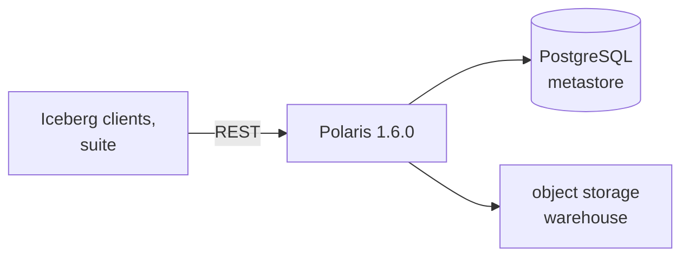

# ADR-009: The Iceberg catalog is Apache Polaris, from a local chart at a pinned version

- **Status:** Accepted
- **Date:** 2026-10-10
- **Related:** ADR-007, ADR-008, ADR-011, ADR-015, ADR-018, ADR-021

## Context

The lakehouse needs an Iceberg REST catalog. The archive runs Apache Polaris from a local copy
of its chart (`charts/polaris/`, version 1.6.0, upgraded and checked on its single-node
development cluster on 2026-09-18: metastore schema v4, management port 8182). The suite was written against
Polaris's REST API and its PostgreSQL schema. Proven on one node only.

## Decision

- **Apache Polaris** is the Iceberg catalog, in `NS_CATALOG_POLARIS` (ADR-007), with its own
  PostgreSQL (ADR-008) and object storage for the warehouse (ADR-011).
- **Version pinned: 1.6.0**, chart and image together. An upgrade is a PR of its own, through
  the gates, that names the metastore schema change.
- **The chart is a local copy** under `charts/polaris/`, so the values Polaris actually uses
  are in this repository and rendered by the static gate.
- **Polaris itself is not modified:** no patched image, no custom schema (ADR-015). The suite
  measures upstream Polaris.
- Its management port is 8182 (Polaris's default differs in older documents); the chart
  values name it explicitly.

### Upgrading to 1.7.0

Polaris 1.7.0 is expected soon (Kade, 2026-10-10). The upgrade is planned now and done in its
own PR once 1.7.0 is released and 1.6.0 runs here:

1. **Read the release notes** for metastore schema changes, configuration renames and removed
   features; list each one in the PR.
2. **Diff the upstream chart** 1.6.0 → 1.7.0 and apply it to the local chart; the diff goes in
   the PR.
3. **Gate the upgrade path:** the dry-run and smoke gates install the last release (Polaris
   1.6.0) and upgrade it to 1.7.0 (ADR-018, ADR-021); the smoke tests run against the upgraded
   catalog.
4. **Schema:** a metastore schema change is applied by Polaris's own migration, never by
   hand; the schema reference file is updated to the one 1.7.0 ships (ADR-015).
5. **Measurements** taken on 1.6.0 are labelled with their version; numbers are compared only
   within one version.
6. If the target clusters stay on 1.6.0 longer, the gate keeps proving 1.6.0 until they move.

## Diagram

## Alternatives considered

- **Upstream chart from a Helm repository:** less to maintain, but values drift silently
  between chart versions, and the archive needed changes Polaris's chart did not expose.
- **Another catalog** (Nessie, Hive Metastore, Unity Catalog OSS): the suite and every
  measurement so far target Polaris.

## Consequences

- Upgrades follow upstream releases by hand, each through the gates (ADR-021 proves the
  upgrade path).
- The local chart must be compared with upstream at each upgrade; the diff goes in the PR.
