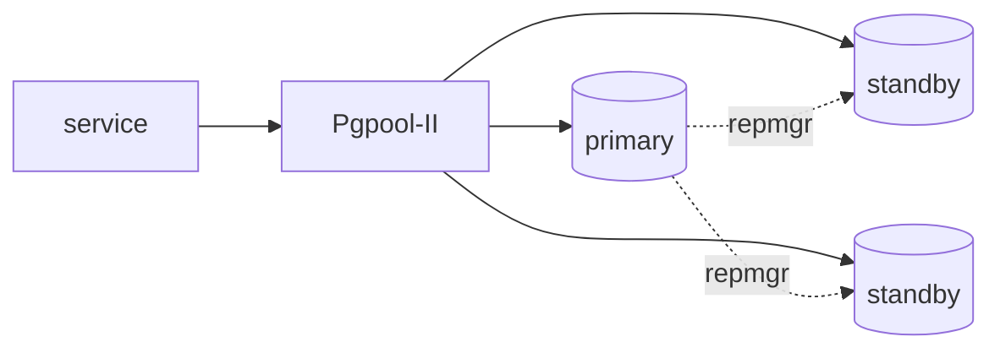

# ADR-010: PostgreSQL runs as Bitnami `postgresql-ha` with Pgpool-II, wrapped in a local umbrella chart

- **Status:** Proposed
- **Date:** 2026-10-10
- **Related:** ADR-008, ADR-009, ADR-012

## Context

The archive runs Polaris's PostgreSQL as a local umbrella chart around Bitnami
`postgresql-ha` 16.3.2: three PostgreSQL instances with repmgr and **Pgpool-II** as the
pooler. Two lessons are recorded there:

- Values meant for the subchart must be nested under `postgresql-ha:`. An entire block once
  sat at the wrong level for months while the cluster ran on the subchart's defaults.
- Bitnami stopped publishing its versioned images under `bitnami/`; the archive pulls
  `bitnamilegacy/*`, which receives no updates.

With one PostgreSQL per service (ADR-008), this choice is made once and repeated for every
service.

## Decision

- **Bitnami `postgresql-ha`, chart 16.3.2**, wrapped in one local umbrella chart
  (`charts/postgresql/`), installed once per service with that service's values.
- **Pooler: Pgpool-II**, as the chart provides; not PgBouncer.
- **Everything for the subchart is nested under `postgresql-ha:`**; the static gate renders
  the chart and a test asserts that the rendered objects carry the intended values, not the
  defaults.
- **The image source is a known risk:** `bitnamilegacy/*` images are frozen. Replacing them is
  the first thing to reconsider, in an ADR that supersedes this one.

## Diagram

## Alternatives considered

- **CloudNativePG operator:** declares a PostgreSQL cluster per namespace as one resource,
  maintained images, built-in pooling (PgBouncer); fits ADR-008 well. Not proven here yet, and
  it adds an operator to install and upgrade. The strongest candidate to supersede this ADR.
- **Bitnami chart with its current, non-legacy images:** depends on Bitnami's paid catalog.
- **A single PostgreSQL instance everywhere:** cheaper, but not what the target clusters run.

## Consequences

- Each service's PostgreSQL is a release of the same chart; upgrades are done once and rolled
  per service.
- Frozen images mean security fixes stop; the risk is tracked in `.memory/` until this ADR is
  superseded.
