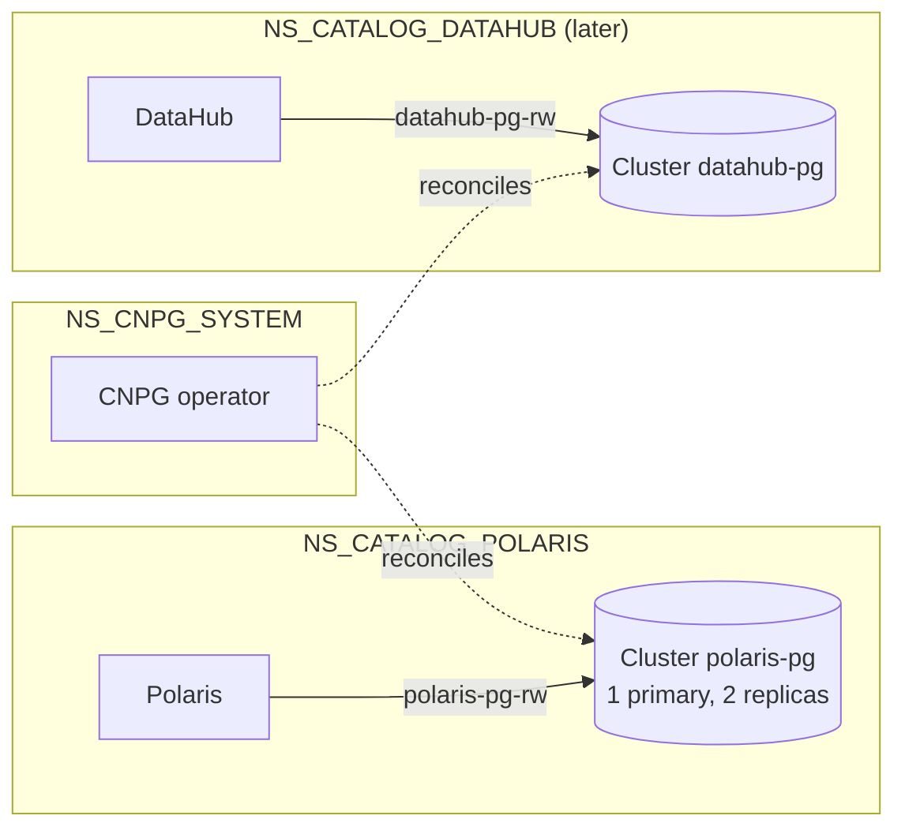

# ADR-010: PostgreSQL runs on the CloudNativePG operator, one `Cluster` per service

- **Status:** Proposed
- **Date:** 2026-10-10
- **Related:** ADR-004, ADR-007, ADR-008, ADR-012, ADR-016

## Context

The archive ran Polaris's PostgreSQL as a local umbrella chart around Bitnami
`postgresql-ha` 16.3.2: three instances with repmgr and Pgpool-II. Two problems are recorded
there:

- Values for the subchart had to be nested under `postgresql-ha:`; a whole block once sat at
  the wrong level for months while the cluster ran on the subchart's defaults.
- Bitnami stopped publishing its versioned images under `bitnami/`; the archive pulls
  `bitnamilegacy/*`, which receives no updates.

The target clusters have moved to the **CloudNativePG** (CNPG) operator (Kade, 2026-10-10),
and the gate copies the target clusters (ADR-004). With one PostgreSQL per service
(ADR-008), an operator that declares each one as a single resource fits as well.

## Decision

- **The CNPG operator** is installed once per cluster, in `NS_CNPG_SYSTEM` (ADR-007), from its
  upstream Helm chart, at the **same operator version as the target clusters** (Kade gives it;
  only the version is committed, ADR-002).
- **Each service's PostgreSQL is one CNPG `Cluster`** in the service's namespace, with its
  own credentials as Secrets (ADR-006). Instances: three where the target clusters run three,
  spread over nodes by anti-affinity; one where an environment cannot afford more (ADR-008).
- **The PostgreSQL image** is CNPG's, pinned by tag and digest to the target clusters' major
  version.
- **Services connect to the `Cluster`'s read-write service** (`<name>-rw`). A **pooler** (CNPG
  `Pooler`, PgBouncer) is added only if the target clusters use one for that service; that
  fact is open until Kade gives it.
- **Backups** (CNPG to object storage, ADR-011) get their own ADR when data needs keeping.
- The `Cluster` manifests are rendered and checked like any chart output (ADR-016): kubeconform
  with CNPG's CRD schemas, and assertions on instances, image and storage.

## Diagram

## Alternatives considered

- **Bitnami `postgresql-ha` with Pgpool-II** (the archive): proven on OrbStack, but frozen
  images, a nesting trap that once ran unnoticed for months, and not what the target clusters
  run.
- **Bitnami with current images:** depends on Bitnami's paid catalog.
- **Another operator** (Zalando, Crunchy PGO): capable, but the target clusters run CNPG.

## Consequences

- The operator and its CRDs come first in the install order (ADR-012), in every environment,
  including the gate's kind cluster.
- Measurements the archive took through Pgpool-II (reads balanced to standbys, the
  replica-staleness probe) do not carry over: with CNPG, Polaris reads from the primary through
  `-rw` unless a later ADR routes reads to `-ro`. Those measurements are taken again.
- Operator upgrades are cluster-wide and follow the target clusters' version; each is a PR of
  its own through the gates.
