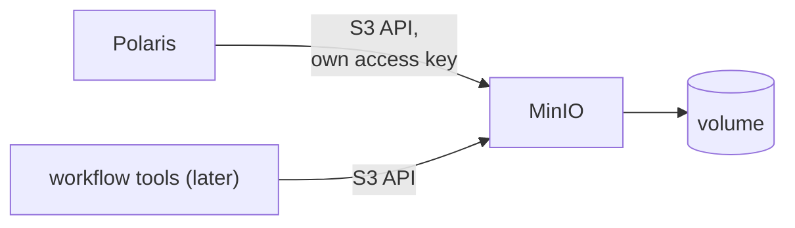

# ADR-011: Object storage is MinIO, from a local chart at a pinned release

- **Status:** Superseded by ADR-023
- **Date:** 2026-10-10
- **Related:** ADR-007, ADR-009, ADR-012

## Context

Polaris needs S3-compatible storage for the Iceberg warehouse, and workflow tools need it for
artifacts. The archive runs MinIO from a local chart (`charts/minio/`, image
`RELEASE.2024-01-01T16-36-33Z`) on a single development node. MinIO has since changed how its community
edition is distributed; the image source must be checked before the chart enters.

## Decision

- **MinIO** provides S3 storage, in `NS_STORAGE` (ADR-007), from a local chart with a pinned
  release.
- Buckets are created by the install scripts, named in `.env`; the warehouse bucket is
  Polaris's (ADR-009).
- Root credentials come from a Secret (ADR-006); services get their own access keys, not the
  root user.
- Before the chart enters: confirm where the pinned image is published and whether it still
  receives fixes; if not, this ADR is amended with the replacement.

## Diagram

## Alternatives considered

- **SeaweedFS, Ceph RGW, Garage:** S3-compatible and actively distributed, but untested with
  this platform; candidates if MinIO's distribution rules it out.
- **A cloud object store:** none locally or in CI.

## Consequences

- MinIO is first in the install order (ADR-012).
- The distribution question may turn this ADR into a replacement before anything is built.
