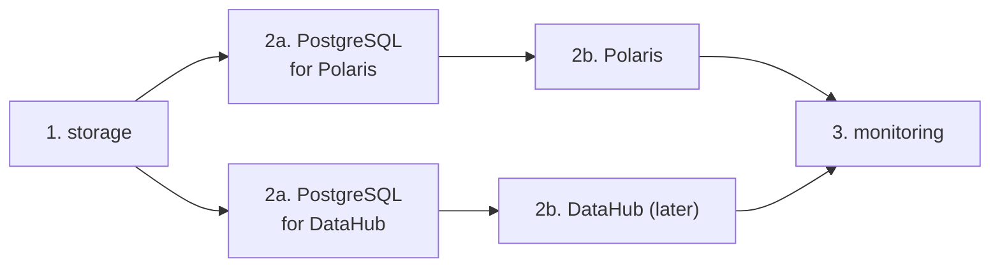

# ADR-012: Install order: storage, then each service's PostgreSQL, then the services, then monitoring

- **Status:** Proposed
- **Date:** 2026-10-10
- **Related:** ADR-007, ADR-008, ADR-009, ADR-010, ADR-011, ADR-013

## Context

The archive recorded a one-directional dependency order, "MinIO → PostgreSQL → Polaris →
everything else", learnt from installs that failed when Polaris started before its database
was ready. With namespaces per service type (ADR-007) and a PostgreSQL per service
(ADR-008), the order is per service.

## Decision

1. **Storage** (`NS_STORAGE`): object storage and its buckets.
2. **For each service:** its PostgreSQL, ready, then the service.
3. **Monitoring** (`NS_MONITORING`): log storage and shippers, metrics, dashboards. Services
   never wait on monitoring; monitoring is allowed to start last and catch up.

- The install script follows this order and waits for readiness at each step; the gates use
  the same script (ADR-018).
- Removal runs in reverse, and every removal step is destructive (ADR-004).

## Diagram

## Alternatives considered

- **Install everything at once and let pods retry:** works eventually for some charts, but
  hides real dependency faults behind restart loops, and Helm's wait times out unpredictably.
- **Monitoring first,** to catch logs from the start: makes every install depend on the
  heaviest component; logs are read from files and stdout after the fact anyway.

## Consequences

- A Helm install of an HA PostgreSQL or Polaris may wait several minutes for readiness; a
  command is stuck only when it prints nothing for 30 seconds or more.
