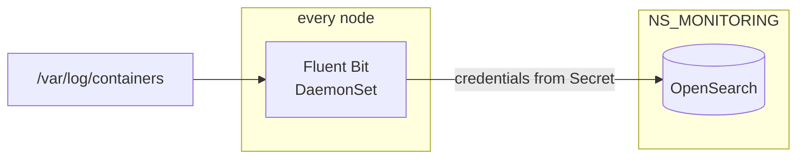

# ADR-013: Logs ship with Fluent Bit to OpenSearch, which runs in the monitoring namespace

- **Status:** Superseded by ADR-024
- **Date:** 2026-10-10
- **Related:** ADR-007, ADR-012, ADR-014

## Context

The archive ships container logs with one Fluent Bit DaemonSet into **OpenSearch 3.5.0**, in
three tiers: all container logs, Polaris's logs, and a Polaris audit report (schema v6),
with index templates and ISM policies kept in the repository. VictoriaLogs was used before
and removed on 2026-09-18. OpenSearch ran in Docker on a workstation, **outside the cluster and
outside the repository**, so neither the gate nor a target cluster could reproduce it. Two
operational lessons are recorded: a Fluent Bit Lua change needs a restart (no hot reload),
and keyword fields must be queried as `.keyword`.

Kade's direction (2026-10-10): OpenSearch, Prometheus and Grafana in a monitoring namespace.

## Decision

- **Fluent Bit**, one DaemonSet, tails container logs and ships them to **OpenSearch**.
- **OpenSearch runs in the cluster**, in `NS_MONITORING`, from a chart in this repository, at
  a pinned version (3.5.0 unless the target clusters run another).
- **Index templates, ISM policies and the Lua filters are in the repository** and applied by
  the install scripts; a Lua change restarts the DaemonSet as part of its apply.
- The tiers and the audit report schema enter under their own ADR with the Polaris logging
  work (ADR-014); this ADR decides the pipeline, not the tiers.
- Metrics and dashboards (Prometheus, Grafana) get their own ADR when they enter.

## Diagram

## Alternatives considered

- **OpenSearch outside the cluster** (the archive): nothing in CI or a target cluster
  reproduces it, and it lives outside the repository.
- **VictoriaLogs:** used and removed in the archive; the queries and reports were built on
  OpenSearch since.
- **Loki:** lighter, but the audit reports rely on OpenSearch's aggregations.

## Consequences

- OpenSearch is the heaviest component on a CI runner; the smoke gate runs it as one small
  node.
- Moving OpenSearch into the cluster is a change from the archive, proven first on the gate.
