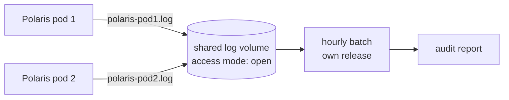

# ADR-014: Polaris writes one log file per pod, read by an hourly batch released separately

- **Status:** Proposed
- **Date:** 2026-10-10
- **Related:** ADR-004, ADR-009, ADR-013

## Context

Besides stdout, the archive's Polaris writes a JSON log file, rolled hourly, for an hourly
batch job that builds the audit report. Two findings are recorded there:

- **One shared file lost data:** with two Polaris pods writing one file under rotation, 44.5 %
  of lines were lost in a measured run; one file per pod (`polaris-<pod>.log`) lost none.
- **The volume is `ReadWriteOnce`**, chosen because OrbStack is one node. On a multi-node
  cluster, a Polaris pod or the batch job scheduled on another node cannot attach it (ADR-004).
  Never run on more than one node.

The batch job is its own image and chart in the archive, released apart from Polaris.

## Decision

- **One JSON log file per Polaris pod**, rolled hourly, on a volume shared with the batch.
- **The batch is its own release** (image and chart), apart from Polaris; it reads every
  pod's rolled and current files and selects lines by timestamp.
- **Open, decided before this ADR is accepted:** how the volume is shared across nodes:
  `ReadWriteMany` storage, a volume per pod with the batch reading through the API, or
  shipping the files instead of sharing a volume. The gate's three nodes (ADR-017) are where
  the choice is proven.

## Diagram

## Alternatives considered

- **One shared file:** measured to lose 44.5 % of lines under rotation.
- **Stdout only, through Fluent Bit:** the archive found stdout was not equivalent to the file
  for the audit report; the reasons are cited when the logging work enters.

## Consequences

- The logging work cannot enter until the volume question is answered.
- The batch's image is built in CI for the target architecture (ADR-004).
