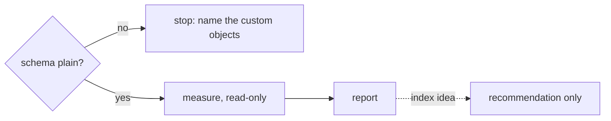

# ADR-015: Measurements run on the plain upstream Polaris schema; no custom indexes

- **Status:** Accepted
- **Date:** 2026-10-10
- **Related:** ADR-008, ADR-009

## Context

The suite profiles the SQL Polaris sends to PostgreSQL and the cost of its API calls. The
archive learnt that a plan taken on a schema with an extra index describes a database nobody
runs, and cannot be told apart afterwards from one taken on the real schema. Polaris's schema
creates exactly three non-key indexes (`idx_entities`, `idx_locations`,
`idx_policy_mapping_record`) and gives `grant_records` only its six-column primary key.

## Decision

- **Every measurement runs on the schema Polaris ships**, from the file Polaris ships
  (ASF-licensed), kept unchanged in the repository as the reference.
- **No measurement creates, drops or changes an index or table.** Read-only notebooks and
  tests only; one that changes the schema is not part of a measurement and is run deliberately
  from a shell.
- **Before measuring, a check confirms the schema is plain** and fails if anything custom
  exists. The set of stock indexes is a constant in code.
- **An index proposal is a recommendation,** recorded with its evidence, never applied to the
  measured database.

## Diagram

## Alternatives considered

- **Measure with the indexes we would add:** shows the gain, but every number would then be
  about a database that does not exist anywhere Polaris is deployed.

## Consequences

- Polaris's own PostgreSQL (ADR-008) is never shared, so other services' objects never appear
  in it.
