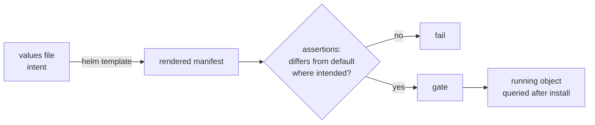

# ADR-016: A setting is verified on the running object against the chart default, never in the values file

- **Status:** Proposed
- **Date:** 2026-10-10
- **Related:** ADR-010, ADR-017, ADR-018

## Context

The archive's most expensive fault: a whole values block for PostgreSQL sat at the wrong
nesting level, Helm ignored it without a warning, and the cluster ran on the subchart's
defaults for months while the values file said otherwise. Reading the values file "confirmed"
the setting every time. A value equal to the chart default proves nothing either: it looks the
same whether the block was applied or ignored.

## Decision

- **A setting is confirmed by querying the running object** (or the rendered manifest in CI)
  and comparing it with the **chart default**, never by reading the values file.
- **`helm lint` is not a render.** Every chart change is also rendered (`helm template` in the
  static gate, a server-side dry-run in the dry-run gate).
- **Every chart that enters comes with assertions on its rendered output** for the values that
  matter (replicas, resources, credentials from Secrets, nesting of subchart values), so an
  ignored block fails CI.
- **Turning on configuration that has never run is a change, not a fix**, and is gated as one.

## Diagram

## Alternatives considered

- **Trust `helm lint` and a review of the values:** what let the archive's fault run for
  months.

## Consequences

- Each chart PR carries a small test of its rendered output.
- Kade's checks on OrbStack and the smoke gate query running objects, not files.
