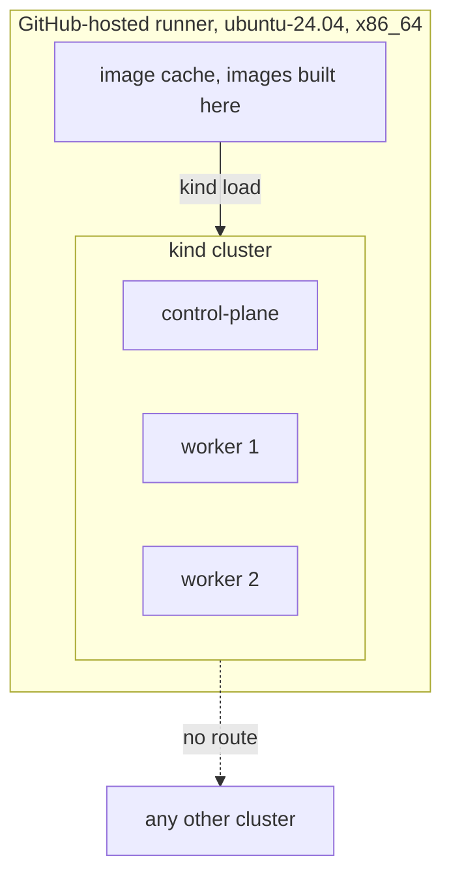

# ADR-017: The Linux gate cluster is kind with three nodes on a GitHub-hosted runner

- **Status:** Accepted
- **Date:** 2026-10-10
- **Related:** ADR-002, ADR-004, ADR-018, ADR-021

## Context

ADR-004 makes Linux the place a release is proven, with several nodes like a target cluster.
GitHub-hosted runners are isolated single VMs that accept no connections from each other.
Four options were compared on 2026-10-10: kind with three nodes on one runner; three runners
joined over a VPN; a temporary cloud cluster per run; a permanent self-hosted cluster. Kade
chose kind to start, keeping the others for later.

## Decision

- **kind** with **one control-plane and two workers**, created in the job and gone with it.
- **Pinned:** the kind node image by digest at the target clusters' Kubernetes minor version;
  the kind, Helm and kubeconform versions. The runner is `ubuntu-24.04` (`x86_64`).
- **Storage:** kind's default (`local-path`, each volume pinned to one node), which reproduces
  the cross-node volume fault of ADR-014.
- **Images** from public registries; images built from this repository are built in the job
  and loaded with `kind load`; pulled images are cached by image list.
- **Sizing:** per-chart CI values that change sizes only; anything else that differs from the
  real values is a finding.
- **No secrets** and no route to any other cluster (ADR-006).
- A real three-node cluster (cloud or self-hosted) later amends this ADR, for the release
  workflow only (ADR-020).

## Diagram

## Alternatives considered

- **Three runners over a VPN:** real kernels, but three jobs to keep in step and an outside
  service with an auth key. Fragile.
- **A temporary cloud cluster:** the closest copy, at a cost per run and with cloud
  credentials and teardown to maintain. Kept for later.
- **A permanent self-hosted cluster:** no per-run cost, but maintenance, resets, and a
  self-hosted runner on a public repository, which GitHub warns against.
- **Single-node kind:** would hide the scheduling faults the gate exists to find.

## Consequences

- Scheduling, affinity and volume-attachment faults show in CI.
- Unproven until a real cluster: network partitions, shared `ReadWriteMany` storage, node
  pressure, the target clusters' admission policies.
- The public runners' size (ADR-002) bounds what one smoke run can install.
