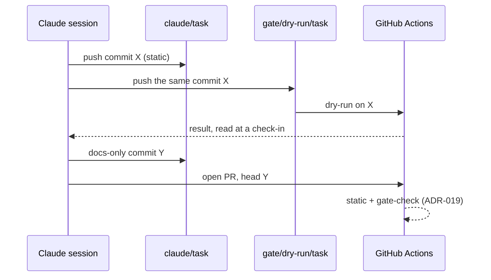

# ADR-018: Dry-run and smoke gates run from throwaway `gate/*` branches on the PR's exact commit

- **Status:** Proposed
- **Date:** 2026-10-10
- **Related:** ADR-016, ADR-017, ADR-019, ADR-021

## Context

A Claude session has no `helm` and no cluster, and a kind cluster with the stack takes
minutes: too much for every push. Kade proposed (2026-10-10) branches that exist only to run a
gate: a session pushes to them, reads the result, and opens its PR on `claude/*` with it,
while the PR runs only the static gate.

## Decision

| Level | Runs on | What | Blocks merge |
|---|---|---|---|
| **static** | every push to `claude/**`, every PR | lint, `helm template`, kubeconform with the CRD schemas in use (CNPG), rendered-output assertions (ADR-016), unit tests, repository checks | yes |
| **dry-run** | push to `gate/dry-run/<task>` | kind (ADR-017); install the last release (ADR-021); server-side dry-run of the upgrade | yes, through ADR-019, for platform changes |
| **smoke** | push to `gate/smoke/<task>`; nightly on `main` | kind; install the last release; real upgrade; wait for readiness; smoke tests | no; reported in the PR |

- `<task>` matches `claude/<task>`. A session pushes **the same commit** it opens the PR from:
  `git push origin HEAD:refs/heads/gate/dry-run/<task>`.
- `gate/*` branches are throwaway: force-push and deletion are allowed there; they are never
  opened as a PR or merged. The session deletes them once the PR is open.
- A newer push to a gate branch cancels the older run.
- Gate workflows: `permissions: {}` at the top, `contents: read` per job, no repository
  secrets, actions pinned to a major version with `persist-credentials: false`.
- **Flow:** commit and push `claude/<task>` → push the same commit to the gate branch → wait
  with a scheduled check-in → on failure fix and push again (at most two self-corrections) →
  on success record what was proven in a docs-only commit → open the PR with each gate's
  commit and run link under *Verified*.

## Diagram

## Alternatives considered

- **Every gate on every PR:** minutes of kind per push.
- **`workflow_dispatch` on the PR branch:** no extra branches, but needs the GitHub API; a
  push works from any session that can push.
- **PR labels:** the PR must exist first, and labelling needs the API too.

## Consequences

- Sessions get real gate results without a cluster of their own.
- Whether GitHub shows a gate branch's checks on a PR with the same commit is unverified;
  nothing relies on it (ADR-019).
