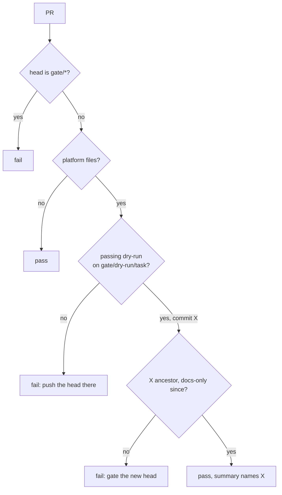

# ADR-019: A platform PR merges only when a passing dry-run gate covers its head

- **Status:** Proposed
- **Date:** 2026-10-10
- **Related:** ADR-018

## Context

ADR-018 runs the dry-run gate on a `gate/*` branch, not on the PR. Without a check on the PR,
a chart change could merge without it. Kade's rules ask for every limit to be enforced by CI.
GitHub's branch protection cannot require a check only for some paths: a required check that
does not run blocks the PR forever.

## Decision

A job **gate-check** runs on every PR and is required. It:

1. Fails if the head branch starts with `gate/`.
2. Passes if the PR changes no **platform file** (`charts/**`, `images/**`, `install/**`,
   `gates/**`, the gate workflows).
3. Otherwise finds the latest successful dry-run run on `gate/dry-run/<task>` (Actions API,
   `actions: read`) and its commit `X`.
4. Passes only if `X` is an ancestor of the head and everything changed since `X` is
   documentation (`*.md`, `.memory/**`).
5. Writes which commit and run it relied on to the job summary.

## Diagram

## Alternatives considered

- **Trust the PR description:** nothing checks the link covers the merged commit.
- **Require head = gated commit:** recording the result in docs would need a second gate run.

## Consequences

- Platform PRs cannot auto-merge without a dry-run of what they merge.
- The smoke gate stays advisory; making it required is an amendment.
- If listing runs by branch proves unreliable, the fallback is a run ID in the PR description
  that the job verifies.
