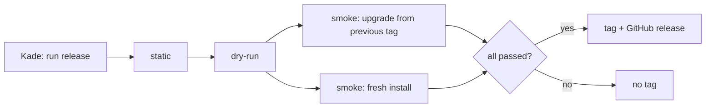

# ADR-020: A release tag is created only by the release workflow, after the full Linux gate

- **Status:** Proposed
- **Date:** 2026-10-10
- **Related:** ADR-004, ADR-017, ADR-018, ADR-021

## Context

The archive had no tags: no deployment could name what it deployed, and no gate had a release
to upgrade from (ADR-021).

## Decision

- **A release is a tag `platform-YYYY.MM.DD`**, `.N` appended for a second one the same day.
- **Only the `release` workflow creates it.** Kade starts it by hand on a commit of `main`; on
  that exact commit it runs the static, dry-run and smoke gates, the smoke gate both as an
  upgrade from the previous tag and as a fresh install, and tags only if all pass. Only the
  tagging job has `contents: write`.
- It writes a GitHub release: chart and image versions with digests, the gate's Kubernetes
  version, the run link.
- **Tags are never moved or deleted;** a ruleset blocks it. A problem found later is a new
  release.
- Claude sessions start the release workflow only when Kade asks in that session.

## Diagram

## Alternatives considered

- **Kade tags by hand after a check on a test cluster:** what a tag means would depend on that
  day's check, and no record would show what was proven (ADR-004).
- **Semantic versions:** a set of charts with independent upstream versions promises no API.
- **A release per merge:** a tag per PR, most of them documentation.

## Consequences

- Every tag has a Linux run that proves it.
- Until the first tag, gates fall back to a fresh install and say so.
