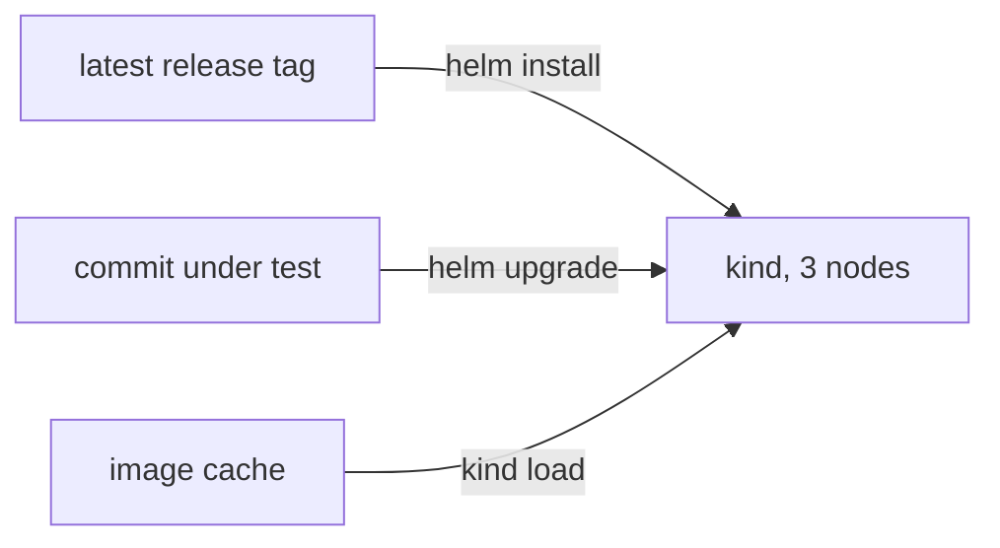

# ADR-021: Gates upgrade from the last release, rebuilt from its tag; no machine snapshots

- **Status:** Accepted
- **Date:** 2026-10-10
- **Related:** ADR-017, ADR-018, ADR-020

## Context

A cluster running these charts is upgraded, not installed fresh. Helm 4 applies changes
server-side, so field-manager conflicts appear only on an upgrade, as do database migrations.
Kade asked (2026-10-10) whether a gate could start from a Linux snapshot of a release. Four
ways were compared: rebuild from the tag; restore a data snapshot stored per tag; boot a
machine image; use a self-hosted runner with VM snapshots.

## Decision

- **Rebuild from the tag:** the dry-run and smoke gates and the release workflow install the
  latest release tag reachable from the commit, from a checkout of that tag, then upgrade to
  the commit under test.
- **No tag yet:** fresh install, and the summary says "no release to upgrade from".
- **Speed comes from caching** pulled images keyed by the tag's image list, not from snapshots.
- **Data snapshots are deferred** to the first change that touches stored data or the
  metastore schema; they would hold fixtures only.

## Diagram

## Alternatives considered

- **Data snapshot per tag now:** the most faithful upgrade, but a snapshot workflow for data
  nobody migrates yet.
- **Machine image:** hosted runners cannot boot a custom image without paid larger runners,
  and saving a kind node misses the cluster data kind keeps on a separate volume.
- **Self-hosted snapshots:** a self-hosted runner on a public repository.
- **Fresh install only:** misses the upgrade faults Helm 4 makes likely.

## Consequences

- Each gate run installs twice: a few minutes more.
- Data-dependent migrations stay unproven until data snapshots exist.
