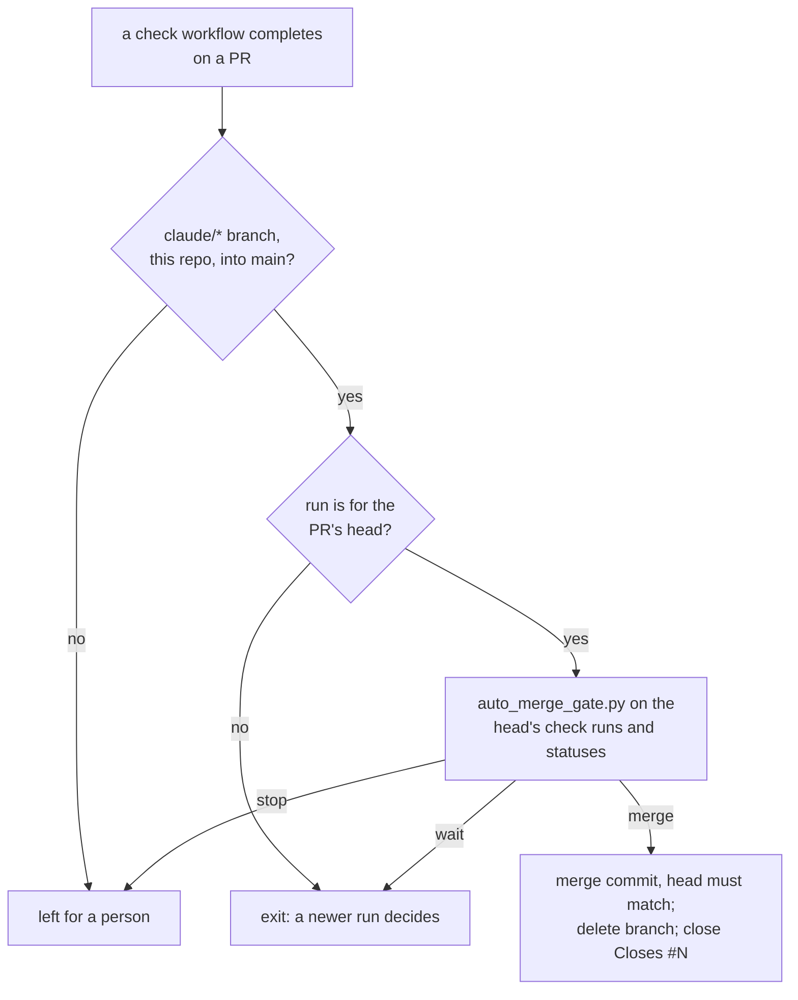

# ADR-022: Claude's PRs merge through an auto-merge workflow once every check on the head is green

- **Status:** Accepted
- **Date:** 2026-10-10
- **Related:** ADR-003, ADR-018, ADR-019

## Context

Kade's rule for cloud sessions is that Claude never merges by hand. A PR either merges through
GitHub's auto-merge or through the repository's own auto-merge workflow. GitHub's auto-merge
depends on two repository settings: "Allow auto-merge" and a branch rule that requires checks.
Both live outside git, and a session can neither read nor change them. Without a required
check, GitHub merges at once.

Stella Rain merges through a workflow (`stella-rain/app` `.github/workflows/auto-merge.yml`,
which calls `stella-rain/.github` `.github/workflows/auto-merge.yml` and
`scripts/auto_merge_gate.py`), and every `claude/*` PR there merges that way. Kade
chose the same here (2026-10-10), because a workflow is a file that a session can write and
review.

## Decision

- **`.github/workflows/auto-merge.yml`** runs on `workflow_run` (completed) of every workflow
  that checks a PR. It merges a PR into `main` when all of these hold:
  - the PR comes from a `claude/*` branch of this repository;
  - the run is for the PR's current head commit;
  - every check run on that commit has finished green (success, neutral or skipped), at least
    one succeeded, and no commit status is pending or failed.
- **It merges with a merge commit**, refusing if the head moved since the checks were read.
  It then deletes the `claude/*` branch and closes the issues the PR names with `Closes #N`
  in this repository. A merge made with `GITHUB_TOKEN` does not apply closing keywords, so the
  workflow closes them itself.
- **The decision is a script with tests**, `scripts/auto_merge_gate.py`, ported from
  `stella-rain/.github` (MIT). The workflow runs the copy on `main`, never the PR's.
- **Every new check workflow is added to the `workflows:` list** of `auto-merge.yml` in the
  same PR that adds it. When gate-check arrives (ADR-019), the merge also requires it by name,
  so a check that has not started yet cannot be skipped.
- **Anything else is left for a person:** a failed or cancelled check, a branch that is not
  `claude/*`, a fork, a PR into another branch. Kade merges his own branches by hand.
- **No repository setting is needed.** "Allow auto-merge" stays off; branch rules may be added
  later and do not change this.

## Diagram

## Alternatives considered

- **GitHub's auto-merge with a required check:** no workflow to maintain, but the behaviour
  depends on settings outside git.
- **Call Stella Rain's reusable workflow:** no copy, but this public repository would run code
  from another organization's `main`.
- **Kade merges every PR by hand:** a click per PR, and green PRs wait for him.

## Consequences

- `workflow_run` workflows are read from `main`. A change to `auto-merge.yml` acts only after
  its own merge, so the PR that adds it is merged by Kade.
- A merge made with `GITHUB_TOKEN` starts no `push` run on `main`. The PR's own runs are the
  gate.
- Until gate-check exists, the merge waits only for the checks that have reported. A check
  workflow that starts late could be missed. Today `static` is the only one.
- Platform PRs merge only when gate-check passes (ADR-019), because gate-check is one of the
  checks.
