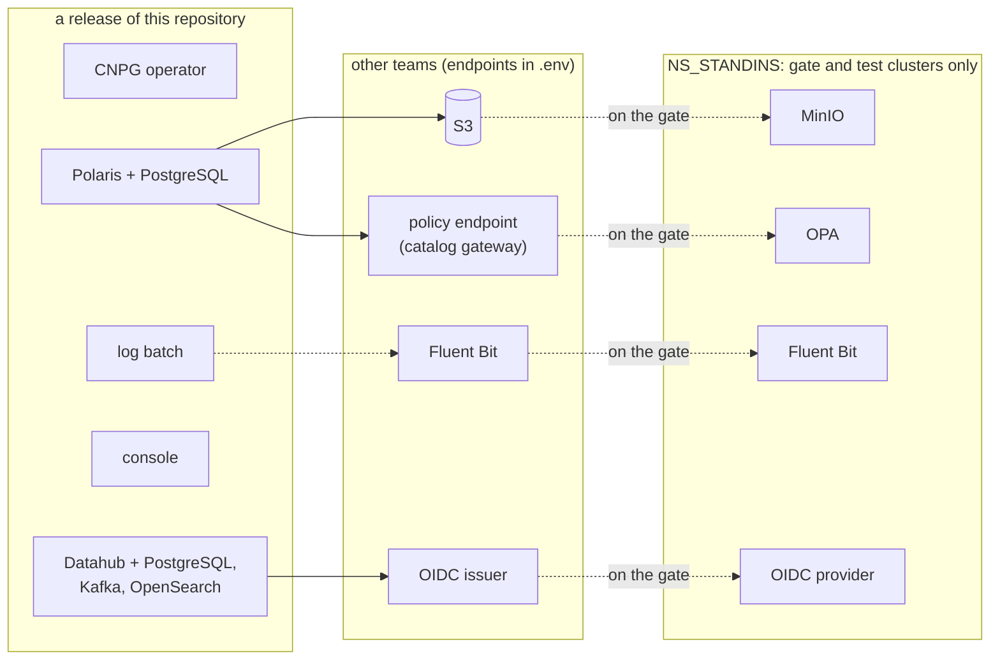

# ADR-023: Other teams' services are interfaces in `.env`, with stand-ins only on the gate

- **Status:** Proposed
- **Date:** 2026-10-10
- **Related:** ADR-002, ADR-006, ADR-007, ADR-011, ADR-012, ADR-017

## Context

The ADRs written first assumed this repository installs the whole platform: object storage
(ADR-011), log storage and shippers (ADR-013) and a monitoring namespace (ADR-007, ADR-012).
Kade set the scope on 2026-10-10 (`docs/plans/roadmap.md`): this repository builds and
releases Polaris, its console, its log batch and Datahub, each with its own stores. Object
storage, observability, ETL, query clients, SSO and the catalog gateway belong to other teams.

A gate still needs something to talk to: Polaris cannot create a catalog without S3, and with
the OPA authorizer (ADR-026) it cannot answer a request without a policy endpoint.

## Decision

- **This repository builds and releases only:** Polaris with its PostgreSQL (ADR-009,
  ADR-010), the Polaris console (ADR-028), the Polaris log batch (ADR-014, ADR-024), Datahub
  with its PostgreSQL, Kafka and OpenSearch (ADR-025), and the CloudNativePG operator they
  depend on (ADR-010; whether a release includes it is open in issue #8).
- **Every other team's service is an interface**, given by `.env` (ADR-002): the S3 endpoint,
  region and bucket; the policy endpoint (ADR-026); the OIDC issuer for Datahub's login; the
  namespace labels of callers allowed in (ADR-027). Nothing in a release installs or
  configures those services.
- **Credentials for those services are typed into `.env` by hand** (ADR-006), never
  generated: for example the S3 access key Polaris uses. `init_env.py` stops generating
  Secrets for services that are not built here (`minio-root`, `opensearch-admin`).
- **Stand-ins on the gate and on Linux test clusters only:** MinIO for S3, OPA for the policy
  endpoint, Fluent Bit for the log hand-off, an OIDC provider for Datahub's login. They live
  in one namespace, `NS_STANDINS` (default `standins`), are installed by the gate's own
  scripts before a release, are never part of a release, and their credentials are generated
  in the job (ADR-017).
- **Amends ADR-007:** `NS_STORAGE` and `NS_MONITORING` are no longer namespaces of this
  repository; `NS_STANDINS` is added for the gate.
- **Amends ADR-012:** the install order is operators, then for each service its PostgreSQL,
  then the service. Storage and monitoring are not install steps; the install script checks
  that the S3 and policy endpoints answer before it installs Polaris.
- **Amends ADR-017:** the gate installs the stand-ins before the release under test.
- **Supersedes ADR-011:** object storage is another team's; MinIO remains only as a stand-in.

## Diagram

## Alternatives considered

- **Keep installing object storage and observability here:** what the first ADRs did; it
  duplicates other teams' work and drifts from the services the target clusters really run.
- **No stand-ins; gate only what runs alone:** Polaris cannot create a catalog without S3 or
  answer a request without its authorizer, so the smoke gate would prove nothing.
- **Stand-ins in each service's namespace:** mixes what is released with what is not, and a
  stray stand-in could reach a release.

## Consequences

- `.env.template` gains the interface variables and `NS_STANDINS`, and loses `NS_STORAGE`,
  `NS_MONITORING`, the MinIO root and OpenSearch credentials, in the PR that changes
  `init_env.py`.
- The smoke gate proves Polaris against MinIO and OPA, not against the real services; a
  difference found on a target cluster is a finding against the stand-in.
- Measurements (ADR-015) taken on the gate name the stand-ins they ran against.
