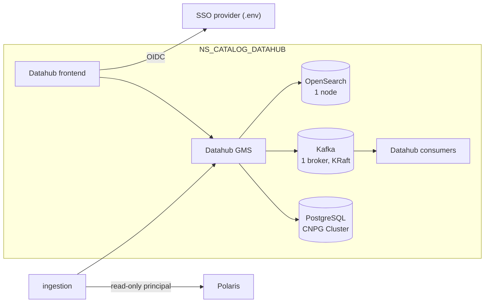

# ADR-025: Datahub runs with PostgreSQL on CloudNativePG, a single-broker Kafka and a small OpenSearch

- **Status:** Accepted
- **Date:** 2026-10-10
- **Related:** ADR-007, ADR-008, ADR-010, ADR-023, ADR-026

## Context

Datahub is built and released here (ADR-023), with its own stores: a metadata database, Kafka
and a search index, all used by Datahub only. On the target clusters its database runs on
Pgpool with PostgreSQL-HA, and a move to CloudNativePG was planned for later.

Research on 2026-10-10 (upstream repositories, `docs/plans/roadmap.md`) found:

- Since 2025-08-28, Bitnami's `postgresql-repmgr`, `pgpool` and `kafka` images are available
  only to paying customers; the old tags moved to the frozen `bitnamilegacy` repository, and
  the `postgresql-ha` and `kafka` charts have had no real update since 2025-09.
- Datahub's own `datahub-prerequisites` chart still uses Bitnami's Kafka chart with
  `bitnamilegacy/kafka`, and Bitnami MySQL.
- Datahub supports PostgreSQL as its metadata store; OpenSearch comes from the
  opensearch-project chart.

Kade's choice (2026-10-10): Datahub's PostgreSQL moves to CloudNativePG now, and its Kafka is
the official Apache image with one broker.

## Decision

- **Datahub** runs in `NS_CATALOG_DATAHUB` (ADR-007) from Datahub's official `datahub` chart,
  kept as a local copy at the target clusters' version (issue #9), like Polaris (ADR-009).
  Datahub's `datahub-prerequisites` chart is not used.
- **Its metadata store is PostgreSQL on a CloudNativePG `Cluster`** in the same namespace,
  exactly as ADR-008 and ADR-010 decide for every service.
- **Its Kafka is one broker in KRaft mode** (no ZooKeeper), from the official `apache/kafka`
  image pinned by tag and digest, in a small chart of this repository. It is used by Datahub
  only and is not reachable from other namespaces (ADR-027).
- **Its search index is a single-node OpenSearch** from the opensearch-project chart, at a
  version Datahub supports, pinned; used by Datahub only.
- **Login** goes through the SSO provider over OIDC, its issuer given in `.env` (ADR-023); an
  OIDC stand-in on the gate.
- **Datahub ingests Polaris's catalog** with its own Polaris principal, which has read-only
  grants (ADR-026).
- **Migration on the target clusters:** the first release that installs Datahub there needs
  a runbook to move the metadata from the existing PostgreSQL-HA to the new `Cluster`, proven
  on a Linux test cluster first.

## Diagram

## Alternatives considered

- **Keep Pgpool and PostgreSQL-HA:** matches the target clusters today, but on images that no
  longer receive free updates; building them from Bitnami's Dockerfiles would make this
  repository maintain database images.
- **Strimzi for Kafka:** robust, but a second operator to install and upgrade for one small
  broker.
- **Datahub's prerequisites chart:** the shortest path, but it runs frozen Bitnami images.
- **Share the ETL team's Kafka:** couples Datahub's internal topics to another team's cluster.

## Consequences

- Datahub's database is managed like Polaris's: one operator, one way to back up and upgrade.
- A single broker has no redundancy; Datahub's topics are rebuilt from its database if the
  broker's volume is lost, and that recovery is part of the smoke gate's tests.
- The data migration from PostgreSQL-HA is a one-time item on the roadmap (P3).
- Whether Datahub needs a schema registry, or uses its internal one, is checked when the chart
  enters.
