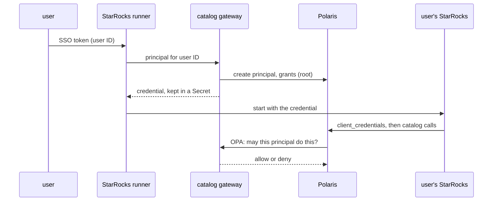

# ADR-026: Polaris issues its own tokens and asks an OPA policy endpoint; principals are created by the catalog gateway

- **Status:** Proposed
- **Date:** 2026-10-10
- **Related:** ADR-006, ADR-009, ADR-023, ADR-027

## Context

How callers reach Polaris on the target clusters (Kade, 2026-10-10, `docs/plans/roadmap.md`):

1. A user signs in through SSO; the token carries a unique user ID.
2. The StarRocks runner reads that user ID and fetches the user's Polaris client ID and secret
   from a Kubernetes Secret.
3. The runner starts the user's StarRocks with those credentials; its Iceberg client
   authenticates to Polaris and stays authenticated.
4. Polaris decides per catalog, namespace and table what that principal may do.
5. The catalog gateway, built by another team, holds the root credential and creates a
   principal per user when the runner asks. It is also Polaris's policy endpoint: Polaris on
   the target clusters uses its OPA authorizer, pointed at the gateway (Kade, 2026-10-10).

Research on 2026-10-10 (Polaris source, 1.6.0 to 1.8.0): the privileges for managing
principals exist internally (`PRINCIPAL_CREATE`, `PRINCIPAL_ROLE_CREATE`, ...), but the
management REST API cannot grant them, so with Polaris's own authorizer nothing lies between
root and full `service_admin`. Polaris also accepts external OIDC tokens (`external` and
`mixed` authentication, since 1.0) and a token-exchange grant for its own tokens.

## Decision

- **Authentication: Polaris's internal token issuer.** Callers obtain tokens from Polaris
  with their principal's client ID and secret (`client_credentials`). The token signing key
  is a Secret generated per clone by `init_env.py` (ADR-006) and shared by every Polaris
  replica, so a token issued by one replica is valid on all.
- **Authorization: Polaris's OPA authorizer**, its endpoint from `.env` (ADR-023). This
  repository does not write the production policy; the gateway owns it.
- **On the gate, an OPA stand-in** runs a test policy kept in this repository: root may do
  everything; an ordinary principal may do only what the smoke tests grant it; anything else
  is refused. The smoke tests check both an allowed and a refused request.
- **The request Polaris sends to the policy endpoint is a contract**, documented with the
  pinned Polaris version (`docs/contracts/polaris-opa-input.md`), so the gateway's team learns
  of a change in a Polaris upgrade before it ships (ADR-009).
- **Bootstrap:** the realm and the root principal are created at install from Secrets
  (`POLARIS_ROOT_CLIENT_ID`, `POLARIS_ROOT_CLIENT_SECRET`, ADR-006). The root credential is
  handed to the gateway's team out of band, never through this repository.
- **One principal per caller.** Per-user principals are created by the gateway. Services of
  this repository that call Polaris (Datahub's ingestion, ADR-025; the smoke tests) get their
  own principals with the narrowest grants that work, never root.
- **Using an SSO token directly with Polaris** (external or mixed authentication, or a token
  exchange) is experimental: a spike under its own ADR, never on the release path.

## Diagram

## Alternatives considered

- **Polaris's own authorizer:** simpler, but it is not what the target clusters run, and it
  cannot give the gateway less than full `service_admin`.
- **External OIDC tokens in Polaris now:** removes per-user secrets, but changes how every
  caller authenticates; kept as the experiment above.
- **A separate signing key per replica:** tokens fail when a request lands on another replica.

## Consequences

- The root credential stays concentrated in the gateway; narrower rules for what the gateway
  does with it live in the gateway's own policy, outside this repository.
- Every Polaris upgrade re-checks the OPA input contract against the stand-in policy.
- `init_env.py` generates the token signing key, in the PR that updates its Secrets.
