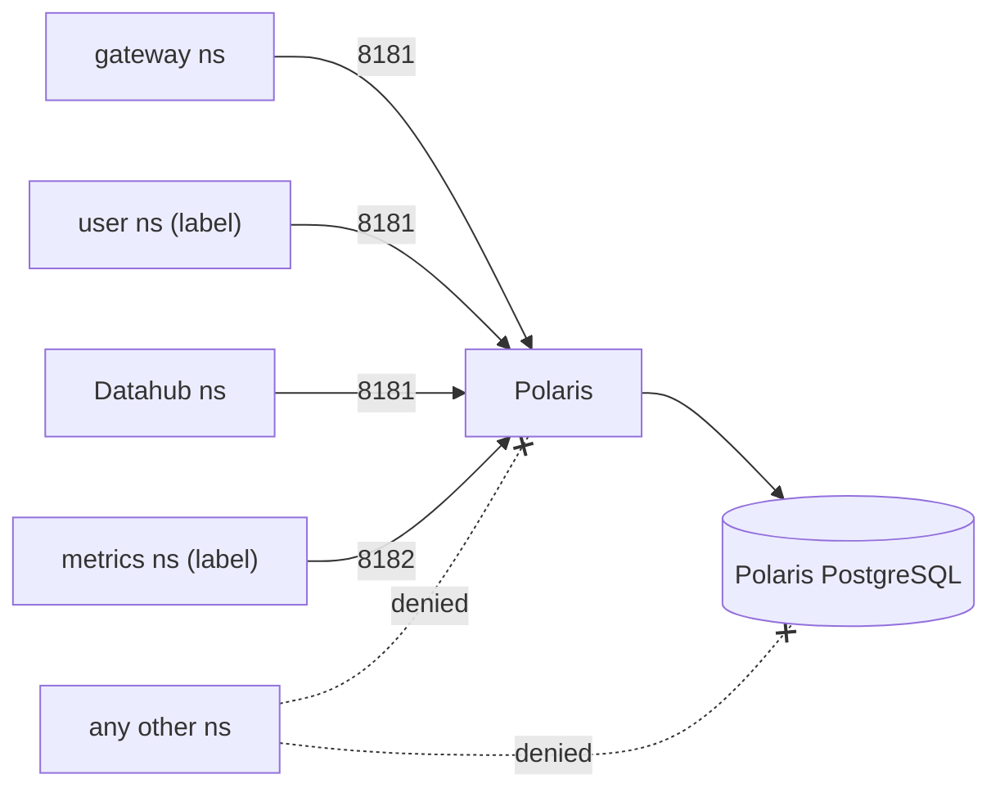

# ADR-027: Ingress to this repository's namespaces is denied by default and allowed per caller

- **Status:** Amended by ADR-034
- **Date:** 2026-10-10
- **Related:** ADR-007, ADR-023, ADR-025, ADR-026

## Context

Polaris and Datahub are called from many places: the catalog gateway, every user's StarRocks
in its own namespace, Datahub's ingestion, the observability team's metrics scraper, lineage
emitters (`docs/plans/roadmap.md`, issue #10). ADR-007 already says which namespaces may talk
to which is written down so network policies can follow. Their stores (PostgreSQL, Kafka,
OpenSearch) are used by one service each (ADR-008, ADR-025).

## Decision

- **Every namespace of this repository has a default-deny ingress `NetworkPolicy`**, and one
  allow policy per caller class. Egress is not restricted yet; that is a later ADR.
- **Callers are selected by namespace label**, the label given in `.env` (ADR-002, ADR-023),
  never by namespace name in a chart.

| Target | Port | Allowed from |
|---|---|---|
| Polaris API | 8181 | the gateway's namespace; user namespaces (StarRocks); Datahub's namespace |
| Polaris management (health, metrics) | 8182 | the metrics scraper's namespace |
| Polaris console | its HTTP port | the ingress controller's namespace |
| Datahub frontend | its HTTP port | the ingress controller's namespace |
| Datahub GMS | its API port | lineage emitters' namespaces (issue #10); Datahub's own pods |
| Each PostgreSQL | 5432 | its own service's pods; the CNPG operator's namespace |
| Datahub's Kafka and OpenSearch | their ports | Datahub's own pods only |

- **The gate enforces them:** the smoke tests check one allowed and one refused connection per
  row. If kind's default network plugin does not enforce `NetworkPolicy`, the gate installs one
  that does, and ADR-017 is amended.

## Diagram

## Alternatives considered

- **No policies, rely on authentication:** every store would be reachable from every
  namespace, protected only by its password.
- **Select callers by namespace name:** names differ per cluster and would end up in charts,
  against ADR-002.

## Consequences

- A new caller needs a namespace label and a line in this table before it can connect.
- Ports named "its port" are filled in when each chart enters.
