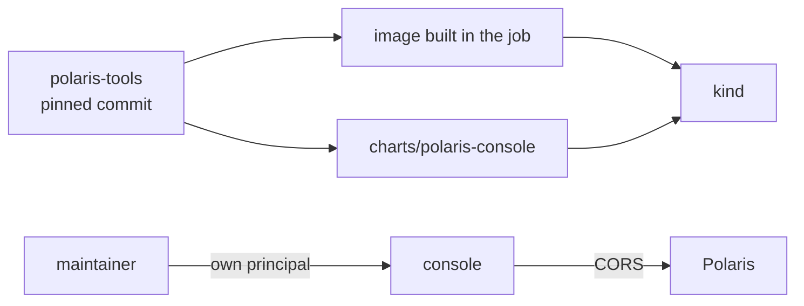

# ADR-028: The Polaris console is a maintainer tool, built from a pinned commit and kept off the release path

- **Status:** Proposed
- **Date:** 2026-10-10
- **Related:** ADR-009, ADR-017, ADR-023, ADR-026

## Context

The team runs the Polaris console from `apache/polaris-tools` (`console/`). Research on
2026-10-10 found a Helm chart in that repository but no published image (`apache/polaris-console`
does not exist on Docker Hub; its README says to build it). Users sign in with a principal's
client ID and secret, and Polaris must allow the console's origin (CORS). Kade (2026-10-10):
the console is only a front end for maintainers, not part of how Polaris operates.

## Decision

- **The console is optional and off by default** in every environment's values. A release
  never depends on it, and Polaris works the same without it.
- **Source pinned:** a commit of `apache/polaris-tools`, with its chart copied locally under
  `charts/polaris-console/`, like Polaris (ADR-009).
- **On the gate, the image is built from that commit** in the job and loaded into kind
  (ADR-017); the smoke gate checks that the console serves and that a maintainer principal
  can sign in. A console failure is reported but does not block a release.
- **How the image reaches the target clusters is not decided here**; it is not needed to
  operate Polaris.
- **Polaris allows the console's origin** (CORS) only when the console is enabled.
- **Maintainers sign in with their own principals**, never root (ADR-026).

## Diagram

## Alternatives considered

- **Publish a console image from this repository:** needs a registry decision that does not
  matter for operating Polaris.
- **Leave the console out entirely:** the team uses it, and a Polaris upgrade could break it
  unnoticed.

## Consequences

- A Polaris upgrade (ADR-009) also re-checks the console on the gate.
- Publishing an image becomes a later ADR if a target cluster needs one.
