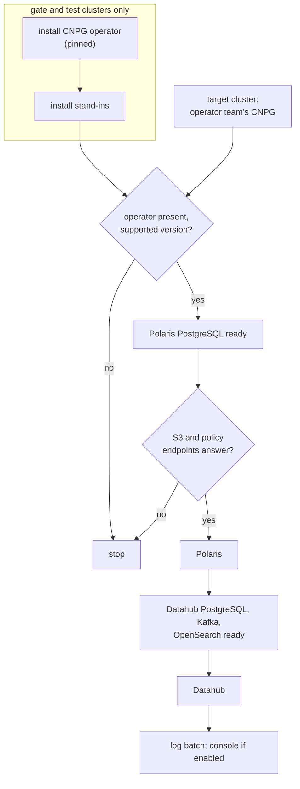

# ADR-029: The CloudNativePG operator belongs to the operator team; this repository installs it only on the gate and test clusters

- **Status:** Accepted
- **Date:** 2026-10-10
- **Related:** ADR-010, ADR-012, ADR-017, ADR-023

## Context

ADR-010 has this repository install the CloudNativePG operator once per cluster. ADR-012
makes the operator step 0 of every install, and ADR-023 (which amended ADR-012) left open
whether a release includes the operator (issue #8). Kade's answer (2026-10-10): on the target
clusters, the Kubernetes operator team installs and runs the operator. The gate and the Linux
test clusters still need one, because Polaris's and Datahub's PostgreSQL are CNPG `Cluster`s
(ADR-008, ADR-025).

ADR-012 has already been amended once, so under ADR-000 it is superseded whole: the install
order is restated here in full.

## Decision

- **On the target clusters the operator is the operator team's.** A release of this
  repository never installs, upgrades or removes it.
- **On the gate and on Linux test clusters, this repository's gate scripts install it**, from
  CNPG's upstream chart at the version the gate pins, in `NS_CNPG_SYSTEM` (ADR-007), together
  with the stand-ins (ADR-023). It is never part of a release.
- **The pinned version follows the target clusters' operator version** when it is known; until
  then, the latest release that supports the gate's Kubernetes version (`docs/plans/roadmap.md`).
- **Install order of a release** (supersedes ADR-012):
  0. **Preconditions, checked, never installed:** the CNPG operator and its CRDs are present
     and the operator's version is one the release supports. On the gate, the operator and
     the stand-ins are installed before this check.
  1. **For each service, in order Polaris, then Datahub:** its PostgreSQL `Cluster`, ready;
     its other stores (Datahub's Kafka and OpenSearch, ADR-025), ready; then the service.
     Before Polaris, the install script checks that the S3 and policy endpoints answer
     (ADR-023).
  2. The Polaris log batch (ADR-014, ADR-024) and the console when enabled (ADR-028).
- The install script follows this order and waits for readiness at each step; the gates use
  the same script (ADR-018). Removal runs in reverse, and every removal step is destructive
  (ADR-004).
- **Amends ADR-010:** the line installing the operator "once per cluster" applies to the gate
  and test clusters only.
- **Amends ADR-023:** the operator is no longer something this repository builds and releases.
- **Supersedes ADR-012.**

## Diagram

## Alternatives considered

- **Install the operator in every release (ADR-010 as written):** two owners for one
  cluster-wide operator; an upgrade here could break other teams' databases.
- **No operator on the gate, mock the `Cluster`s:** the gate would prove nothing about
  PostgreSQL.

## Consequences

- A CNPG upgrade on the target clusters is the operator team's; the gate follows it by moving
  its pin, and that PR proves the release still works on the new version.
- A release states which operator versions it supports, and its install stops on any other.
