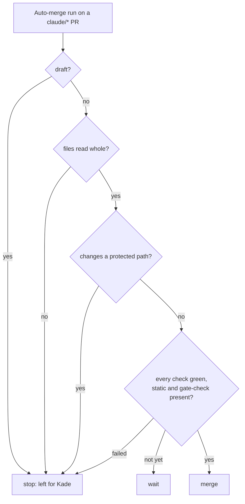

# ADR-030: Auto-merge leaves PRs that change the merge rules or the checks to Kade

- **Status:** Amended by ADR-059
- **Date:** 2026-10-10
- **Related:** ADR-019, ADR-022

## Context

ADR-022 says a change to `auto-merge.yml` acts only after its own merge, "so the PR that adds
it is merged by Kade". Nothing enforced that. PR #16 changed `auto-merge.yml`, and the
Auto-merge workflow already on `main` merged it at 13:56:15Z on 2026-10-10, as soon as its
`static` and `gate-check` checks were green (issue #15).

The same gap covers every check. A `pull_request` workflow runs the copy in the PR, so a PR
that edits `gate-check.yml` or `static.yml` is judged by its own edited check. gate-check runs
its script from `main` (ADR-019), but a PR can still change the workflow that calls it. A
green check on such a PR proves little, and only a person can review it.

## Decision

- **Protected paths.** Auto-merge answers `stop` (left for Kade) when the PR changes any of:
  - `.github/workflows/**`;
  - `scripts/auto_merge_gate.py`, the merge decision (ADR-022);
  - `scripts/gate_check.py`, the gate-check rule (ADR-019).

  The PR's files are read in full from the pull request files API, paginated. A renamed file
  counts under both its old and its new name. If the list cannot be read whole, the answer is
  `stop`.
- **Drafts.** Auto-merge never merges a draft PR; it answers `stop`. It checks this itself
  rather than relying on GitHub refusing the merge.
- **Sessions open a PR that touches a protected path as a draft**, and its description says
  Kade merges it by hand. Kade marks it ready and merges it. Marking a PR ready starts no
  check workflow (`pull_request` runs on opened, synchronize and reopened), so Auto-merge does
  not run on it. Until this ADR's code is on `main`, the PR that brings it relies on GitHub
  refusing to merge a draft: its API documents "still a draft" as a reason a PR cannot be
  merged.
- **Amends ADR-022:** to its merge conditions it adds "the PR is not a draft and changes no
  protected path". Kade's own branches are still merged by hand.

## Diagram

## Alternatives considered

- **A ruleset with CODEOWNERS review on these paths:** GitHub enforces it, but it lives in
  repository settings outside git, which ADR-022 avoids, and it would ask Kade to approve
  instead of merge.
- **Run the checks with `pull_request_target`:** the base branch's workflow would run, but
  with a token that can write, next to the PR's code: GitHub's own warning case.
- **Keep the convention:** it failed in PR #16.

## Consequences

- Workflow and gate-script changes wait for Kade; everything else still merges on green.
- The PR that implements this ADR changes `auto-merge.yml`, so it is opened as a draft and
  merged by Kade. It is the first proof that the Auto-merge on `main` leaves a draft alone.
- A PR that is opened ready by mistake and touches a protected path is still stopped once this
  ADR's code is on `main`.
