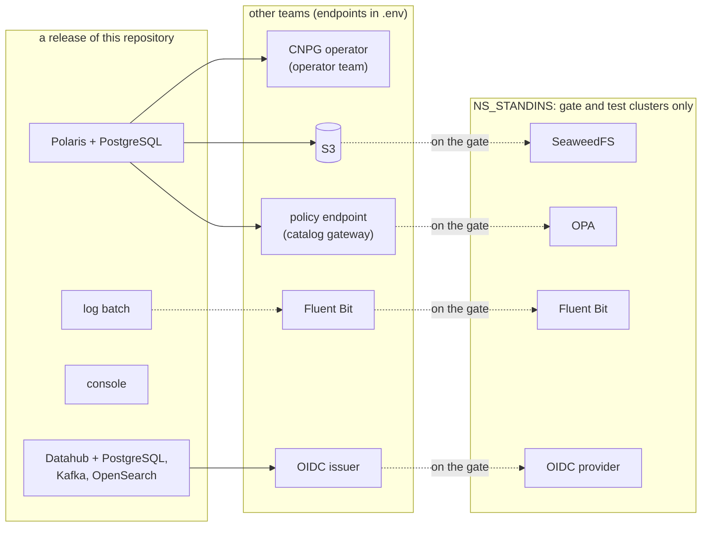

# ADR-031: Other teams' services are interfaces in `.env`; stand-ins only on the gate, SeaweedFS for S3

- **Status:** Proposed
- **Date:** 2026-10-10
- **Related:** ADR-002, ADR-006, ADR-007, ADR-011, ADR-017, ADR-023, ADR-026, ADR-029

## Context

ADR-023 made other teams' services interfaces in `.env`, with stand-ins on the gate, and named
MinIO as the S3 stand-in. ADR-029 has since amended it: the CloudNativePG operator is the
operator team's, not something this repository releases.

MinIO can no longer be the stand-in. Checked on 2026-10-10: `minio/minio` answers 404 on
Docker Hub; its quay.io repository asks for authentication; the `minio/minio` GitHub repository
says "THIS REPOSITORY IS NO LONGER MAINTAINED", and its last tag is
`RELEASE.2025-10-15T17-29-55Z`. Kade chose SeaweedFS from a comparison of four replacements
(2026-10-10).

ADR-023 has already been amended once, so under ADR-000 it is superseded whole. This ADR
restates it, with ADR-029's amendment and the new S3 stand-in.

## Decision

- **This repository builds and releases only:** Polaris with its PostgreSQL (ADR-009,
  ADR-010), the Polaris console (ADR-028), the Polaris log batch (ADR-014, ADR-024), and
  Datahub with its PostgreSQL, Kafka and OpenSearch (ADR-025). The CloudNativePG operator they
  depend on is the operator team's on the target clusters (ADR-029).
- **Every other team's service is an interface**, given by `.env` (ADR-002): the S3 endpoint,
  region and bucket; the policy endpoint (ADR-026); the OIDC issuer for Datahub's login; the
  namespace labels of callers allowed in (ADR-027). Nothing in a release installs or
  configures those services.
- **Credentials for those services are typed into `.env` by hand** (ADR-006), never
  generated: for example the S3 access key Polaris uses.
- **Stand-ins on the gate and on Linux test clusters only:**
  - **S3: SeaweedFS**, the `chrislusf/seaweedfs` image pinned by digest, one pod running
    `weed mini`, which creates the bucket at start; its S3 endpoint listens on port 8333.
  - **Policy endpoint: OPA**, with a test policy (ADR-026).
  - **Log hand-off: Fluent Bit** (ADR-024).
  - **Datahub's login: an OIDC provider.**

  They live in one namespace, `NS_STANDINS` (default `standins`), are installed by the gate's
  own scripts before a release, and are never part of a release. Their credentials are
  generated in the job (ADR-017). Each enters with the first phase that needs it: S3, OPA and
  Fluent Bit with Polaris (P2), the OIDC provider with Datahub (P3).
- **Carried forward from ADR-023:** `NS_STORAGE` and `NS_MONITORING` are not namespaces of
  this repository, and `NS_STANDINS` is (amending ADR-007); the gate installs the stand-ins
  before the release under test (amending ADR-017); object storage is another team's
  (superseding ADR-011). Those ADRs keep the statuses ADR-023 gave them.
- **Supersedes ADR-023.**

## Diagram

## Alternatives considered

- **Garage** (AGPL-3.0, v2.4.1): light, but a node layout and keys must be set up with its
  own commands before the first request.
- **versitygw** (Apache-2.0, v1.8.0): the simplest, an S3 gateway in front of a directory; a
  younger project with fewer users.
- **MinIO built from its last source tag:** frozen, with no security fixes, and a build step
  in every gate run.
- **MinIO's current editions:** distributed under the vendor's own license terms, not as an
  open-source image; the gate of a public repository would depend on terms it does not
  control.

## Consequences

- At acceptance, the living documents that cite ADR-023 (`CLAUDE.md`, `README.md`,
  `docs/plans/roadmap.md`) cite this ADR instead, and the roadmap's MinIO lines say SeaweedFS.
- SeaweedFS is Apache-2.0 (its `LICENSE`, checked 2026-10-10), and its S3 gateway also
  implements STS, which Polaris's credential vending may use on the gate.
- A difference found on a target cluster between SeaweedFS and the real S3 service is a
  finding against the stand-in.
- The smoke gate proves Polaris against SeaweedFS and OPA, not against the real services;
  measurements taken on the gate name the stand-ins they ran against (ADR-015).
