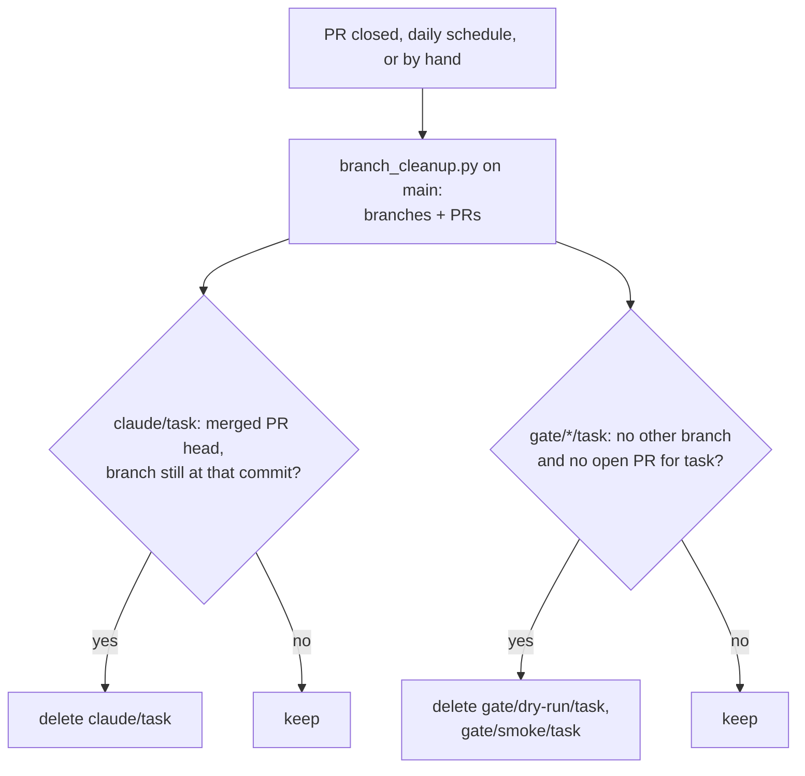

# ADR-032: A cleanup workflow deletes merged `claude/*` branches and their `gate/*` branches

- **Status:** Proposed
- **Date:** 2026-10-10
- **Related:** ADR-018, ADR-019, ADR-022, ADR-030

## Context

Two kinds of branch outlive their work (issue #21):

- **`claude/*` branches of PRs Kade merges by hand.** Auto-merge deletes the branch of a PR it
  merges (ADR-022). A PR it leaves to Kade (ADR-030) is merged without that step, so its
  branch stays. After PR #20, `claude/compassionate-bardeen-fy8atx` stayed.
- **`gate/*` branches.** ADR-018 says the session deletes them once the PR is open. Sessions
  cannot: the ref deletion is refused with HTTP 403. Nothing else deletes them.

The three leftovers were deleted by hand on 2026-10-10. Stella Rain has neither gap: every
`claude/*` PR there merges through its auto-merge workflow, and it has no gate branches.

A merge or a branch deletion made with `GITHUB_TOKEN` starts no workflow run, so a workflow on
`pull_request: closed` sees the PRs Kade merges, but not the ones Auto-merge merges.

## Decision

- **`.github/workflows/branch-cleanup.yml`** runs on `pull_request: closed`, on a daily
  schedule, and by hand (`workflow_dispatch`). Every trigger runs the same sweep over all the
  repository's branches.
- **A `claude/<task>` branch is deleted** when a merged PR has it as its head and the branch
  still points at that PR's head commit. A branch with commits after the merge, or whose PR
  was closed without merging, is kept.
- **`gate/dry-run/<task>` and `gate/smoke/<task>` are deleted** when no other branch has the
  same `<task>` (task as in ADR-019: the branch name without its first segment) and no open PR
  has that task. While `claude/<task>` or `kade/<task>` exists, its gate branches stay, so a
  session can re-push them for the next commit.
- **The decision is a script with tests**, `scripts/branch_cleanup.py`: it reads the branch
  list and the PR list and prints the branches to delete. The workflow runs the copy on
  `main`, never a PR's.
- **The workflow deletes only names under `claude/` or `gate/`**, checked in the workflow
  itself, whatever the script prints. `main`, `rc` and Kade's branches are never touched.
  Only the cleanup job has `contents: write`, and `pull-requests: read` to list the PRs.
- **Amends ADR-018:** "The session deletes them once the PR is open" is replaced by "the
  cleanup workflow deletes them once their task's branch is gone". ADR-022 is unchanged:
  Auto-merge still deletes the `claude/*` branch it merges.

## Diagram

## Alternatives considered

- **GitHub's "Automatically delete head branches" setting:** one click, and it covers hand
  merges of `claude/*`. It does not cover `gate/*`, which are never a PR's head, and it lives
  in settings outside git (ADR-022 avoids those).
- **Auto-merge also deletes the gate branches:** covers only the PRs it merges, and changes
  ADR-022, which is already amended and would have to be superseded whole (ADR-000).
- **`pull_request: closed` only:** misses every PR Auto-merge merges, because its merge uses
  `GITHUB_TOKEN`.
- **Kade deletes them by hand:** what happened on 2026-10-10; three branches after one PR.

## Consequences

- No branch outlives its work by more than a day; a hand-merged PR's branches go at once.
- gate-check still finds the dry-run of a deleted gate branch: it reads runs by branch name
  from the runs API (ADR-019), and runs stay listed after their branch is deleted.
- The PR that brings the workflow changes `.github/workflows/`, so it is a draft Kade merges
  (ADR-030). `scripts/branch_cleanup.py` is not a protected path: a change to it merges on
  green, but the prefix check in the workflow bounds what it can delete.
- Whether the token can delete a ref is proven by the first run after that merge; Auto-merge
  already deletes refs with the same token.
