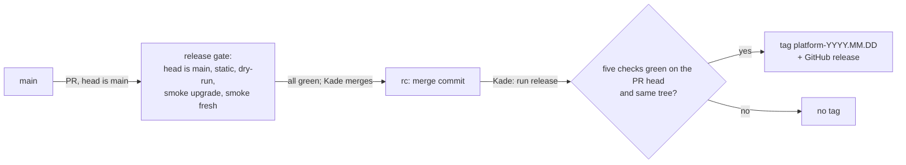

# ADR-033: Release candidates are gated on a PR from `main` into `rc`; the release workflow tags `rc`

- **Status:** Amended by ADR-053
- **Date:** 2026-10-10
- **Related:** ADR-018, ADR-019, ADR-020, ADR-021, ADR-022, ADR-032

## Context

ADR-020 runs the full gate inside the release workflow, on the commit of `main` Kade starts it
on. Planning it showed the gap (2026-10-10): with only the head of `main` releasable, a commit
that passed cannot be released once a later commit fails; accepting any commit means every
gate the release calls needs a ref input. Kade chose the flow of his other repositories
(`stella-rain/core`, ADR-040 there): `main` → `rc` → release, the full gate on the candidate,
and a release that only reads that gate's result. `gate/*` branches stay a tool of Claude
sessions for testing a commit (ADR-018). Kade created `rc` at `eba0e8a` on 2026-10-10.

## Decision

- **`rc` holds release candidates.** It changes only through a PR whose head is `main` of this
  repository, merged by Kade with a merge commit. Nothing is committed to `rc`; a fix found on
  a candidate goes to `main` first and reaches `rc` with the next candidate.
- **The release gate**, `.github/workflows/release-gate.yml`, runs on every PR into `rc`. Its
  check names are fixed, because the ruleset requires them:
  - `the head is main`: fails at once for any other head; the jobs below wait for it;
  - `dry-run / dry-run`: the dry-run gate (ADR-018);
  - `smoke upgrade / smoke`: the smoke gate, upgrading from the latest release tag (ADR-021);
  - `smoke fresh / smoke`: the smoke gate on a fresh install;
  - and `static`, which `static.yml` already runs on every PR.

  The dry-run and smoke workflows are called, not copied; they test the PR's merge result.
- **A ruleset on `rc`** (Kade's setting): a PR is required, merge commits only, the five
  checks above required, no deletion, no force push. A skipped job counts as passed, so
  `the head is main` is required too.
- **The release workflow**, `.github/workflows/release.yml`, is started by Kade by hand on
  `rc` and runs no cluster. For the head commit of `rc` it finds the PR that was merged as
  that commit and requires:
  - each of the five checks to have succeeded on that PR's head commit;
  - the `rc` commit's tree to equal that head's tree, so the tag names what was tested;
  - no `platform-*` tag on the commit yet.

  Then it creates the tag `platform-YYYY.MM.DD` (`.N` appended for a second release that day)
  on the `rc` commit, with a GitHub release listing chart and image versions with digests, the
  gate's Kubernetes version, the PR, and the release gate's run. Only the tagging job has
  `contents: write`.
- **Tags are never moved or deleted;** a tag ruleset on `platform-*` blocks updates and
  deletions (Kade's setting). A problem found later is a new release.
- **Claude sessions** open a PR into `rc` or start the release workflow only when Kade asks
  in that session, and never merge into `rc`.
- **Supersedes ADR-020.**
- **Amends ADR-019:** gate-check runs on every PR except those into `rc`, whose release gate
  runs the dry-run itself.
- **Amends ADR-021:** where it says "the release workflow" installs the latest release tag, read
  "the release gate".
- Auto-merge acts only on `claude/*` heads into `main` (ADR-022) and branch cleanup deletes
  only `claude/` and `gate/` names (ADR-032), so neither touches `rc` or its PRs.

## Diagram

## Alternatives considered

- **ADR-020 as written, the head of `main` only:** a commit that passed cannot be released
  once a later one fails.
- **The release takes any commit of `main` and reruns the gate:** every called gate needs a
  ref input, and no branch records which commit was the candidate.
- **Release from the nightly smoke on `main`:** only one commit a night is smoked, and dry-run
  and the fresh install are not run.
- **Kade tags `rc` by hand, as in `stella-rain/core`:** nothing would check that the tagged
  commit is the one that passed the gate; ADR-020's reason for a tagging workflow stands.

## Consequences

- Every release names a PR into `rc` whose gate proved it, and releasing takes seconds.
- `rc` keeps the last candidate that passed, whatever `main` does after it.
- Kade sets two rulesets: on `rc`, and on `platform-*` tags.
- `release-gate.yml` and `release.yml` run only after their merge: the first candidate PR
  proves the gate, the first release proves the workflow.
- The gates must upgrade from a tag before the first release (ADR-021): today they stop when
  a `platform-*` tag exists. That ships in the same PR as the release workflow.
