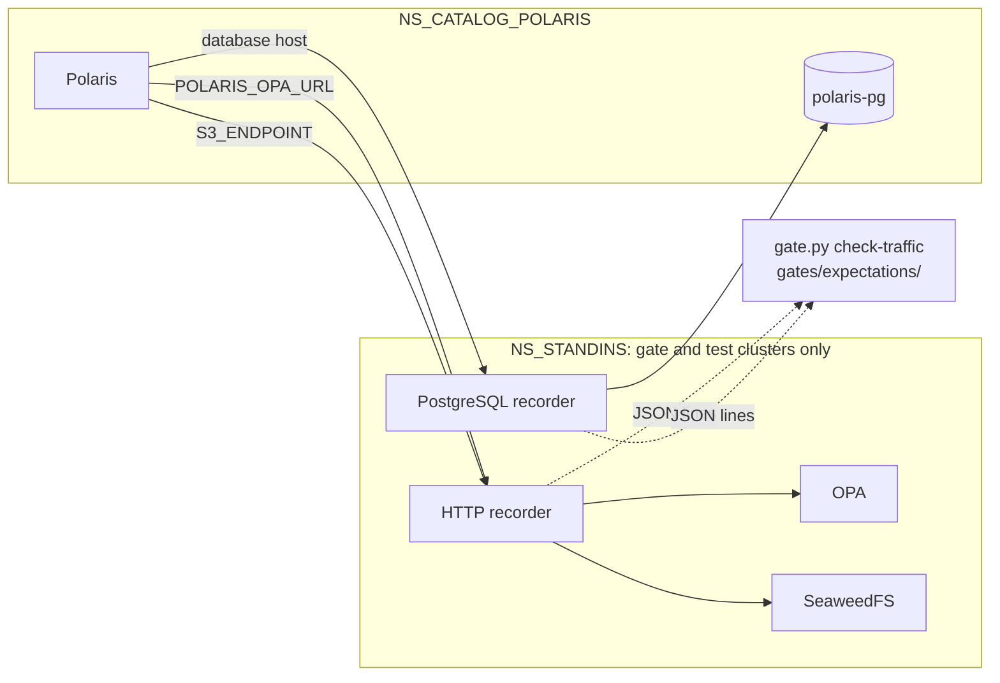

# ADR-034: Recording proxies on the gate prove each of Polaris's connections and its exchanges

- **Status:** Proposed
- **Date:** 2026-10-11
- **Related:** ADR-002, ADR-008, ADR-017, ADR-018, ADR-026, ADR-027, ADR-029, ADR-031

## Context

Polaris depends on three services it reaches over the network: its PostgreSQL (ADR-008), the
S3 endpoint and the policy endpoint (ADR-026, ADR-031). On the gate the last two are stand-ins
(SeaweedFS and OPA). ADR-029 has the install check that the S3 and policy endpoints answer
before Polaris starts. That check proves an endpoint is up; it does not prove that Polaris
connected to it, nor what Polaris asked and what it was told. A smoke test that passes could
still hide a wrong bucket, a policy query with the wrong input, or a statement that failed and
was retried.

Kade asked (2026-10-11) for a middleware between each pair of services, so that a check proves
the connection itself: A sends to the middleware, the middleware forwards the whole request to
B, B answers the middleware, the middleware returns the answer to A, and the test reads what
the middleware saw and checks that the expected exchanges are there.

Options weighed with Kade on 2026-10-11:

- **HTTP:** our own proxy on Python's standard library, mitmproxy in reverse mode, or Envoy
  with its tap filter. Kade chose our own.
- **PostgreSQL:** Pgpool-II between Polaris and PostgreSQL on the gate only (the archive ran
  Pgpool-II in front of its database: `enjay27/lakehouse-k8s` `charts/postgresql/values.yaml`
  at `09a4773`), our own proxy for PostgreSQL's wire protocol, or PostgreSQL's own statement
  log. Kade chose our own proxy.

## Decision

- **Recording proxies ("recorders") run on the gate and on Linux test clusters only**, in
  `NS_STANDINS`, installed by the gate's own scripts with the stand-ins and never part of a
  release (ADR-031). A release does not change: on a target cluster `.env` names the real
  services, and Polaris reaches them directly.
- **Three connections are recorded**, each through its own recorder port:

  | From | Recorder | To |
  |---|---|---|
  | Polaris | HTTP | the policy endpoint (OPA stand-in) |
  | Polaris | HTTP | the S3 endpoint (SeaweedFS stand-in) |
  | Polaris | PostgreSQL | `polaris-pg`'s read-write service |

  On the gate, `.env` points Polaris at the recorder: `POLARIS_OPA_URL`, `S3_ENDPOINT`, and
  the database host Polaris connects to. That host is taken from `.env` like the other two;
  its default is the `Cluster`'s read-write service.
- **Our own code, Python's standard library only**, under `gates/recorder/`, unit-tested in the
  static gate (ADR-018). It runs from the official Python image pinned by digest, with the
  script mounted from a ConfigMap, so no image is built.
- **Forwarding is transparent.** Every request and response passes unchanged, in both
  directions: every header (`Host`, `Authorization`, `x-amz-security-token` included), every
  body, every PostgreSQL message, authentication included. So S3 signatures, OPA queries and
  SCRAM logins work through the recorder exactly as without it. HTTP/1.1 is handled with
  `Expect: 100-continue` and chunked bodies, which the S3 client sends.
- **PostgreSQL over TLS:** when the client asks for TLS, the recorder accepts it with a
  certificate generated in the gate job (ADR-017), and opens TLS to PostgreSQL in turn. A
  client that verifies the server's certificate (`verify-ca`, `verify-full`) cannot pass
  through the recorder; if Polaris's chart chooses one, that is a finding to decide then.
- **One record per exchange, one JSON line on the recorder's stdout**, read with
  `kubectl logs`:
  - **HTTP:** time, recorder port, method, path and query, status, duration, request and
    response headers, and each body: a JSON body up to 64 KiB in full (so OPA's input and
    decision are complete), any other body as its length and sha256.
  - **PostgreSQL:** one record per statement: time, user, database, application name, the SQL
    text, the number of bind parameters, the result's column names and row count, the
    command tag, or the error's severity, SQLSTATE and message.
- **The record never holds a credential or a stored value**, because Actions logs are public
  (ADR-002). Removed from the record only, never from what is forwarded:
  - HTTP: the `Authorization`, `Proxy-Authorization`, `x-amz-security-token`, `Cookie` and
    `Set-Cookie` headers, and the `X-Amz-Credential`, `X-Amz-Signature` and
    `X-Amz-Security-Token` query parameters, shown as `<redacted>`.
  - PostgreSQL: every authentication message, every bind parameter value, every row value,
    and an error's detail field (it can quote key values). Polaris writes principals' secret
    hashes and salts as bind parameters, and reads them back as rows.
- **`gates/gate.py check-traffic`** reads the records and matches them against expectation
  files in `gates/expectations/`. An expectation names an exchange that must exist (for
  example: OPA answered allow for root; OPA answered deny for the ordinary principal on an
  action it was not granted; S3 answered 200 to a `PUT` of a `metadata.json`; PostgreSQL
  completed an insert into `entities`), or one that must not (an S3 403, a PostgreSQL
  authentication failure). The smoke gate fails when an expectation does not hold. Its output
  names each expectation and the number of records that matched, never a body.
- **ADR-029's check that the endpoints answer stays**, on every cluster. On the gate it goes
  through the recorder, so it is recorded too.
- **Amends ADR-027:** `NS_STANDINS` is a namespace of this repository, so it also gets a
  default-deny ingress policy. On the gate and test clusters only:

  | Target | Port | Allowed from |
  |---|---|---|
  | The recorders | their ports | Polaris's namespace; the gate's check pods |
  | SeaweedFS, OPA | their ports | the recorders; the gate's check pods |
  | Polaris's PostgreSQL | 5432 | also the PostgreSQL recorder |

- **Amends ADR-031:** `NS_STANDINS` also holds the recorders, and on the gate the endpoints in
  `.env` name the recorders, not the stand-ins.

## Diagram

## Alternatives considered

- **mitmproxy in reverse mode:** mature HTTP handling, but a large image to pin and follow, our
  own addon for the record format anyway, and it must be told to keep the `Host` header for S3
  signatures to hold.
- **Envoy with its tap filter:** production-grade, but its configuration is large and its tap
  output is the hardest to write expectations against.
- **Pgpool-II on the gate only:** it logs every statement, but it is not transparent: it parses
  and routes SQL and does its own authentication (SCRAM through it needs `pool_passwd`). The
  gate would then reach PostgreSQL differently from a target without a pooler, and whether the
  target has one is still open (issue #9).
- **PostgreSQL's own statement log** (`log_statement`, gate only): no component in the path,
  but it records statements without their results, from the server's side only, in a second
  format.
- **Each stand-in's own log** (OPA's decision log, SeaweedFS's audit log): one format per
  service, no record for PostgreSQL, and nothing proven about the Polaris side.

## Consequences

- On the gate, a smoke run proves for each connection that Polaris opened it, what it sent and
  what it was answered; with the smoke tests' own results (a refused request answered 403),
  it proves the whole loop.
- The recorded OPA inputs are the request Polaris actually sends, so the gate can check them
  against `docs/contracts/polaris-opa-input.md` at every Polaris upgrade (ADR-026).
- Not proven by the recorders: anything on a target cluster, TLS to the real services, and
  the real network path. Those stay with the install on a Linux test cluster.
- The recorders are code this repository maintains: an HTTP or wire-protocol case they get
  wrong fails the gate, not a release, and is fixed with a unit test first.
- Each later stand-in that a service of this repository calls over HTTP (Datahub's OIDC
  provider, P3) can be recorded by adding a recorder port; the log batch's hand-off to Fluent
  Bit is a file and is not recorded.
