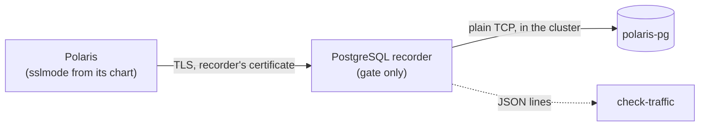

# ADR-035: The PostgreSQL recorder ends the client's TLS and talks plain TCP to PostgreSQL

- **Status:** Proposed
- **Date:** 2026-10-11
- **Related:** ADR-017, ADR-026, ADR-034

## Context

ADR-034 puts a recorder between Polaris and its PostgreSQL on the gate, and says: "when the
client asks for TLS, the recorder accepts it with a certificate generated in the gate job, and
opens TLS to PostgreSQL in turn."

PostgreSQL logs in with SCRAM. Over TLS, libpq and pgjdbc bind SCRAM to the server's TLS
certificate by default (`channel_binding=prefer`, mechanism `SCRAM-SHA-256-PLUS`). Channel
binding exists to detect exactly what ADR-034 describes: a middlebox that ends TLS and opens
its own. The client binds to the recorder's certificate; PostgreSQL checks against its own.

Measured on 2026-10-11 with PostgreSQL 16.15 (local server, `ssl = on`, `scram-sha-256` in
`pg_hba.conf`) and the recorder of `gates/recorder/proxy.py` at commit `7a898e4`:

| Path | psql options | Result |
|---|---|---|
| directly to PostgreSQL | `sslmode=require` | logs in |
| recorder, TLS on both sides (ADR-034) | `sslmode=require` | **FATAL: SCRAM channel binding check failed** (28000) |
| recorder, TLS on both sides | `sslmode=require channel_binding=disable` | logs in |
| recorder, TLS on both sides | `sslmode=disable` | logs in |
| recorder ends TLS, plain TCP to PostgreSQL | `sslmode=require` | logs in |
| recorder ends TLS, plain TCP to PostgreSQL | `sslmode=require channel_binding=require` | refused by the client: the server offered no channel binding |

With plain TCP behind the recorder, PostgreSQL does not offer `SCRAM-SHA-256-PLUS`, and a
client that only prefers channel binding logs in without it (Kade's choice, 2026-10-11).

## Decision

- **On the gate and test clusters, the PostgreSQL recorder ends the client's TLS** with the
  certificate generated in the gate job, and **connects to PostgreSQL over plain TCP** inside
  the cluster. It answers the client's `SSLRequest` itself and never forwards it; without a
  certificate it answers no.
- **Amends ADR-034:** this replaces only its rule "opens TLS to PostgreSQL in turn". Everything
  else in ADR-034 stands.
- **A client that requires channel binding (`channel_binding=require`) or verifies the server's
  certificate (`verify-ca`, `verify-full`) cannot pass through the recorder.** If Polaris's
  chart chooses either, it is a finding to decide then. It is not hidden by a gate-only
  setting (ADR-017).
- The recorder's `tls` field in a `connect` record means TLS between the client and the
  recorder.

## Diagram

## Alternatives considered

- **TLS on both sides (ADR-034 as written):** every login with the default
  `channel_binding=prefer` fails, as measured above.
- **`channel_binding=disable` in Polaris's connection on the gate only:** a difference from the
  release's settings that hides how Polaris really logs in (ADR-017).
- **The recorder refuses TLS:** works only while Polaris accepts plain connections; if its
  chart requires TLS (`sslmode=require`), the gate cannot run it.

## Consequences

- On the gate, PostgreSQL receives the recorder's connections without TLS, so its
  `pg_hba.conf` must allow them; CloudNativePG's default rules are expected to. The smoke gate
  proves it.
- On a target cluster nothing changes: Polaris reaches PostgreSQL directly, with whatever TLS
  and channel binding its chart sets.
