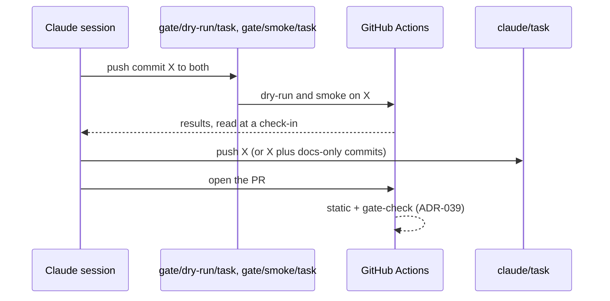

# ADR-038: Dry-run and smoke gates run from throwaway `gate/*` branches on the PR's exact commit, before the PR opens

- **Status:** Accepted
- **Date:** 2026-10-11
- **Related:** ADR-016, ADR-017, ADR-018, ADR-021, ADR-032, ADR-033, ADR-039

## Context

ADR-018 put the kind gates on throwaway `gate/*` branches: a Claude session has no `helm` and
no cluster, and a kind cluster with the stack takes minutes, too much for every push. ADR-032
amended it (the cleanup workflow, not the session, deletes the gate branches), so ADR-018 can
only be superseded whole (ADR-000). Issue #53 needs it changed again:

- Its table says smoke does not block a merge. ADR-039 makes smoke block platform PRs.
- Its flow pushes `claude/<task>` and opens the PR before the gates finish. gate-check then
  failed on #49, #51 and #52 as soon as each PR opened, because the dry-run on the same commit
  (70-80 s) had not finished. Each needed one re-run. #56 put the order below in `CLAUDE.md`.
  #57 followed it and gate-check passed at once.

This ADR restates ADR-018 with ADR-032's change and these two changes. What blocks a merge
moves to ADR-039, so the two can change on their own.

## Decision

| Level | Runs on | What |
|---|---|---|
| **static** | every push to `claude/**`, every PR | lint, `helm template`, kubeconform with the CRD schemas in use (CNPG), rendered-output assertions (ADR-016), unit tests, repository checks |
| **dry-run** | push to `gate/dry-run/<task>` | kind (ADR-017); install the last release (ADR-021); server-side dry-run of the upgrade |
| **smoke** | push to `gate/smoke/<task>`; nightly on `main` | kind; install the last release; real upgrade; wait for readiness; smoke tests |

- Which of these block a merge, and how, is ADR-039's. The release gate calls dry-run and
  smoke on PRs into `rc` (ADR-033).
- `<task>` matches `claude/<task>`. A session pushes **the same commit** it opens the PR from:
  `git push origin HEAD:refs/heads/gate/dry-run/<task>`, and the same to `gate/smoke/<task>`.
- `gate/*` branches are throwaway: force-push and deletion are allowed there; they are never
  opened as a PR or merged. The cleanup workflow deletes them once their task's branch is
  gone (ADR-032).
- A newer push to a gate branch cancels the older run.
- Gate workflows: `permissions: {}` at the top, `contents: read` per job, no repository
  secrets, actions pinned to a major version with `persist-credentials: false`.
- **Flow:** push commit X to `gate/dry-run/<task>` and `gate/smoke/<task>` → wait with a
  scheduled check-in → on failure fix and push again (at most two self-corrections) → once
  both pass, push `claude/<task>` and open the PR, or push the new head of a PR already open,
  with each gate's commit and run link under *Verified*. A later docs-only commit needs no new
  gate run (ADR-039).
- **Supersedes ADR-018.**

## Diagram

## Alternatives considered

- **Every gate on every PR:** minutes of kind per push.
- **`workflow_dispatch` on the PR branch:** no extra branches, but needs the GitHub API; a
  push works from any session that can push.
- **PR labels:** the PR must exist first, and labelling needs the API too.
- **Open the PR first, re-run gate-check when the gates finish:** what happened on #49, #51 and
  #52; one manual re-run per PR.

## Consequences

- Sessions get real gate results without a cluster of their own.
- A PR opens about 6 minutes after its commit is pushed (smoke's run time), not at once.
- GitHub lists a gate branch's runs among the checks of a PR with the same commit (seen on
  #57); nothing relies on it: ADR-039 reads the runs by branch.
