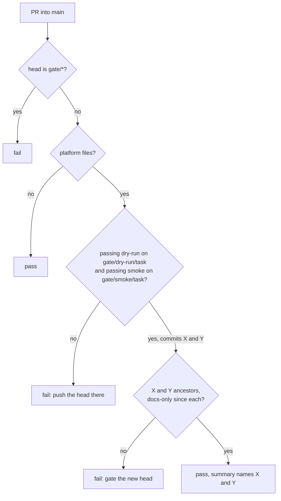

# ADR-039: A platform PR merges only when passing dry-run and smoke gates cover its head

- **Status:** Amended by ADR-040
- **Date:** 2026-10-11
- **Related:** ADR-019, ADR-022, ADR-028, ADR-030, ADR-033, ADR-038

## Context

ADR-019 added gate-check: a required job that lets a platform PR merge only when a passing
dry-run covers its head. GitHub's branch protection cannot require a check only for some
paths: a required check that does not run blocks the PR forever. ADR-019 left smoke advisory
and said that making it required is an amendment. ADR-033 amended it (PRs into `rc` are
skipped), so ADR-019 can only be superseded whole (ADR-000).

Issue #53: smoke being advisory let #51 merge before its smoke result was in; nothing on the PR
said whether smoke had passed. The dry-run proves the upgrade renders and applies; only smoke
proves the stack runs (Polaris, the stand-ins, PyIceberg, the log batch, the recorder). Kade
asked (2026-10-11) for gate-check to require smoke as it requires the dry-run.

This ADR restates ADR-019 with ADR-033's change and the smoke requirement.

## Decision

A job **gate-check** runs on every PR except those into `rc`, whose release gate runs the
dry-run and smoke itself (ADR-033), and is required. It:

1. Fails if the head branch starts with `gate/`.
2. Passes if the PR changes no **platform file** (`charts/**`, `images/**`, `install/**`,
   `gates/**`, the gate workflows).
3. Otherwise, for each of **dry-run** (`gate/dry-run/<task>`) and **smoke**
   (`gate/smoke/<task>`), finds the latest successful run of that workflow on that branch
   (Actions API, `actions: read`) and its commit `X`.
4. Passes only if, for both, `X` is an ancestor of the head and everything changed since `X` is
   documentation (`*.md`). The two may cover the head from different commits.
5. Writes which commits and runs it relied on to the job summary.

A smoke run passes with a failed console step: those steps never block (ADR-028), and smoke's
last step warns of any that failed.

**Supersedes ADR-019.**

## Diagram

## Alternatives considered

- **Trust the PR description:** nothing checks the link covers the merged commit.
- **Require head = gated commit:** recording the result in docs would need a second gate run.
- **Keep smoke advisory (ADR-019):** a PR can merge with a broken stack; #51 did before its
  result was in.
- **Require only the nightly smoke on `main`:** finds a break after the merge, not before.

## Consequences

- Platform PRs cannot auto-merge without a dry-run and a smoke of what they merge.
- A platform PR waits about 6 more minutes (smoke's run time) before it can merge.
- A smoke that fails for a reason outside the PR blocks platform merges until it is fixed or
  re-run. Non-platform PRs are not affected.
- gate-check gains `gate/smoke/<task>` in `scripts/gate_check.py` and its tests, a change Kade
  merges by hand (ADR-030), only once this ADR is Accepted.
- If listing runs by branch proves unreliable, the fallback is a run ID in the PR description
  that the job verifies.
