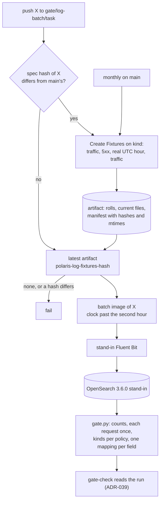

# ADR-040: Log batch fixtures come from a real UTC roll; a Log Batch Gate ships them into an OpenSearch stand-in

- **Status:** Proposed
- **Date:** 2026-10-11
- **Related:** ADR-002, ADR-009, ADR-024, ADR-030, ADR-031, ADR-032, ADR-036, ADR-038, ADR-039

## Context

ADR-036 §7 proves the batch on the smoke gate: traffic to both replicas, the batch run with its
clock past the current hour, a stand-in Fluent Bit reading the outputs. Two things it cannot
reach (#54):

- **The hourly roll.** Smoke ends within minutes of its traffic, so Polaris never crosses a
  UTC hour and never writes a `.yyyy-MM-dd-HH.gz`. The batch's selection across a roll and the
  current file (ADR-036 §4) is proven only by unit tests on files the tests write.
- **The `exception` field.** Polaris writes it only on a 5xx answer. A 5xx on smoke trips the
  recorder's must-nots (ADR-034), so smoke sends none (#60). Its shape was measured locally
  (#59).

Neither is a property of one run: rolled files never change once written, so files captured
once stay valid until what made them changes. Branch `claude/batch-roll-fixture` (aa38b9d,
on hold) captured them once and committed them:

- each pod rolled to `.2026-10-11-17.gz`;
- a 500 (the catalog's S3 endpoint not answering) wrote an `ERROR` line whose `exception`
  carries `suppressed`, about 40 KB.

It turned the JVM's clock (`-Duser.timezone=GMT+00:37`) to roll within minutes, ran two plain
containers rather than the release, and committed files that nothing ties to the Polaris they
came from.

Nothing on the gate reads the outputs as the observability team's OpenSearch would: the
stand-in Fluent Bit checks each line against the contract's schema (ADR-024), not that a
document is indexed, nor that the fields keep one mapping across lines (`mdc`,
`http_status`, the nested `exception`).

Kade's design and choices, 2026-10-11 (#61):

- a **Create Fixtures** workflow crossing a real UTC hour, its files a workflow artifact with a
  manifest and a spec hash, nothing committed;
- a **Log Batch Gate** workflow: the batch over the latest fixtures, a stand-in Fluent Bit, an
  **OpenSearch stand-in**, the official image at 3.6.0;
- triggers computed from the branch's diff, not from `on.paths`;
- the gate on a **separate gate branch**, `gate/log-batch/<task>`;
- the spec: `gates/logs_traffic.sh`, Polaris's image and its `quarkus.log.file.*` settings;
- a **monthly** Create Fixtures run, so an artifact outlives the 90-day expiry.

ADR-038 and ADR-039 are Accepted and not amended, so this ADR amends them. ADR-031 (amended by
ADR-034) and ADR-036 (amended by ADR-037) could only be superseded whole; this ADR changes
neither, see §6.

## Decision

### 1. The fixture spec and its hash

- **The spec files:**
  - `gates/logs_traffic.sh`, the requests sent;
  - the Create Fixtures workflow and the capture code it runs;
  - in `charts/polaris/values-lakehouse.yaml`: Polaris's image (tag and digest), the
    `quarkus.log.file.*` settings and `TZ`.
- **The spec hash** is the SHA-256 over those, defined once in `gates/` code, unit-tested in
  the static gate. Only the named values of `values-lakehouse.yaml` enter it, so another
  change to Polaris's values keeps the fixtures.

### 2. Create Fixtures (workflow)

- **Where:** on kind, as smoke builds it (ADR-017, ADR-031): the stand-ins, then this commit
  installed fresh with `install/release.py`. So the files are a release's: two pods on two
  nodes, the chart's rendered appender settings, `TZ=UTC`, the `polaris-logs` claim.
- **What:**
  1. `gates/logs_traffic.sh` against both pods;
  2. one request answered 5xx on each pod: a table made in a catalog whose S3 endpoint does not
     answer, so the fixtures carry `exception`;
  3. a wait for the next **real UTC hour** plus 60 s, at most 60 minutes;
  4. the same traffic again, under its own request ID prefix, which rolls each pod's file to
     `.yyyy-MM-dd-HH.gz` exactly as in a release;
  5. the claim's files copied from the runner's shared directory (`gates/kind.yaml`).
- **The artifact** `polaris-log-fixtures-<spec hash>`, kept 90 days:
  - each pod's rolls and current file, as written;
  - `manifest.json`: the spec hash, the commit, Polaris's image, the hour crossed, the request
    ID prefixes, and each file's SHA-256, size and mtime.
- **No recorder check runs:** the 5xx is wanted here.
- **When:** called by the Log Batch Gate when the spec changed (§4); monthly on `main`, at a
  minute that keeps the wait short; and by `workflow_dispatch`.

### 3. Log Batch Gate (workflow)

- **Where:** containers on the Actions runner, on one Docker network; no cluster. What it
  proves is the files' path from the batch to an index, which needs no node.
- **What:**
  1. Downloads the artifact named for the checkout's spec hash, from this run when Create
     Fixtures ran in it, else the latest unexpired one (`actions: read`). It fails when none
     exists, and refuses one whose manifest's spec hash, or any file's SHA-256, differs.
  2. Restores each file's mtime from the manifest, then runs the batch's image, built from this
     checkout, over a copy, its clock set past the second hour captured. Both hours are
     published: the first from the rolls, the second from the current files. The Kubernetes API
     does not answer, so no current file moves (ADR-036 §4).
  3. The stand-in Fluent Bit (`gates/pins.json`) reads `processed-logs/` and
     `aggregated-logs/` and ships them to the OpenSearch stand-in, one index per output. It
     keeps the records OpenSearch refuses and reports them.
  4. `gates/gate.py` checks OpenSearch:
     - every output line is a document: each index's count equals its files' lines, and no
       record was refused;
     - each request appears once, in the hour of its timestamp, across the roll;
     - counts per request kind as the audit policy says (contract v2), as `check-logs` counts
       them on smoke, the 5xx kept with its `exception`;
     - one mapping per field: `mdc`, `http_status` and `exception` (with `causedBy` and
       `suppressed`) each map one way in every index, and no field limit is reached.

### 4. Triggers, from the diff

- **The workflow `log-batch.yml`** runs on a push to `gate/log-batch/<task>`. Its first job
  reads `git diff origin/main...HEAD` and the spec hash on both sides:
  - **the spec changed** → Create Fixtures, then the Log Batch Gate on its artifact;
  - **else** → the Log Batch Gate on the latest artifact for the spec hash.
- **The batch files:** `images/polaris-log-batch/**`, `charts/polaris-log-batch/**` and
  `docs/contracts/**`. With the spec files, they are what makes gate-check require this gate
  (§5).
- A newer push to the branch cancels the older run (ADR-038).

### 5. Amends ADR-038 and ADR-039

- **ADR-038**, its table gains a level:

  | Level | Runs on | What |
  |---|---|---|
  | **log-batch** | push to `gate/log-batch/<task>`; Create Fixtures monthly on `main` | Create Fixtures when the spec changed; the Log Batch Gate |

  Its flow: when the PR changes a batch file or a spec file, the session also pushes commit X
  to `gate/log-batch/<task>`, and opens the PR only once all three gates passed. The same
  workflow rules apply: `permissions: {}`, `contents: read` per job, `actions: read` only for
  the job that downloads the artifact, no repository secrets.
- **ADR-039**, gate-check's steps 3 and 4: when the PR changes a **batch file** or a **spec
  file** (§1, §4; by path, `charts/polaris/values-lakehouse.yaml` whole), gate-check also
  finds the latest successful `log-batch.yml` run on `gate/log-batch/<task>`, and passes only
  if its commit is an ancestor of the head with only `*.md` changed since. A PR changing only
  `docs/contracts/` is not a platform PR, so it needs this gate alone.

### 6. The OpenSearch stand-in

- `opensearchproject/opensearch:3.6.0`, pinned by digest in `gates/pins.json`; one node,
  `discovery.type=single-node`, the security plugin and its demo configuration off, a 512 MB
  heap. It listens only on the runner's Docker network and holds no credential.
- It runs with OpenSearch's defaults, dynamic mapping, no index template: the observability
  team's version and template are unknown (#9), and templates are theirs (ADR-024). Once they
  are known, the stand-in copies them.
- It stands in for the observability team's OpenSearch, not Datahub's (ADR-025).
- **ADR-031** keeps its rules: stand-ins are never part of a release, are pinned, and are
  started by the gate's own scripts. This one runs on the runner, outside any cluster, so
  `NS_STANDINS` and ADR-034's ingress policies do not reach it.
- **ADR-036 §7** stays: smoke still proves the batch on kind across nodes, and this gate
  adds the roll, `exception` and the index.

## Diagram

## Alternatives considered

- **Fixtures committed to git** (`claude/batch-roll-fixture`): nothing ties them to the Polaris
  they came from, and a public repository keeps every version. Kade chose artifacts.
- **A turned JVM clock:** rolls within minutes, but under a zone a release never has.
- **The roll on smoke:** up to 60 minutes added to every platform PR, to prove files that do not
  change between runs.
- **Triggers from `on.paths`:** cannot tell a spec change from a change to the batch, and a
  skipped workflow leaves gate-check nothing to read.
- **The Log Batch Gate as a step of smoke:** every platform PR would wait on it, and a batch
  change would wait on the whole stack. Kade chose a separate gate branch.
- **The Log Batch Gate on kind:** adds a cluster and a heavy OpenSearch pod to what needs
  neither.
- **An OpenSearch-compatible lighter server:** its mapping rules are not OpenSearch's, and
  mapping is what the gate checks. Kade chose the official image.

## Consequences

- **#54's roll and `exception` items** are proven by a gate, from a release's own files, on
  every PR that changes the batch or what the fixtures are made from.
- **A spec change waits up to about 60 minutes** for the real hour; a batch change waits only
  for the Log Batch Gate.
- **If the monthly run fails** and the artifact expires, every batch PR fails at the download
  until Create Fixtures is run by hand.
- **`log-batch.yml` and the Create Fixtures workflow run on gate branches and `main`, not on
  PRs,** so they do not join `auto-merge.yml`'s list; gate-check, which does, reads them.
- **Code follows once this ADR is Accepted,** after ADR-039's smoke requirement (#53):
  - the workflows, the capture and check code, the pin, and the contract's measured wording on
    `suppressed` and the 500's `ERROR` line from `claude/batch-roll-fixture`;
  - gate-check's log-batch requirement in `scripts/gate_check.py` and its tests;
  - `scripts/branch_cleanup.py` deleting `gate/log-batch/<task>` with the others (ADR-032).

  Each changes `.github/workflows/` or `scripts/gate_check.py`, so each is a draft Kade
  merges by hand (ADR-030). Then `claude/batch-roll-fixture` and its gate branches go.
- **The fixtures stand in for production lines** only as far as the traffic in
  `gates/logs_traffic.sh` reaches; a new kind of request enters there and changes the spec.
