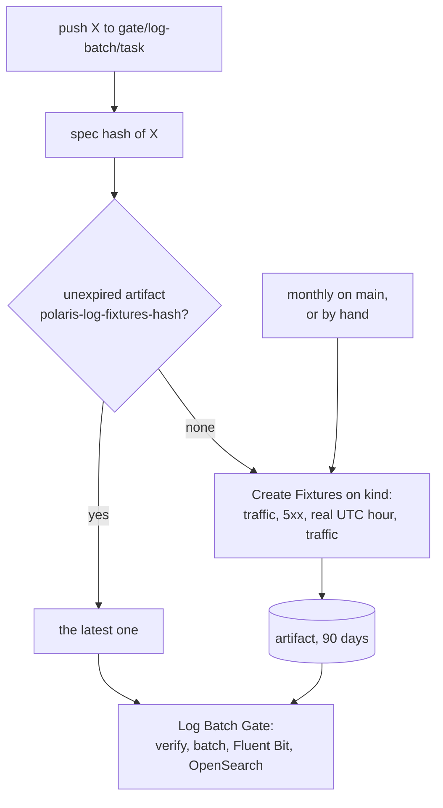

# ADR-041: The Log Batch Gate creates fixtures only when no unexpired artifact holds their spec hash

- **Status:** Proposed
- **Date:** 2026-10-11
- **Related:** ADR-030, ADR-038, ADR-040

## Context

ADR-040 §4 decides whether `log-batch.yml` runs Create Fixtures by comparing the branch with
`main`: when the fixture spec changed, it creates fixtures; otherwise it uses the latest
unexpired artifact for the spec hash.

While a PR changes the spec, that comparison stays true on every push. So every push to
`gate/log-batch/<task>` creates fixtures again and waits up to about 60 minutes for a real UTC
hour, even when an artifact for the same spec hash already exists. #66 did this twice for one
spec hash: runs 38165411360 and 38166538010 (#67).

The artifact is named for the spec hash, and the gate already refuses one whose manifest or
files differ from it (ADR-040 §3). An unexpired artifact with this hash is therefore exactly
what a new capture would make.

The comparison also leaves expiry uncovered. When the monthly run fails, or GitHub disables
its schedule, the artifact expires, and every batch PR fails at the download until someone runs
Create Fixtures by hand (ADR-040, Consequences).

Kade's choice (2026-10-11, #67): create fixtures only when no unexpired artifact exists.

## Decision

- **Replaces ADR-040 §4's first bullet.** The first job of `log-batch.yml` computes the spec
  hash of the checkout and looks up an unexpired artifact `polaris-log-fixtures-<spec hash>` in
  this repository:
  - **none** → Create Fixtures, then the Log Batch Gate on its artifact;
  - **one or more** → the Log Batch Gate on the latest of them.

  The job needs `actions: read`. It still reports, in the step summary only, whether the spec
  changed against `main`. Nothing depends on that line.
- **Replaces in ADR-040 §2,** under *When*, "called by the Log Batch Gate when the spec changed
  (§4)": called by the Log Batch Gate when no unexpired artifact exists for the spec hash.
- **Replaces in ADR-040 §5** the cell of ADR-038's table "Create Fixtures when the spec
  changed": Create Fixtures when no unexpired artifact exists for the spec hash.
- **Unchanged from ADR-040:**
  - the spec files and their hash (§1);
  - the artifact and its manifest (§2);
  - the gate's download and `verify` (§3);
  - the monthly run on `main`, and `workflow_dispatch` for a fresh capture on demand;
  - gate-check's requirement by path (§5).
- **Who can make an artifact is unchanged:** only a push to this repository's gate branches or
  `main`, or a run started by hand. ADR-040 §3 already reuses any such artifact when the spec is
  unchanged.
- **The workflow change** is a draft Kade merges by hand (ADR-030).

## Diagram

## Alternatives considered

- **Keep ADR-040 §4 as it is:** every push of a PR that changes the spec waits up to about 60
  minutes, and an expired artifact fails every batch PR until someone runs Create Fixtures by
  hand.
- **Reuse an artifact only when it has some days left before it expires:** that adds a tuning
  value to guard a window of minutes, the time between the lookup and the download. If the
  artifact expires within that window, the gate fails, and the next push creates fixtures.
- **Drop the monthly run, now that expiry repairs itself:** a batch PR after 90 quiet days
  would then wait up to 60 minutes. The monthly run keeps that wait rare and costs one capture
  a month.

## Consequences

- **A PR that changes the spec** waits for the real hour on its first push to
  `gate/log-batch/<task>` only. Later pushes reuse that capture while the spec hash stays the
  same.
- **The fixtures expire after 90 days without a capture** (the monthly run failed, or GitHub
  disabled its schedule). The next batch PR then creates new fixtures and waits up to 60
  minutes, instead of failing. ADR-040's consequence "every batch PR fails at the download
  until Create Fixtures is run by hand" no longer holds.
- **Fresh fixtures for an unchanged spec** come from the monthly run or a run by hand, never
  from a push.
- **Code follows once this ADR is Accepted:** `log-batch.yml`'s first job and its header
  comment. `gates/fixtures.py` keeps the spec hash and `changes`, which now only feeds the
  summary.
- ADR-040 becomes "Amended by ADR-041" when this ADR is accepted.
