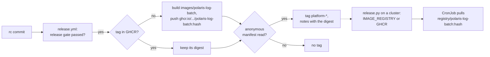

# ADR-042: The release workflow pushes the log batch's image to GHCR; clusters pull it from a registry named in `.env`

- **Status:** Accepted
- **Date:** 2026-10-12
- **Related:** ADR-002, ADR-004, ADR-028, ADR-030, ADR-033, ADR-036, ADR-037

## Context

ADR-036 §3 builds the log batch's image from this repository (`images/polaris-log-batch`). Its
tag is the first 12 hex digits of a SHA-256 over the files that go into it
(`install/release.py batch_image`), and the chart pins that tag
(`charts/polaris-log-batch/values.yaml`). On the gate, the image is built and loaded into kind
(`gates/gate.py batch-image`). ADR-036 left open how a release publishes it: "decided with the
first release".

On a target cluster, `release.py` step 2 installs the CronJob (ADR-037), but nothing puts the
image where the cluster can pull it. The install's read-back checks only the image the
CronJob names, so the install would pass, and the first hourly run would then fail to pull
the image (#55).

Kade's direction (2026-10-12, #55): a registry, the GitHub Container Registry if it fits,
Docker Hub otherwise. GHCR fits:

- **No new credential.** A workflow pushes with its own `GITHUB_TOKEN`, given
  `packages: write` for that one job. No account, no stored secret (ADR-006).
- **Public images pull without logging in.** Docker Hub rate-limits anonymous pulls, and an
  earlier session already got a 429 from it.
- **The package is linked to this repository**, so its source is this public repository
  (ADR-002).

Two facts are unknown:

- **Whether a target cluster can reach `ghcr.io`** (#9).
- **Whether a package first pushed from a workflow starts public or private.** That shows on
  the first push.

Kade's choice (2026-10-12): the batch's image only. The console's image stays as ADR-028 left
it, since a release never depends on the console.

## Decision

### 1. The release workflow pushes the image

- **When:** `release.yml` (ADR-033), after its check that the release gate passed and before
  the tag. A new job does it, with `contents: read` and `packages: write` only. The tagging job
  needs it, so a release is tagged only once its image can be pulled.
- **What:**
  - built from `images/polaris-log-batch` of the `rc` commit, for `linux/amd64`, the runner's
    platform (ADR-004);
  - pushed as `ghcr.io/enjay27/lakehouse/polaris-log-batch:<content hash>`, the tag
    `batch_image` computes and the chart pins.
- **A tag is never overwritten.** If the tag is already in GHCR, the job neither builds nor
  pushes, and it uses the digest already there. The same files keep the same image across
  releases.
- **Anonymous read-back:** without credentials, the job reads the manifest of that tag. If it
  is refused, for example because the package is private, the release stops before the tag. The
  package is made public once, in its settings (Kade's setting), and the release is run again.
- **The release notes** list the image with its digest, as ADR-033 asks.

### 2. Clusters pull from a registry named in `.env`

- **`IMAGE_REGISTRY` in `.env`:** the registry and path that this repository's images are
  pulled from. Empty means `ghcr.io/enjay27/lakehouse`.
- **The image a cluster runs:** `<IMAGE_REGISTRY>/polaris-log-batch:<content hash>`.
  - `release.py` passes it to the chart.
  - The read-back of step 2 (ADR-037) checks that the CronJob runs it.
- **A cluster that cannot reach `ghcr.io`** pulls from a mirror. The mirror holds the image
  under the same name and tag, and `IMAGE_REGISTRY` names it. The operators of that cluster
  copy the image, using the digest from the release notes. This repository never reaches a
  target cluster or its mirror (ADR-004).
- **The chart's default repository** is `ghcr.io/enjay27/lakehouse/polaris-log-batch`. Its
  tag stays pinned and tested as today.

### 3. The gate is unchanged

- It still builds the image from the checkout and loads it into kind, under the name
  `release.py` computes from `IMAGE_REGISTRY`.
- With `pullPolicy: IfNotPresent`, kind runs the loaded image. Nothing is pulled from GHCR.
  No gate needs `packages` access.

### Not decided here

- **The console's image** stays as ADR-028 decided. Publishing it would be a later ADR, which
  can follow this one.
- **Pruning old versions in GHCR.** Each version is one content hash, so the count grows only
  when the batch's files change.
- **Architectures other than `linux/amd64`.** If #9 shows another architecture, a later ADR
  covers it.

### The code

- **What changes:**
  - `release.yml`: the new job, and the tag job's dependency on it;
  - `install/release.py` and `install/release_tag.py`, with their tests;
  - `gates/gate.py batch-image`;
  - the chart's `values.yaml`;
  - `.env.template`.
- **How it merges:** a draft Kade merges by hand (ADR-030), after passing dry-run and smoke
  runs on its head (ADR-039).

## Diagram

## Alternatives considered

- **Docker Hub:** it needs an account and a token stored as a secret, and it rate-limits the
  anonymous pulls a target cluster would make.
- **Image archives attached to the GitHub release, loaded by the operators:** every node, or
  the operators' own registry, has to import it by hand on each change. A registry needs that
  only for a mirror.
- **Push the image the release gate tested:** a job on a PR would need `packages: write`, and a
  candidate that is never released would leave an image behind. The release builds from the
  same files, with the base pinned by digest.
- **Push on every merge to `main`:** an image nobody releases is pushed, and `main`'s
  workflows gain write access to packages.
- **Overwrite the tag on each release:** a rebuild gives a new digest under the same tag. Pods
  pulled before and after would run different bytes under one name.

## Consequences

- **A target cluster that can reach `ghcr.io`** installs a release with nothing to load:
  `IMAGE_REGISTRY` stays empty.
- **A cluster behind a mirror** needs one copy per new content hash and `IMAGE_REGISTRY` set.
  The release notes name the image and its digest.
- **The first release proves the push.** If the package starts private, that release stops
  before its tag. Kade makes the package public, and the release runs again; the push is
  skipped because the tag exists.
- **The release workflow gains one job with `packages: write`.** The tag job still alone has
  `contents: write` (ADR-033).
- **The gate's image name changes** to the GHCR name. What it runs does not.
- **Code follows once this ADR is Accepted** (see *The code*).
- **ADR-036 keeps its status.** Its §3 left this decision to the first release. This ADR makes
  that decision and replaces nothing ADR-036 decided.
