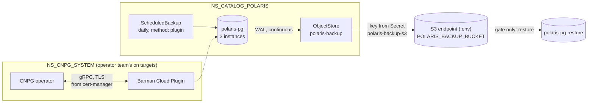

# ADR-043: Every PostgreSQL backs up to S3 through the Barman Cloud Plugin, which the operator team installs

- **Status:** Proposed
- **Date:** 2026-10-12
- **Related:** ADR-006, ADR-008, ADR-010, ADR-016, ADR-025, ADR-029, ADR-031

## Context

ADR-010 left backups for "their own ADR when data needs keeping". Polaris's PostgreSQL holds
the catalog: every table's current metadata location, the principals and their grants. The
table files stay in S3 without it, but nothing points to them any more. `platform-2026.10.12`
is the first release with Polaris, and it has no backup.

What CloudNativePG 1.30.1, the gate's pinned operator (ADR-029), offers. Read from its CRDs
and upstream's documentation on 2026-10-12:

- **Built-in backups** (`.spec.backup.barmanObjectStore`): base backups and WAL archiving to
  S3. They are deprecated since 1.26, and the 1.30.0 release notes say they are removed in
  1.31.0.
- **The Barman Cloud Plugin** (0.15.1, `barmancloud.cnpg.io/v1` `ObjectStore`) is their
  replacement, through CNPG's plugin interface.
  - A `Cluster` names it under `.spec.plugins`, and `Backup` and `ScheduledBackup` take
    `method: plugin`.
  - It must run in the operator's namespace.
  - It needs cert-manager.
- **Volume snapshots** need a CSI snapshot class. Whether the target clusters have one is
  unknown (#9), and kind has none.

Kade's choices (2026-10-12):
- the Barman Cloud Plugin;
- the plugin and cert-manager belong to the operator team on the target clusters, as the
  operator does (ADR-029).

## Decision

### 1. What is backed up, and how

- **Every CNPG `Cluster` of this repository:** Polaris's now, and Datahub's when it enters
  (ADR-025).
- **WAL archiving:** each `Cluster` names the plugin under `.spec.plugins`, with
  `isWALArchiver: true`, so its WAL is archived continuously.
- **Base backups:** a `ScheduledBackup` with `method: plugin` makes one every day.
- **Where the chart puts it:** each service's PostgreSQL chart carries its `ObjectStore`
  (`charts/polaris-postgres` for Polaris), in the service's namespace.
- **Retention is a value in that chart**, not part of this decision.

### 2. Where the backups go

- **To the S3 endpoint from `.env`** (`S3_ENDPOINT`, ADR-031), into a bucket of their own,
  `POLARIS_BACKUP_BUCKET`.
- **With their own key,** never Polaris's warehouse key. `POLARIS_BACKUP_S3_ACCESS_KEY_ID`
  and `POLARIS_BACKUP_S3_SECRET_ACCESS_KEY` are typed in by hand, like the other teams'
  credentials (ADR-031).
- **The key reaches the cluster as a Secret.** `init_env.py --apply-secrets` creates
  `polaris-backup-s3`, the only way credentials reach a chart (ADR-006).
- **On the gate,** the S3 stand-in gets that bucket and a key of its own.

### 3. Who installs the plugin and cert-manager (amends ADR-029)

- **On the target clusters,** the plugin and cert-manager are the operator team's, like the
  operator. A release never installs, upgrades or removes them.
- **On the gate and Linux test clusters,** the gate scripts install both before the operator
  check, each pinned with its digest in `gates/pins.json`:
  - cert-manager in its own namespace;
  - the plugin's release manifest in `NS_CNPG_SYSTEM`.
- **Added to ADR-029's step 0:** the plugin runs in `NS_CNPG_SYSTEM`, and the `ObjectStore`
  CRD is present. Otherwise the install stops before step 1.

### 4. A restore is proven on the gate

After the PyIceberg tests, the smoke gate:
- takes an on-demand `Backup` of polaris-pg and waits for it to complete;
- creates a `Cluster` `polaris-pg-restore` that bootstraps from the `ObjectStore`, from the
  base backup and the archived WAL up to the latest;
- reads from it the realm's root principal and the catalog the smoke tests created;
- then deletes it.

A restore on a target cluster is a runbook, proven on a Linux test cluster first; runbooks
are not ADRs.

### Not decided here

- **The retention value and the schedule's hour:** tuning values in the chart.
- **Encryption and replication of the backup bucket:** the object storage team's.
- **A point-in-time restore drill**, beyond the restore to the latest.

## Diagram

## Alternatives considered

- **Built-in `barmanObjectStore`:** nothing more to install, but it is removed in CNPG 1.31.0.
  The next operator upgrade would force a migration of every `Cluster`'s backups.
- **Volume snapshots:** they depend on a snapshot class nobody has confirmed on the target
  clusters, cannot be proven on kind, and keep no WAL between snapshots.
- **A `pg_dump` CronJob of this repository:** no plugin and no cert-manager. But it is a
  logical dump: every write since the last dump is lost, and a restore replays the whole
  dump.
- **This repository installs the plugin and cert-manager:** it would own software in the
  operator team's namespace, against ADR-029.
- **Polaris's warehouse key for the backups too:** one leaked key would then reach both the
  tables and their catalog's backups.

## Consequences

- **The target clusters need the plugin and cert-manager before the release that carries
  this.** Otherwise its install stops at step 0. That is a question for the operator team,
  added to #9.
- **The gate installs cert-manager and the plugin on every run,** which adds their start-up
  time. A restore runs on every smoke.
- **Losing the backup bucket loses the backups,** not the database. The object storage team
  keeps the bucket.
- **Upgrading CNPG to 1.31** needs no backup migration.
- **ADR-029 becomes "Amended by ADR-043"** when this ADR is accepted. Code follows once it is
  Accepted:
  - the gate's installs and pins, and step 0's check;
  - `charts/polaris-postgres`;
  - `.env.template` and `init_env.py`'s Secret;
  - the smoke gate's restore.
