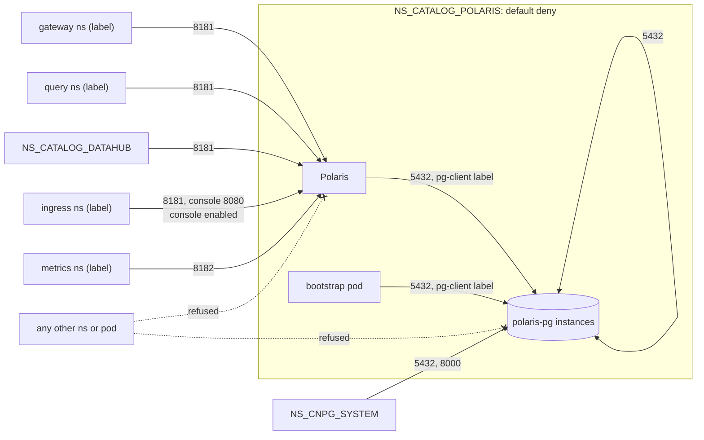

# ADR-044: Ingress is denied by default and allowed per caller; Polaris's policies are a chart, proven on the gate

- **Status:** Proposed
- **Date:** 2026-10-13
- **Related:** ADR-000, ADR-002, ADR-007, ADR-009, ADR-016, ADR-017, ADR-025, ADR-026, ADR-027, ADR-028, ADR-031, ADR-034, ADR-036, ADR-043, ADR-045

## Context

ADR-027 denies ingress by default in every namespace of this repository and allows each
caller class by namespace label. ADR-034 amended it with `NS_STANDINS`'s rows. Kade set these
policies as the next work before Datahub (2026-10-12, `docs/plans/roadmap.md`). ADR-027 has
already been amended once, so under ADR-000 it is superseded whole: this ADR restates every
rule in force and adds what building them for `NS_CATALOG_POLARIS` showed is missing:

- **The CNPG operator reads each instance's status on port 8000**, and its checks and actions
  depend on it. CloudNativePG's own example policy allows the operator's namespace on 8000
  and 5432 ([networking](https://cloudnative-pg.io/docs/1.30/networking),
  [example](https://cloudnative-pg.io/docs/1.30/cncf-projects/cilium)). ADR-027 allowed only
  5432. Backups through the plugin (ADR-043) are started through the same port.
- **A Cluster's instances replicate to each other on 5432.** ADR-027's "its own service's
  pods" did not say whether that means the service or the instances.
- **The realm bootstrap** (ADR-026) runs Polaris's admin tool in a pod of its own that
  connects to polaris-pg. It is not a Polaris pod.
- **The console's browser calls Polaris's API** through the ingress controller, at
  `POLARIS_CONSOLE_API_URL` (ADR-028). So while the console is enabled, 8181 has that caller
  too.
- **The gate's checks** (PyIceberg, the console's sign-in, the restore's `psql`, curl) run in
  pods in `NS_CATALOG_POLARIS`, and the PostgreSQL recorder (ADR-034) runs in `NS_STANDINS`.
  Neither is a caller on a target cluster.
- **`.env` names no caller label yet**, and ADR-027 did not say where the policies live.
- **The gate's CNI:** kind's default, kindnet, implements NetworkPolicy through the
  kube-network-policies project ([kindnet](https://kindnet.sigs.k8s.io/docs/user/network-policies/)).
  Its docs name no kind version, so this is proven on the gate (§6), not assumed.
- **Kubelet probes:** an isolated pod still accepts connections from its own node
  (Kubernetes' NetworkPolicy semantics), so probes need no rule.

## Decision

### 1. Deny by default, allow per caller (restated from ADR-027)

- **Every namespace of this repository has a default-deny ingress `NetworkPolicy`**, and
  allow policies per caller class. On the gate and test clusters that includes
  `NS_STANDINS` (ADR-031).
- **Callers in other teams' namespaces are selected by a namespace label given in `.env`**
  (ADR-002), never by a namespace name in a chart.
- **Egress is not restricted;** that is a later ADR.

### 2. Caller classes from `.env`

- **One variable per caller class, holding one `key=value` namespace label:**

  | Variable | Caller class |
  |---|---|
  | `POLARIS_GATEWAY_NAMESPACE_LABEL` | the catalog gateway's namespace |
  | `POLARIS_QUERY_NAMESPACE_LABEL` | user namespaces (StarRocks) |
  | `METRICS_NAMESPACE_LABEL` | the metrics scraper's namespace |
  | `INGRESS_NAMESPACE_LABEL` | the ingress controller's namespace |

  Datahub's lineage emitters (issue #10) get theirs with Datahub's chart.
- **Empty means no namespace of that class is allowed;** the install says so and goes on.
- **This repository's own namespaces and the operator's** are selected by
  `kubernetes.io/metadata.name`, a label Kubernetes sets on every namespace, with the name
  from `.env` (`NS_CATALOG_DATAHUB`, `NS_CNPG_SYSTEM`, `NS_CATALOG_POLARIS`). No name is
  written in a chart.

### 3. The rules

`NS_CATALOG_POLARIS`, built now:

| Target | Port | Allowed from |
|---|---|---|
| Polaris API | 8181 | gateway, query and Datahub namespaces; the ingress controller's namespace while the console is enabled |
| Polaris management | 8182 | the metrics scraper's namespace |
| The console | its container port (8080) | the ingress controller's namespace, while the console is enabled |
| polaris-pg's instances | 5432 | pods labelled `lakehouse/polaris-pg-client: "true"` in this namespace (Polaris, the bootstrap pod); the other instances of the namespace's Clusters |
| polaris-pg's instances | 5432, 8000 | the operator's namespace `NS_CNPG_SYSTEM` |

- **Instances** are pods with `cnpg.io/podRole: instance`. The rule covers every Cluster in
  the namespace, so the gate's `polaris-pg-restore` (ADR-043) is covered too.
- **The log batch** (ADR-036) and the bootstrap pod receive no connection, so nothing is
  allowed to them.
- **polaris-pg's metrics exporter port** waits for P5's metrics ADR.

`NS_CATALOG_DATAHUB`, restated from ADR-027 and built with Datahub (ADR-025); the ports named
"its port" are filled in when each chart enters:

| Target | Port | Allowed from |
|---|---|---|
| Datahub frontend | its HTTP port | the ingress controller's namespace |
| Datahub GMS | its API port | lineage emitters' namespaces (issue #10); Datahub's own pods |
| Datahub's PostgreSQL | 5432, 8000 | as polaris-pg, for Datahub's pods and the operator |
| Datahub's Kafka and OpenSearch | their ports | Datahub's own pods only |

`NS_STANDINS`, gate and test clusters only, restated from ADR-034:

| Target | Port | Allowed from |
|---|---|---|
| The recorders | their ports | Polaris's namespace; the gate's check pods |
| SeaweedFS, OPA | their ports | the recorders; the gate's check pods |
| Polaris's PostgreSQL | 5432 | also the PostgreSQL recorder |

### 4. Where the policies live

- **A local chart per service namespace.** Polaris's is `charts/polaris-network-policies`,
  installed into `NS_CATALOG_POLARIS` by `install/release.py` first in step 1 (ADR-045), and
  rendered, schema-checked and validated with kubeconform in the static gate like the other
  local charts (ADR-016). A policy removed from the chart is removed from the cluster by
  helm. Datahub gets its own when it enters.
- **The upstream Polaris and console charts stay unchanged** (ADR-009, ADR-028). Pods are
  selected by the labels they already carry, plus the client label set through
  `values-lakehouse.yaml`'s `podLabels`.
- **`NS_STANDINS`'s policies** are applied by the gate's own scripts with the stand-ins, never
  part of a release (ADR-031).

### 5. Gate-only callers

On the gate only, `gate.py` adds two allow policies to `NS_CATALOG_POLARIS`, never part of a
release:
- pods labelled `lakehouse-gate/check: "true"` (every check pod) reach every port;
- the PostgreSQL recorder in `NS_STANDINS` reaches 5432 (ADR-034).

### 6. The gate proves each rule

A new smoke step, `check-network`, creates one namespace per caller label from the gate's
`.env` and one with none, and from a short-lived pod in each tries a TCP connection:
- **each allowed row:** a connection from a namespace of that class succeeds;
- **each row:** a connection from the unlabelled namespace fails within a timeout, and so
  does one from a labelled namespace to a port its class is not allowed (gateway to 8182);
- **polaris-pg:** refused from the unlabelled namespace and from an unlabelled pod in
  `NS_CATALOG_POLARIS`. Allowed traffic is proven by Polaris, the bootstrap, replication, the
  backup and the restore working, and by `check-traffic` (ADR-034);
- **`NS_STANDINS`:** SeaweedFS and OPA refused from an unlabelled pod in `NS_CATALOG_POLARIS`.

If a refused connection succeeds, kindnet is not enforcing: the code stops there, and a new
ADR changes ADR-017's cluster with a CNI that does.

## Diagram

## Alternatives considered

- **Amend ADR-027 again:** ADR-000 forbids amending an ADR already amended; readers would
  piece one decision together from three ADRs.
- **No policies, rely on authentication** (from ADR-027): every store reachable from every
  namespace, protected only by its password.
- **Select callers by namespace name in charts** (from ADR-027): names differ per cluster
  and would end up in charts, against ADR-002.
- **The pg rule in `charts/polaris-postgres` and the rest in a new chart:** one namespace's
  policies split across two charts, and the default deny in only one of them.
- **`release.py` writes the manifests and applies them with kubectl:** no new chart, but a
  policy removed in a later release stays on the cluster until someone deletes it, and the
  static gate renders nothing.
- **Select Polaris and the bootstrap pod by the upstream chart's labels:** the bootstrap pod
  is not from the chart, and a label of our own names the permission, not the workload.
- **A label variable for Datahub's and the operator's namespaces too:** one more value to set
  per environment, for namespaces whose names `.env` already holds.
- **Gate check pods allowed by namespace, not label:** any pod in `NS_CATALOG_POLARIS` could
  then reach polaris-pg on the gate, and the gate would no longer prove the release's rule.

## Consequences

- **A target cluster needs the caller labels on its namespaces** before the release that
  carries this, or those callers are refused. The labels and their values are a question
  for the operator team, added to #9.
- **A new caller** needs a label, a variable, a row in a later ADR and a `check-network`
  case.
- **A refused connection costs `check-network` its timeout,** a few seconds per case.
- **Supersedes ADR-027,** with ADR-034's amendment of it restated in §3. Code follows once
  this ADR and ADR-045 are Accepted:
  - `charts/polaris-network-policies`, and `podLabels` in Polaris's `values-lakehouse.yaml`;
  - `release.py`'s step 1 and the bootstrap pod's label;
  - `.env.template` and `init_env.py` with the four variables;
  - the gate's policies, `check-network` and its step in `smoke.yml`.
