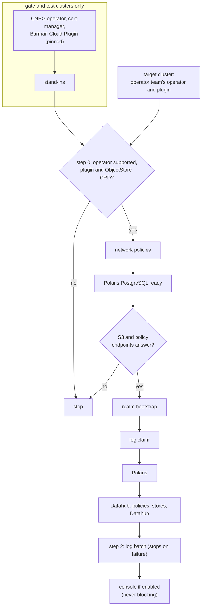

# ADR-045: The CNPG operator and its backup plugin are the operator team's; a release installs in a fixed order

- **Status:** Amended by ADR-077
- **Date:** 2026-10-13
- **Related:** ADR-000, ADR-004, ADR-007, ADR-010, ADR-012, ADR-017, ADR-018, ADR-026, ADR-028, ADR-029, ADR-031, ADR-036, ADR-037, ADR-043, ADR-044

## Context

ADR-029 made the CloudNativePG operator the operator team's on the target clusters, had the
gate scripts install it on the gate and test clusters, and restated the install order of a
release in full. ADR-043 amended it: the Barman Cloud Plugin and cert-manager are the
operator team's too, the gate installs them, and step 0 checks the plugin.

ADR-044 installs Polaris's network policies first in step 1, before polaris-pg, so every
component starts under them. That changes ADR-029's order again. ADR-029 has already been
amended once, so under ADR-000 it is superseded whole: this ADR restates it with ADR-043's
amendment and ADR-044's step.

Since ADR-029, other ADRs placed their parts in its steps without changing it: the realm
bootstrap after the endpoints answer (ADR-026), the log claim before Polaris (ADR-036), the
log batch in step 2 and its failure stopping the install (ADR-037), the console never
blocking (ADR-028). They are restated in the order below, unchanged, so it reads in one
place.

## Decision

### 1. Who installs the operator, the plugin and cert-manager (restated from ADR-029, ADR-043)

- **On the target clusters,** the CNPG operator, the Barman Cloud Plugin and cert-manager are
  the operator team's. A release of this repository never installs, upgrades or removes them.
- **On the gate and on Linux test clusters, this repository's gate scripts install them**,
  each pinned in `gates/pins.json`, never as part of a release:
  - the operator from CNPG's upstream chart, in `NS_CNPG_SYSTEM` (ADR-007);
  - cert-manager in its own namespace;
  - the plugin's release manifest in `NS_CNPG_SYSTEM`;
  - then the stand-ins (ADR-031).
- **The operator's pinned version follows the target clusters' version** when it is known;
  until then, the latest release that supports the gate's Kubernetes version
  (`docs/plans/roadmap.md`).
- **ADR-010's "once per cluster"** applies to the gate and test clusters only, as ADR-029
  said.

### 2. Install order of a release

0. **Preconditions, checked, never installed:**
   - the CNPG operator and its CRDs are present, and its version is one the release supports;
   - the Barman Cloud Plugin runs in `NS_CNPG_SYSTEM`, and the `ObjectStore` CRD is present
     (ADR-043).

   Otherwise the install stops before step 1.
1. **For each service, in order Polaris, then Datahub:**
   - **Polaris:**
     1. its network policies (ADR-044);
     2. its PostgreSQL `Cluster`, ready;
     3. the S3 and policy endpoints answer (ADR-031);
     4. the realm bootstrap (ADR-026);
     5. the log claim (ADR-036);
     6. Polaris.
   - **Datahub:** its network policies, its PostgreSQL `Cluster`, its Kafka and OpenSearch
     (ADR-025), each ready; then Datahub.
2. **Then:**
   - the Polaris log batch, whose failure stops the install (ADR-037);
   - the console when enabled, never blocking (ADR-028).

- **The install script follows this order** and waits for readiness at each step; the
  first step with a problem stops the rest. The gates use the same script (ADR-018).
- **Removal runs in reverse,** and every removal step is destructive (ADR-004).

## Diagram

## Alternatives considered

- **Amend ADR-029 again:** ADR-000 forbids amending an ADR already amended.
- **Install the policies after polaris-pg or in step 2:** the components would start
  unprotected on a fresh install, and the first install would not run under the rules the
  gate proves.
- **Install the operator and the plugin in every release** (from ADR-029): two owners for
  cluster-wide software; an upgrade here could break other teams' databases.
- **No operator on the gate, mock the `Cluster`s** (from ADR-029): the gate would prove
  nothing about PostgreSQL.

## Consequences

- **A CNPG or plugin upgrade on the target clusters is the operator team's;** the gate
  follows by moving its pin, and that PR proves the release still works on the new version.
- **A release states which operator versions it supports,** and its install stops on any
  other, or without the plugin.
- **Supersedes ADR-029,** with ADR-043's amendment of it restated in §1 and step 0. ADR-012
  stays superseded by ADR-029. Code follows once this ADR and ADR-044 are Accepted: only
  step 1's network policies are new to `install/release.py`.
