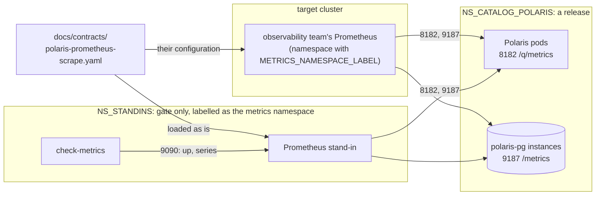

# ADR-046: Metrics are a scrape contract for the observability team's Prometheus, proven by a stand-in on the gate

- **Status:** Proposed
- **Date:** 2026-10-13
- **Related:** ADR-002, ADR-009, ADR-010, ADR-016, ADR-017, ADR-028, ADR-031, ADR-036, ADR-040, ADR-044, ADR-045

## Context

P5 of `docs/plans/roadmap.md` gives the observability team two things: metrics endpoints for
Polaris and Datahub, and the scrape configuration their Prometheus needs. Kade put metrics
next, before Datahub (2026-10-12). The metrics scraper is another team's service (ADR-031).
ADR-044 already lets the scraper's namespace (`METRICS_NAMESPACE_LABEL`) reach Polaris's
management port 8182. It left polaris-pg's exporter port to this ADR.

What the pinned versions already do, read on 2026-10-13:

- **Polaris 1.6.0** serves Prometheus metrics at `/q/metrics` on its management port 8182
  ([telemetry](https://polaris.apache.org/releases/1.6.0/telemetry/)). Every series carries
  the tag `application=Polaris`. The realm ID tags are off by default, against high
  cardinality. Health is on the same port (`/q/health/live`, `/q/health/ready`, the chart's
  probes).
- **The upstream chart** (`charts/polaris/values.yaml`) has `metrics.enabled: true` and
  `serviceMonitor.enabled: true`. Its `templates/servicemonitor.yaml` renders a
  `ServiceMonitor` only if the cluster serves `monitoring.coreos.com/v1`, and gives it no
  labels unless they are set. On the gate, kind has no such CRD, so nothing is rendered. On a
  target cluster that runs the Prometheus Operator, every release so far has created an
  unlabelled `ServiceMonitor` in `NS_CATALOG_POLARIS`. Whether their Prometheus selects it
  depends on its selectors, which are unknown (#9).
- **CloudNativePG 1.30.1**: each instance runs an exporter on port 9187 (`metrics`),
  path `/metrics`, with CNPG's default queries. Its results are cached for
  `metricsQueriesTTL` (default 30 s). The pinned CRD marks `.spec.monitoring.enablePodMonitor`
  as deprecated, "to be removed in an upcoming release"; it says to create a `PodMonitor` by
  hand instead. `charts/polaris-postgres` sets no `monitoring` field.
- **No other workload of this repository serves metrics.** The console is a maintainer
  tool (ADR-028). The log batch (ADR-036) is a CronJob: its outcome is a Job's status, which
  Kubernetes' own metrics carry.
- **Whether the target clusters run the Prometheus Operator** is unknown (#9).

## Decision

### 1. What a release exposes

| Target | Selected by | Port | Path |
|---|---|---|---|
| Polaris | pods `app.kubernetes.io/name=polaris`, `app.kubernetes.io/instance=polaris` | 8182 (`polaris-mgmt`) | `/q/metrics` |
| polaris-pg's instances | pods `cnpg.io/cluster=polaris-pg`, `cnpg.io/podRole=instance` | 9187 (`metrics`) | `/metrics` |

- **Both use plain HTTP, in Prometheus's text format, with no authentication.** Access is
  limited by the network rule in §4.
- **Upstream defaults are kept:** Polaris's `metrics.enabled: true`, no extra tags, the realm
  ID tags off (there is one realm). CNPG keeps its default queries and adds no custom ones;
  `monitoring.tls` stays off.
- **Datahub's targets** join the contract with Datahub's chart (P3), under its own ADR.

### 2. No monitor objects in a release

- **`values-lakehouse.yaml` sets `serviceMonitor.enabled: false`.** A release creates no
  `ServiceMonitor` and no `PodMonitor`. `enablePodMonitor` stays unset.
- **Why:** how the scraper finds its targets is part of the observability team's service
  (ADR-031). An object it may or may not select, rendered only on some clusters, is a setting
  of their service that the gate never sees.
- If the observability team asks for monitor objects, a later ADR adds them, with their
  labels from `.env`.

### 3. The contract

- **`docs/contracts/polaris-metrics.md`**: §1's table, the namespace (`NS_CATALOG_POLARIS`
  from `.env`), the label the scraper's namespace needs (`METRICS_NAMESPACE_LABEL`), the
  30 s query cache, and the series the gate requires (§5).
- **`docs/contracts/polaris-prometheus-scrape.yaml`**: a `scrape_configs` fragment for plain
  Prometheus. It uses `kubernetes_sd_configs` with role `pod` in one namespace, keeps pods by
  §1's labels and the container port by name, and keeps the pod and namespace as labels.
  The only placeholder is the namespace, `${NS_CATALOG_POLARIS}`.
- **The gate loads that file**, with the namespace filled in. So the scrape configuration
  handed to the team is the one the gate proves.

### 4. The network rule (amends ADR-044 §3)

ADR-044 §3 gains these rows:

| Namespace | Target | Port | Allowed from |
|---|---|---|---|
| `NS_CATALOG_POLARIS` | polaris-pg's instances | 9187 | the metrics scraper's namespace |
| `NS_STANDINS` (gate and test clusters only) | the Prometheus stand-in | 9090 | the gate's check pods |

- **The 9187 rule goes in `charts/polaris-network-policies`.** Like 8182, it is left out
  while `METRICS_NAMESPACE_LABEL` is empty.
- **The 9090 rule goes with `NS_STANDINS`'s other policies**, in the gate's scripts.
- **`check-network` gains three cases:**
  - the metrics namespace to 9187: allowed;
  - the unlabelled namespace to 9187: refused;
  - the gateway namespace to 9187: refused.

### 5. The gate proves the contract

- **A Prometheus stand-in**: the official `prom/prometheus` image, pinned by digest in
  `gates/pins.json`, at a version at least two weeks old.
  - It runs as one pod in `NS_STANDINS`, from the gate's own scripts, never part of a release
    (ADR-031 keeps its rules).
  - On the gate only, `NS_STANDINS` carries the gate's `METRICS_NAMESPACE_LABEL`. So the
    stand-in crosses the release's own policies, as the real scraper would.
  - A ServiceAccount with a Role in `NS_CATALOG_POLARIS` lets it list and watch pods (`get`,
    `list`, `watch`), for service discovery.
  - It holds no credential and stores nothing past the job.
- **A new smoke step, `check-metrics`**, runs after the smoke tests' traffic. From a check pod
  it asks the stand-in's HTTP API that:
  - `up` is 1 for every Polaris pod (`replicaCount`) and every polaris-pg instance
    (`instances`);
  - Polaris's `http_server_requests_seconds_count` has a sample above zero, from the smoke
    tests' requests;
  - CNPG's `cnpg_collector_up` is 1 for every instance.

  The contract lists these series. A series Polaris or CNPG renames in a later version fails
  this step in that version's upgrade PR.
- **The failure dump** prints the stand-in's targets with each one's last error.

## Diagram

## Alternatives considered

| Option | What it gives | Long-term cost |
|---|---|---|
| **A contract and a plain scrape configuration, proven by a Prometheus stand-in** (chosen) | Works with any Prometheus, with or without its operator. The file the team gets is the one the gate runs. | One pinned image, a Role and a smoke step to keep. A Prometheus upgrade is a pin change. |
| **A release ships a `ServiceMonitor` and a `PodMonitor`, labelled from `.env`** | Discovery is automatic where the Prometheus Operator runs. | Ties every release to the operator's CRDs: pinned CRD schemas for kubeconform, and the operator on the gate to prove selection. It is unknown whether the targets run it (#9). CNPG's own `PodMonitor` switch is already deprecated. |
| **Keep upstream's default `ServiceMonitor`** | No change. | Rendered only where the CRD exists, with no labels. The gate never renders it, so nothing proves it. |

- **`prometheus.io/scrape` pod annotations:** a convention, not a standard. They work only
  if the team's configuration honours them, and they would still be our setting of their
  service.
- **Check the endpoints with curl only, no stand-in:** no new image. It proves each endpoint
  answers, not that the contract's discovery finds every pod, nor its labels.
- **Push metrics over OTLP:** it needs a collector endpoint in `.env`, and P5 asks for scrape
  configuration.

## Consequences

- **The next release removes the unlabelled `ServiceMonitor`** from target clusters that
  run the Prometheus Operator. Whether their Prometheus used it is added to #9. Release notes
  name the removal.
- **A target cluster's scraper needs `METRICS_NAMESPACE_LABEL` on its namespace**, which is
  already a question on #9 (ADR-044). It also needs the contract's scrape configuration.
- **Amends ADR-044** (§3's rows, `check-network`'s cases). Code follows once this ADR is
  Accepted:
  - `serviceMonitor.enabled: false` in `charts/polaris/values-lakehouse.yaml`, with
    `charts/test_polaris.py` comparing it with the chart default (ADR-016);
  - the 9187 rule in `charts/polaris-network-policies`;
  - the two contract files;
  - in `gates/`: the stand-in, its pin, Role and policy, the namespace label, `check-metrics`,
    the new `check-network` cases, and the step in `smoke.yml`.
- **That PR changes `values-lakehouse.yaml` and `smoke.yml`.** It needs passing dry-run,
  smoke and log-batch gates on its head (ADR-040 §5), and goes as a draft Kade merges
  (ADR-030).
