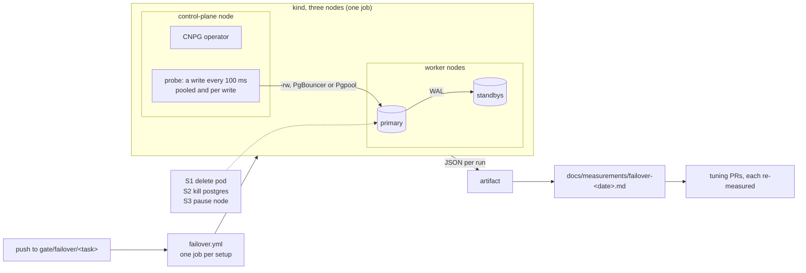
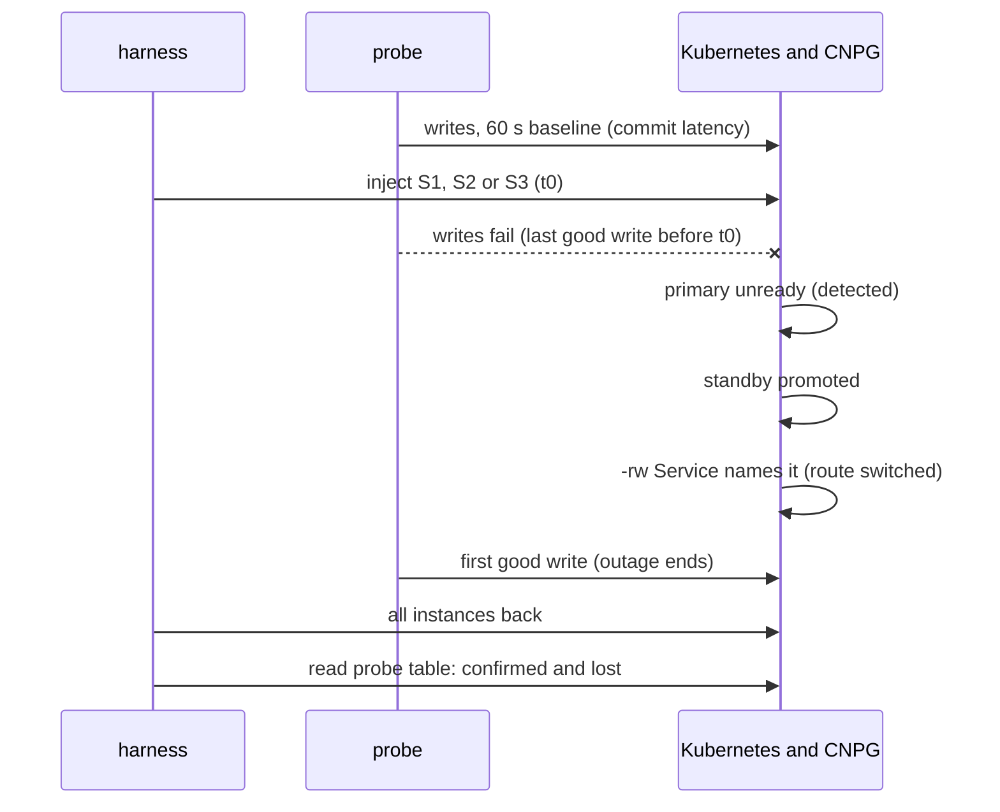

# ADR-047: Failover is measured on the gate before it is tuned: a pgjdbc probe times each setup under three failures

- **Status:** Accepted
- **Date:** 2026-10-13
- **Related:** ADR-003, ADR-004, ADR-008, ADR-010, ADR-015, ADR-017, ADR-025, ADR-030, ADR-031, ADR-032, ADR-038, ADR-039, ADR-043, ADR-044, ADR-045

## Context

Issue #31 (planned with Kade on 2026-10-11) sets the goal: when PostgreSQL's primary is lost,
writes stop for **at most 30 s** and **no confirmed write is lost**. Kade put failover next,
before Datahub (2026-10-12).

**What the target clusters do today** (Kade, #31, numbers only):

- The primary's node goes down. Pgpool notices, but its failover command is off, so no
  standby is promoted.
- After more than 3 minutes a Kubernetes health check fails and the pod restarts. The same
  primary comes back, so no data is lost.
- Pgpool keeps routing callers to the dead primary, so **every query in the window fails**.

So today's "no data loss" comes from never promoting: the target waits for the old primary.

**What this repository runs** (`charts/polaris-postgres`): one CNPG 1.30.1 `Cluster`, three
instances with required anti-affinity, and WAL archived through the Barman Cloud Plugin
(ADR-043). It sets none of CNPG's failover settings, so all are CNPG's defaults. Polaris
connects to `polaris-pg-rw` with pgjdbc. The gate is kind 1.36 with three nodes (ADR-017).

**What CNPG 1.30.1 does on failure**, read in its documentation at `v1.30.1` on 2026-10-13
(`docs/src/failover.md`, `instance_manager.md`, `replication.md`):

- **It promotes on the primary pod's `Ready` condition**, after `failoverDelay` (default 0).
- **On a pod or process failure, the readiness probe goes false.** The default readiness
  probe runs every 10 s and fails after 3 failures.
- **On a node loss, the kubelet cannot update `Ready`.** The node lifecycle controller flips it
  once the node is `Unknown`, after `--node-monitor-grace-period`: 50 s by default on
  Kubernetes 1.32 and later. CNPG says the operator sees the primary unready **40 to 55 s**
  after the node is lost.
  - That setting belongs to the cluster's kube-controller-manager, not to this repository.
  - So on a stock cluster, **30 s cannot be reached on a node loss from this repository's
    side**. This settles the risk #31 left open.
- **A lease guards promotion** (`.spec.primaryLease`, `leaseDurationSeconds` 15). After an
  abrupt loss, a standby must see the lease unrenewed for 15 s before it promotes. On a node
  loss that wait ends inside the node grace period.
- **Synchronous replication is off by default.** `.spec.postgresql.synchronous` sets it, with
  two options:
  - `dataDurability`: `required` (the default) pauses writes when no synchronous standby is
    available; `preferred` drops back to asynchronous.
  - `failoverQuorum`: promote only a standby known to hold every synchronous commit.

  Without synchronous replication, promoting a standby can lose commits it had not yet
  received.
- **An isolated primary keeps committing.** The isolation check (on by default) restarts a
  primary that reaches neither the API server nor another instance. That restart is a smart
  shutdown, in which open sessions keep committing for `smartShutdownTimeout` (180 s).

**What a client sees** is a separate question.

- pgjdbc's `socketTimeout` defaults to 0 (none). On a node loss nothing closes the socket, so
  a pooled connection can wait for TCP's own timeout, which takes minutes.
- Client timeouts have to be measured with the client Polaris uses.

**No measurement exists yet.** The archive measured through Pgpool-II, not failover, and
ADR-010 says those numbers do not carry over.

## Decision

### 1. A measurement first, then tuning

- **A harness on kind measures failover** in a fixed set of setups and failures (§2, §3) and
  records what callers see (§4).
- **Tuning comes after it**, in separate PRs (§8). Each one re-runs the measurement to show
  the outage shrinking.
- **The measurement changes nothing a release installs.**

### 2. Setups

| | Setup | Promotes | In front of PostgreSQL |
|---|---|---|---|
| **C3a** | PG-HA with repmgr and Pgpool, nothing promotes, as the target runs it | nothing | Pgpool |
| **C3b** | C3a with repmgr's and Pgpool's failover on | repmgr | Pgpool |
| **C0** | `charts/polaris-postgres` as released, CNPG's defaults | CNPG | the `-rw` Service |
| **C1** | C0 tuned: detection, shutdown, synchronous replication, client timeouts | CNPG | the `-rw` Service |
| **C2** | C1 with CNPG's PgBouncer `Pooler` | CNPG | PgBouncer |
| **C4** | C0 with Pgpool in front, Pgpool's own failover off, its one backend the `-rw` Service | CNPG | Pgpool |

- **C3a is the harness check.**
  - It runs first and must reproduce the target: no promotion, about 3 minutes of failed
    writes, no write lost.
  - Its settings are the target's numbers, which Kade gives on #31: Pgpool's health check
    and backend flags, the probes and `terminationGracePeriodSeconds`, repmgr's reconnect
    settings, and the chart and image versions.
  - If C3a does not reproduce the target, no number is trusted. The harness is fixed first.
- **C1's settings** come from the CNPG fields above and pgjdbc's connect, socket and login
  timeouts:
  - each value is written in the harness with a comment, and the results report it;
  - they are inputs to a measurement, not a decision (ADR-000 rule 11).
  - Synchronous replication is `method: any`, `number: 1`, `dataDurability: required`.
- **PG-HA, repmgr and Pgpool are measurement fixtures on the gate only.**
  - ADR-025 keeps them out of releases, and this ADR does not change that.
  - They follow ADR-031's rules for stand-ins: pinned by digest in `gates/pins.json`,
    started by the gate's scripts, never part of a release.
  - Bitnami publishes current images only to paying customers (ADR-025). The fixtures use
    the frozen `bitnamilegacy` images at the target's versions, or the nearest one there; the
    results name what ran.

### 3. Failures

| | Failure | How |
|---|---|---|
| **S1** | The primary pod is deleted | `kubectl delete pod`, default grace period |
| **S2** | The primary's `postgres` process dies | `SIGKILL` to the postmaster in the container |
| **S3** | The primary's node is lost | `docker pause` of the kind node, `docker unpause` after a fixed time |

- **Each setup runs each failure 5 times.** The results give the median and the worst case.
- **Between runs** the harness waits until every instance is ready and the cluster reports
  healthy.
- **S3 pauses a worker only.** Pausing the control plane would stop the API server and the
  operator. So:
  - the CNPG operator, Pgpool and the probe are pinned to the control-plane node;
  - before an S3 run, the harness switches the primary over to a worker if it is not on one.
- **How long S3's node stays down** is a question for Kade on #31. It must match the
  target's failure for C3a to reproduce it. Every run records it.
- **S3 is measured on the stock node grace period.** One extra job, C1 under S3 only, runs
  on kind with the grace period lowered to 20 s.
  - It shows what the cluster's setting would give.
  - The results label it as not the target's.
- **Not covered:** a network partition in which the primary keeps running. CNPG's isolation
  check covers it. With `dataDurability: required`, an isolated primary cannot confirm a
  commit, because no standby acknowledges it.

### 4. What is recorded

For each run:

| What | From |
|---|---|
| failure injected | the harness, at the command |
| failure detected | the operator's log (CNPG) or Pgpool's log (C3, C4), cross-checked by polling `Cluster` status each second |
| standby promoted | the new primary's log, and `.status.currentPrimaryTimestamp` |
| route switched | the `-rw` Service's EndpointSlice naming the new primary, or Pgpool's backend status |
| last good write before, first good write after | the probe |
| writes failed, writes confirmed, writes confirmed and lost | the probe, and a read of its table once every instance is back |
| commit latency, p50 and p99, over the 60 s before the failure | the probe |

- **The write outage** is the time from the last good write before the failure to the first
  good write after it.
- **A confirmed write is lost** if its commit returned to the probe but its row is missing
  from the new primary.
- **The commit latency** shows the cost of synchronous replication (C0 against C1).
- **One clock:** every node of kind runs on the runner, so all timestamps share it.

### 5. The probe

- **Java, with pgjdbc**, the driver Polaris uses, at the version Polaris 1.6.0's image ships.
  It is one source file run by the JDK's source launcher, with no build tool.
- **Pins:** the JDK image (Eclipse Temurin) by digest and the pgjdbc jar by SHA-256, both in
  `gates/pins.json`. The probe image is built on the runner and loaded into kind, as the
  console is (ADR-028).
- **Every 100 ms it writes one row:** a sequence number and its send time, in autocommit, to
  a table in its own database, `failover_probe`.
  - It never touches Polaris's database, so ADR-015's plain schema is untouched.
  - Polaris itself is not installed for this measurement.
- **Two modes run side by side:**
  - **pooled**: long-lived connections reused, and a failed one replaced, as Polaris's pool
    does;
  - **per write**: a new connection for each write.
- **It connects directly**, never through ADR-034's recorder: a proxy in the path changes
  what the client sees on a node loss. In C2, C3 and C4 it connects through that setup's
  pooler, since the pooler is what is measured.
- **ADR-044's policies:** the probe and C4's Pgpool carry the gate's check label (ADR-044
  §5), so they reach polaris-pg on 5432.

### 6. Running it

- **`failover.yml`** runs on a push to `gate/failover/<task>` and on `workflow_dispatch`.
  - **Inputs:** the setups, the failures and the number of runs.
  - **Jobs:** one per setup, each on its own kind cluster built as smoke builds it
    (ADR-017).
  - **Each job installs only what it needs:**
    - CNPG and the Barman Cloud Plugin (ADR-045 step 0), and the SeaweedFS stand-in for WAL
      archiving;
    - polaris-postgres and polaris-network-policies, as ADR-045's step 1 installs them;
    - or the PG-HA fixture for C3.
  - **Output:** each run's record as JSON, in an artifact.
- **ADR-038's rules for `gate/*` branches apply**: throwaway, the same commit as the PR, a
  newer push cancels the older run, and the cleanup workflow deletes them (ADR-032).
  - It is a measurement, not a gate level. gate-check does not require it (ADR-039).
  - The workflow follows ADR-038's workflow rules: `permissions: {}`, `contents: read` per
    job, no repository secrets.
- **The harness** is `gates/failover/`: a Python driver, the probe and its Dockerfile.
  - Its arithmetic is unit-tested in the static gate: outage, lost writes, and medians.
  - Being under `gates/`, its PR needs dry-run and smoke (ADR-039).
  - The PR adds a workflow, so it is a draft Kade merges by hand (ADR-030).

### 7. Results

- **Where:** `docs/measurements/failover-<date>.md`, with every run's JSON beside it, in the
  PR that took them (ADR-003).
- **What they name:** the run links and the versions measured: Kubernetes and kind, CNPG,
  the PostgreSQL image, the plugin, pgjdbc and the JDK, and the Pgpool, repmgr and PG-HA
  images.
- **When:** results are committed only once C3a has reproduced the target (§2). Runs before
  that are harness work and are not recorded as measurements.

### 8. What follows the results

- **Tuning values go in values files** (ADR-000 rule 11): CNPG's probes and shutdown timeouts
  in `charts/polaris-postgres`, and pgjdbc's timeouts in Polaris's JDBC URL and pool
  settings. Each tuning PR re-runs `failover.yml` and shows the outage shrinking.
- **Choices that change a decision get their own ADR:**
  - synchronous replication in a release, which trades write latency and availability for no
    lost write;
  - a `Pooler`, which ADR-010 admits only where the target clusters use one.

## Diagram

## Alternatives considered

| Option | What it gives | Long-term cost |
|---|---|---|
| **Measure every setup on kind, C3a first as the harness check** (chosen) | Numbers for today's target and every candidate, from one harness, trusted because C3a reproduces what the target sees. | A probe image, frozen fixture images and a workflow to keep. 6 setups × 3 failures × 5 runs per measurement. |
| **Tune CNPG from its documentation, no measurement** | Fast. | No number shows the goal is met, and client behaviour on a node loss stays a guess. |
| **CNPG setups only, no C3 or C4** | No Bitnami fixtures. | Nothing reproduces the target, so nothing checks the harness, and the gain over today cannot be shown. |
| **Measure on a Linux test cluster** | Real nodes and a real network. | Not repeatable per PR, and a node loss there needs someone at the cluster. It stays possible later with the same probe. |

- **A probe in Python (psycopg):** simpler to write, but its timeouts and pool are not
  pgjdbc's, and Polaris runs pgjdbc. Kade chose Java on pgjdbc (#31).
- **Measure through ADR-034's recorder:** reuses the gate's recording, but a proxy in the path
  answers the client when PostgreSQL does not, which hides a node loss.
- **Polaris itself as the probe:** the real client, but its writes are API calls with their
  own retries and latency. The probe isolates the database path; Polaris's settings follow
  from it (§8).

## Consequences

- **#31's open risk is settled from CNPG's documentation**, to be confirmed by the
  measurement:
  - on a stock cluster, a node loss costs at least the node grace period (50 s) before CNPG
    acts;
  - reaching 30 s there needs the target cluster's `--node-monitor-grace-period` lowered,
    which is the cluster team's setting;
  - S1 and S2 are within this repository's reach.
- **New questions for Kade on #31**, numbers only:
  - how long the target's node stayed down;
  - the target's `--node-monitor-grace-period`, if the cluster team can say.
- **C3a waits on the target's settings** (#31's checklist). The harness can be built and run
  before then, but no result is committed until C3a reproduces the target.
- **New dependencies, gate only**, each pinned by digest or SHA-256 in `gates/pins.json`:
  - an Eclipse Temurin JDK image and the pgjdbc jar;
  - the frozen `bitnamilegacy` PG-HA, repmgr and Pgpool images, and the PG-HA chart.

  They never reach a release.
- **kind understates network latency:** every instance is on one runner. The commit latency
  cost of synchronous replication measured here is a lower bound, and the results say so.
- **Code follows once this ADR is Accepted:**
  - `gates/failover/` with its unit tests;
  - the pins;
  - `failover.yml`, as a draft Kade merges (ADR-030).

  It needs dry-run and smoke on its head (ADR-039). The first results follow in their own PR.
