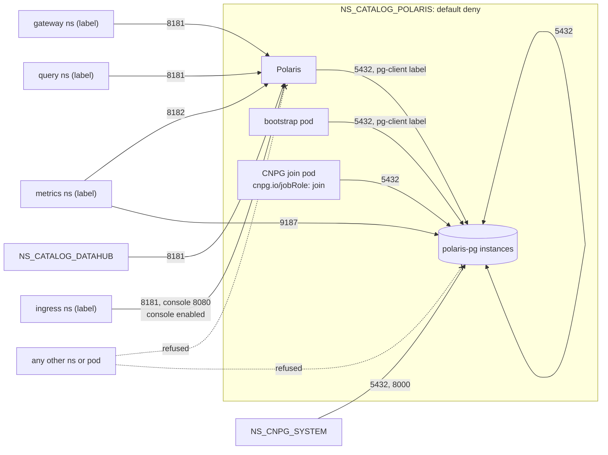
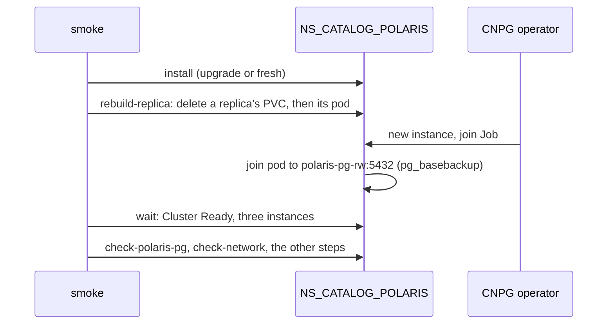

# ADR-048: Ingress is denied by default and allowed per caller, CNPG's join pods included; smoke rebuilds a replica under the policies

- **Status:** Amended by ADR-067
- **Date:** 2026-10-13
- **Related:** ADR-000, ADR-002, ADR-007, ADR-009, ADR-016, ADR-017, ADR-021, ADR-025, ADR-026, ADR-028, ADR-030, ADR-031, ADR-033, ADR-034, ADR-036, ADR-038, ADR-039, ADR-043, ADR-044, ADR-045, ADR-046, ADR-047

## Context

ADR-044 denies ingress by default in this repository's namespaces and allows each caller
class; ADR-046 amended its §3 with the metrics rows. Its 5432 rule for polaris-pg is now
wrong, and ADR-044 is already amended, so under ADR-000 it is superseded whole: this ADR
restates every rule in force, ADR-046's rows included, and changes what the finding below
shows.

**The finding** (#103): the first run of ADR-047's failover measurement,
[failover.yml run 38351413597](https://github.com/enjay27/lakehouse/actions/runs/38351413597)
on `7f67143`, stopped in install on all four jobs.
- On a fresh install with `charts/polaris-network-policies`, the primary `polaris-pg-1`
  starts. CNPG then runs `polaris-pg-2-join`, a Job pod that clones the primary through
  `polaris-pg-rw:5432` to make the replica.
- Every attempt for 14 minutes ended in `dial error: timeout`. The Cluster stayed at
  "Creating a new replica", and `install/release.py` failed its `kubectl wait` after 900 s.
- ADR-044 §3 admits to the instances' 5432 only pods labelled
  `lakehouse/polaris-pg-client: "true"` and other instances (`cnpg.io/podRole: instance`).
  A join pod carries neither, so the default deny drops it.

**Who it affects:** the first install of a release with network policies on any cluster;
rebuilding a replica that lost its volume; scaling polaris-pg up.

**Why the gates missed it:**
- Dry-run and smoke upgrade from the last release (ADR-021). That release's polaris-pg already
  has its three instances when the policies arrive, so no join pod runs.
- Only the release gate's `smoke fresh` installs from nothing (ADR-033). It has not run since
  the policies merged (#94).

**CNPG 1.30.1's labels** (`pkg/specs/jobs.go`, `pkg/specs/pods.go`,
`pkg/specs/pgbouncer/deployments.go` at `v1.30.1`):
- Every Job pod the operator creates carries `cnpg.io/cluster: <cluster>` and
  `cnpg.io/jobRole: <role>`. The roles are `initdb`, `import`, `pgbasebackup`,
  `full-recovery`, `snapshot-recovery` and `join`.
- `join` makes a replica with `pg_basebackup` from the primary, so it is the one role that
  connects to another instance of its own Cluster.
- `cnpg.io/cluster` is also on every instance and on a Pooler's PgBouncer pods
  (`cnpg.io/podRole: pooler`). As a selector it would admit every job and any Pooler added
  later, not only the pods that clone.

**Rebuilding a replica** (CNPG 1.30.1, `docs/src/controller.md`, "Coherence of PVCs"): when an
instance's PVC is deleted, the operator classifies the instance as unusable and creates a new
one, which joins the Cluster through its join strategy. With no volume snapshots configured
(ADR-043), that strategy is a `join` Job. This is the path of a fresh install's replicas, and
it can run on a release that is already installed.

## Decision

### 1. Deny by default, allow per caller (restated from ADR-044)

- **Every namespace of this repository has a default-deny ingress `NetworkPolicy`**, and
  allow policies per caller class. On the gate and test clusters that includes
  `NS_STANDINS` (ADR-031).
- **Callers in other teams' namespaces are selected by a namespace label given in `.env`**
  (ADR-002), never by a namespace name in a chart.
- **Egress is not restricted;** that is a later ADR.

### 2. Caller classes from `.env` (restated from ADR-044)

- **One variable per caller class, holding one `key=value` namespace label:**

  | Variable | Caller class |
  |---|---|
  | `POLARIS_GATEWAY_NAMESPACE_LABEL` | the catalog gateway's namespace |
  | `POLARIS_QUERY_NAMESPACE_LABEL` | user namespaces (StarRocks) |
  | `METRICS_NAMESPACE_LABEL` | the metrics scraper's namespace |
  | `INGRESS_NAMESPACE_LABEL` | the ingress controller's namespace |

  Datahub's lineage emitters (issue #10) get theirs with Datahub's chart.
- **Empty means no namespace of that class is allowed;** the install says so and goes on.
- **This repository's own namespaces and the operator's** are selected by
  `kubernetes.io/metadata.name`, a label Kubernetes sets on every namespace, with the name
  from `.env` (`NS_CATALOG_DATAHUB`, `NS_CNPG_SYSTEM`, `NS_CATALOG_POLARIS`). No name is
  written in a chart.

### 3. The rules

`NS_CATALOG_POLARIS`, built:

| Target | Port | Allowed from |
|---|---|---|
| Polaris API | 8181 | gateway, query and Datahub namespaces; the ingress controller's namespace while the console is enabled |
| Polaris management | 8182 | the metrics scraper's namespace |
| The console | its container port (8080) | the ingress controller's namespace, while the console is enabled |
| polaris-pg's instances | 5432 | pods labelled `lakehouse/polaris-pg-client: "true"` in this namespace (Polaris, the bootstrap pod); the other instances of the namespace's Clusters; **CNPG's join pods in this namespace (`cnpg.io/jobRole: join`)** |
| polaris-pg's instances | 5432, 8000 | the operator's namespace `NS_CNPG_SYSTEM` |
| polaris-pg's instances | 9187 | the metrics scraper's namespace (from ADR-046 §4) |

- **The join row is the change.** It sits in the same `polaris-pg-clients` policy as the
  5432 row's other sources, as one more pod selector of this namespace.
- **`cnpg.io/jobRole: join`, not `cnpg.io/cluster`:** it admits only the pods that clone an
  instance. CNPG's other jobs restore from S3 or initialise locally and need no ingress
  (Context).
- **Instances** are pods with `cnpg.io/podRole: instance`. The rules cover every Cluster in
  the namespace, so the gate's `polaris-pg-restore` (ADR-043) is covered too.
- **The 8182 and 9187 rules** are left out while `METRICS_NAMESPACE_LABEL` is empty.
- **The log batch** (ADR-036) and the bootstrap pod receive no connection, so nothing is
  allowed to them.

`NS_CATALOG_DATAHUB`, restated from ADR-044 and built with Datahub (ADR-025); the ports named
"its port" are filled in when each chart enters:

| Target | Port | Allowed from |
|---|---|---|
| Datahub frontend | its HTTP port | the ingress controller's namespace |
| Datahub GMS | its API port | lineage emitters' namespaces (issue #10); Datahub's own pods |
| Datahub's PostgreSQL | 5432, 8000 | as polaris-pg, for Datahub's pods, its Cluster's join pods and the operator |
| Datahub's Kafka and OpenSearch | their ports | Datahub's own pods only |

`NS_STANDINS`, gate and test clusters only, restated from ADR-044 and ADR-046 §4:

| Target | Port | Allowed from |
|---|---|---|
| The recorders | their ports | Polaris's namespace; the gate's check pods |
| SeaweedFS, OPA | their ports | the recorders; the gate's check pods |
| The Prometheus stand-in | 9090 | the gate's check pods |
| Polaris's PostgreSQL | 5432 | also the PostgreSQL recorder |

### 4. Where the policies live (restated from ADR-044)

- **A local chart per service namespace.** Polaris's is `charts/polaris-network-policies`,
  installed into `NS_CATALOG_POLARIS` by `install/release.py` first in step 1 (ADR-045), and
  rendered, schema-checked and validated with kubeconform in the static gate like the other
  local charts (ADR-016). A policy removed from the chart is removed from the cluster by
  helm. Datahub gets its own when it enters.
- **The upstream Polaris and console charts stay unchanged** (ADR-009, ADR-028). Pods are
  selected by the labels they already carry, plus the client label set through
  `values-lakehouse.yaml`'s `podLabels`.
- **`NS_STANDINS`'s policies** are applied by the gate's own scripts with the stand-ins, never
  part of a release (ADR-031).

### 5. Gate-only callers (restated from ADR-044)

On the gate only, `gate.py` adds two allow policies to `NS_CATALOG_POLARIS`, never part of a
release:
- pods labelled `lakehouse-gate/check: "true"` (every check pod) reach every port;
- the PostgreSQL recorder in `NS_STANDINS` reaches 5432 (ADR-034).

### 6. `check-network` proves each rule

The smoke step `check-network` creates one namespace per caller label from the gate's `.env`
and one with none, and from a short-lived pod in each tries a TCP connection:
- **each allowed row:** a connection from a namespace of that class succeeds;
- **each row:** a connection from the unlabelled namespace fails within a timeout, and so
  does one from a labelled namespace to a port its class is not allowed (gateway to 8182);
- **polaris-pg on 5432:** refused from the unlabelled namespace and from an unlabelled pod in
  `NS_CATALOG_POLARIS`. **New:** allowed from a pod in `NS_CATALOG_POLARIS` labelled
  `cnpg.io/jobRole: join`, and refused from a pod with that label in the unlabelled
  namespace. The probe pods never carry the gate's check label, so §5 does not admit them.
  Polaris, the bootstrap, replication, the backup and the restore working, and
  `check-traffic` (ADR-034), prove the other allowed sources;
- **polaris-pg on 9187** (from ADR-046 §4): allowed from the metrics namespace, refused from
  the unlabelled and the gateway namespaces;
- **`NS_STANDINS`:** SeaweedFS and OPA refused from an unlabelled pod in
  `NS_CATALOG_POLARIS`.

If a refused connection succeeds, kindnet is not enforcing: the code stops there, and a new
ADR changes ADR-017's cluster with a CNI that does.

### 7. Smoke rebuilds a replica under the policies

A probe pod with the join label proves the rule, not that CNPG's own join works through it.
So smoke runs a real join on every run, upgrade and fresh alike:
- **A new step, `gate.py rebuild-replica`,** right after the install and before
  `check-polaris-pg`. It picks one replica of polaris-pg (not `.status.currentPrimary`),
  deletes its PVC without waiting, then its pod, with plain `kubectl` in
  `NS_CATALOG_POLARIS`.
- **It passes when** a join pod of polaris-pg ran, and the Cluster is Ready again with three
  instances within a time limit set in the code. On failure it prints the join pod's log.
- **`check-polaris-pg` then runs on the rebuilt Cluster.** Its three instances on three
  nodes, and every later step, show the rebuilt replica serves like the others.
- **Gate only:** the step deletes a volume, so it runs only on the kind gate (ADR-004),
  never in `install/` or against a target cluster.
- **The release gate's `smoke fresh`** (ADR-033) stays the proof of a whole install from
  nothing. With this step, a PR's smoke also runs the join that a fresh install's replicas
  need.

## Diagram

## Alternatives considered

- **Amend ADR-044:** ADR-000 forbids amending an ADR already amended (ADR-046).
- **Select `cnpg.io/cluster: polaris-pg`:** one label for every pod of the Cluster, but it
  also admits every job and any Pooler added later. The restore's jobs need no ingress.
- **Allow the whole namespace on 5432:** no new selector, but every pod in
  `NS_CATALOG_POLARIS`, the log batch's included, would reach PostgreSQL, and the client
  label would mean nothing.
- **Label the join pods ourselves:** CNPG creates them; the Cluster's `inheritedMetadata`
  would put the label on the instances and every job too, which is wider than `jobRole`.
- **Smoke also runs `fresh` on every `gate/smoke/**` push:** it proves the whole fresh
  install, but doubles smoke's runner time on every platform PR. The release gate already
  runs it before each release.
- **Only the `check-network` case:** proves the rule with a probe, not that CNPG's join works
  under it.
- **The `alpha.cnpg.io/unrecoverable` annotation to rebuild:** CNPG 1.30.1 marks it
  experimental; deleting the PVC and pod is the documented behaviour it builds on.

## Consequences

- **A first install with network policies works again** on any cluster, and so do a replica
  rebuild and a scale-up. The last release, `platform-2026.10.12`, carries no network
  policies, so no release needs a repair.
- **A pod in `NS_CATALOG_POLARIS` that sets `cnpg.io/jobRole: join` reaches polaris-pg's
  5432**, as one that sets the client label already does. Who can create pods there is the
  boundary, as before; the password still applies.
- **Smoke takes one replica clone longer.** On the gate's small database that should be about
  a minute; the first run gives the number.
- **Supersedes ADR-044,** with ADR-046's amendment of it restated in §3 and §6. ADR-046 stays
  in force for the rest. Code follows once this ADR is Accepted, in one PR that closes #103:
  - the join pod selector in `charts/polaris-network-policies/templates/postgres.yaml`, with
    a chart test that fails first;
  - the two new `check-network` cases in `gates/network.py`;
  - `gate.py rebuild-replica`, its tests, and its step in `smoke.yml`;
  - the comments and living documents that cite ADR-044 cite this ADR.
- **That PR changes `smoke.yml`.** It needs passing dry-run and smoke on its head (ADR-039),
  and goes as a draft Kade merges (ADR-030).
- **ADR-047's failover measurement** runs again on its branch once that PR merges.
